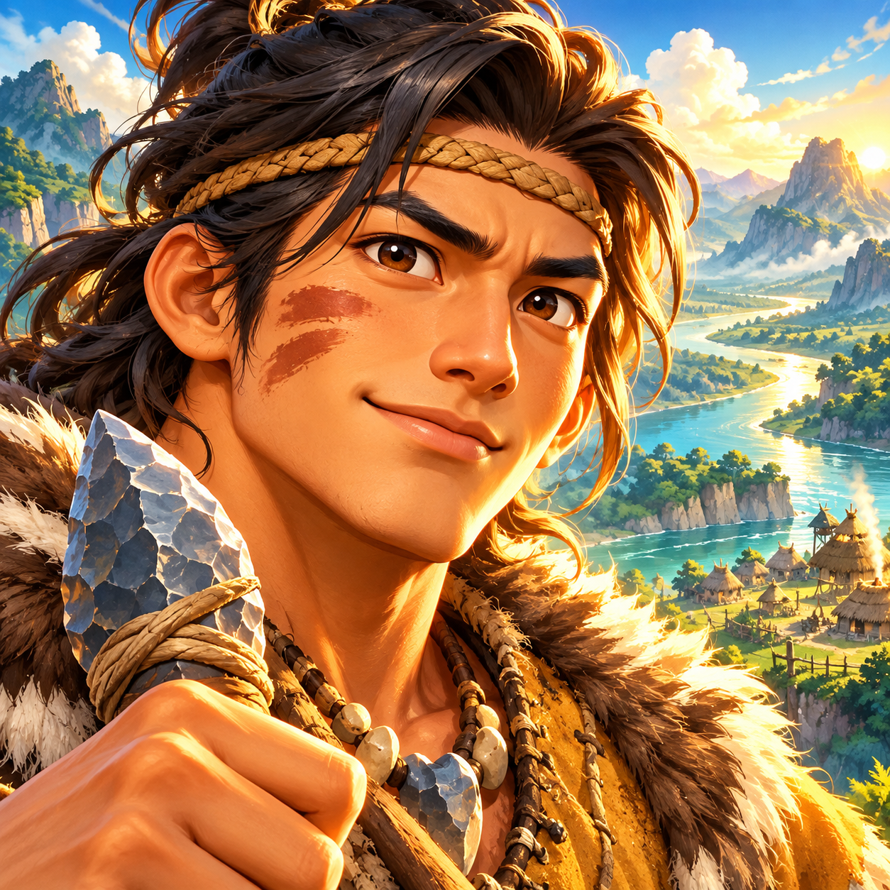

# RoxHistory 앱 아이콘 — 3안 시안 v001

2026-11-02. 수정 요청 **REQ-001**. 현재 상태는 **시안 제작 완료·사용자 선택 대기**입니다.

사용자가 제공한 홈 화면 참고 이미지에서 주변 게임 아이콘의 큰 주제·강한 대비·입체감을 참고했습니다. 현재 RoxHistory의 작은 움집 아이콘을 본격적인 게임 아이콘으로 발전시키는 디자인 검토입니다.

| 1안 · 영웅 얼굴 중심 | 2안 · 문명 건설 중심 | 3안 · 유물 상징 중심 |
| --- | --- | --- |
|  |  |  |
| 개척자 얼굴과 눈빛으로 게임다운 첫인상 강조 | 기존 움집의 정체성을 크게 확장하고 건설·정착 분위기 강조 | 돌도끼와 토기로 선사시대·역사 모험의 상징 강조 |

## 공통 제작 기준

- 기존의 선명한 원색 만화풍·입체 명암·따뜻한 금빛과 푸른색 대비를 유지합니다.
- 작은 화면에서 중심 소재가 읽히도록 주제를 크게 배치합니다. 정사각형 끝까지 배경을 채우고 글자 없이 주제로 식별하게 구성했습니다.
- 세 원본은 각각 **1254×1254 PNG**입니다. 채택 후 실제 런처 마스크·안전 영역·최종 내보내기 규격을 정리합니다.
- **기본 내장 image_gen 도구**로 생성했습니다. [전체 제작 프롬프트](prompts.txt), [파일·해시·제작 상태](manifest.json)를 함께 보관합니다.

이번 변경은 디자인 시안과 수정사항 기록입니다. APK 아이콘을 교체하거나 게임 코드를 변경한 것이 아닙니다. 사용자가 안을 선택하면 수정사항 대장을 갱신하고, 요청 시 개발 담당 지시문에 반영합니다.
