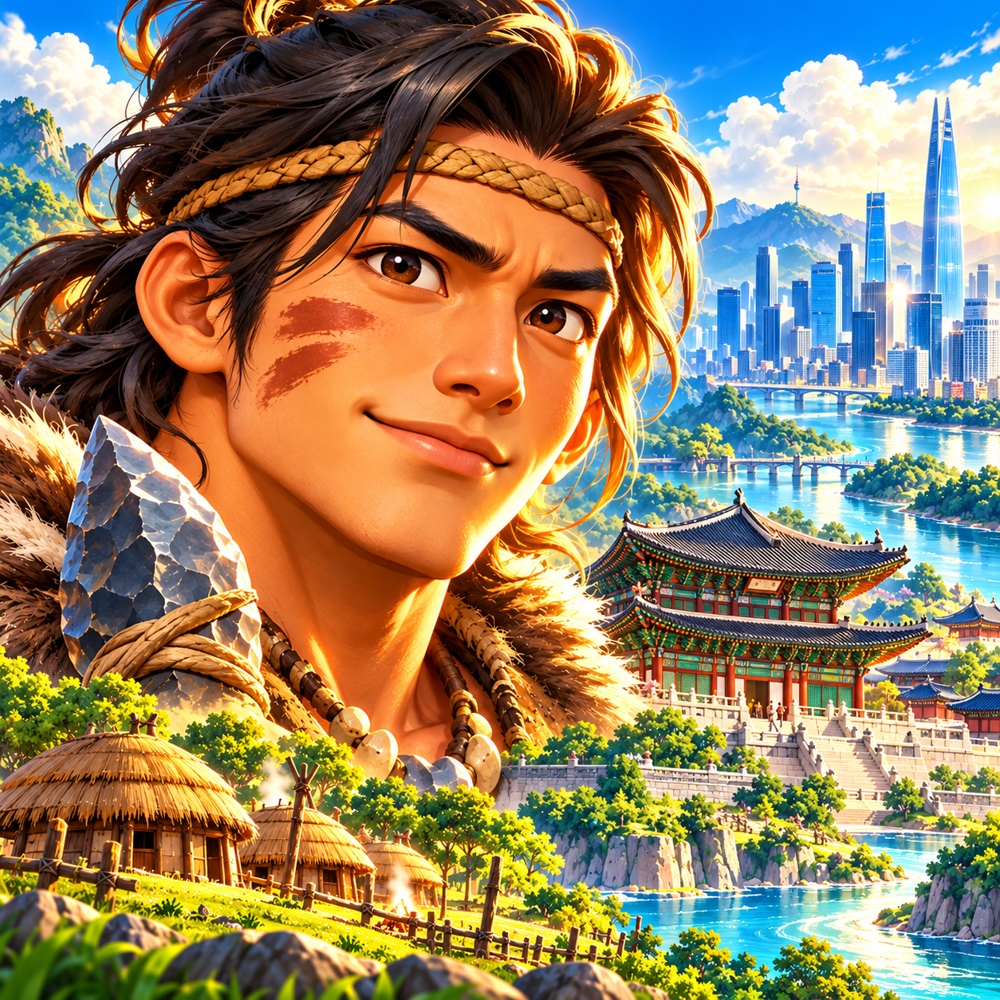
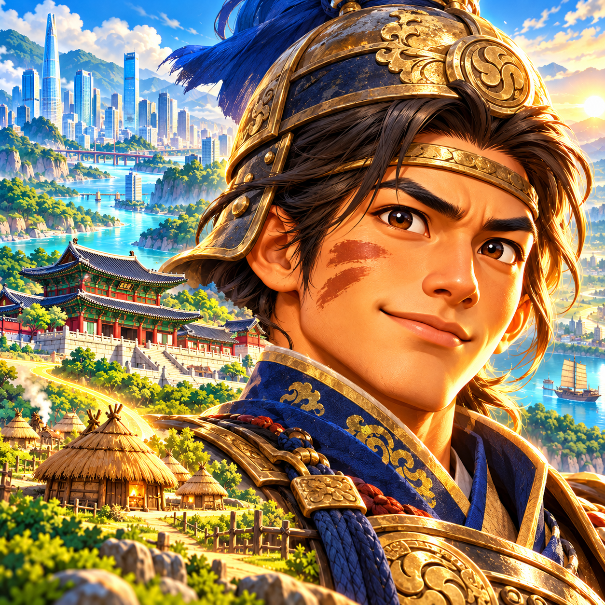
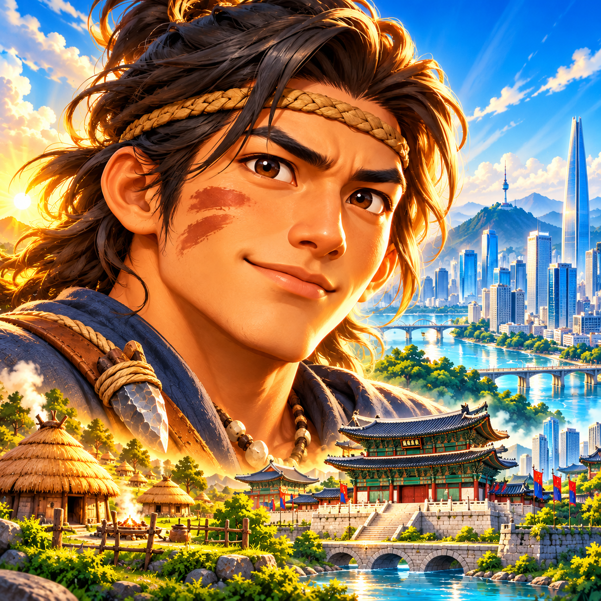

# RoxHistory 앱 아이콘 v002 — 영웅과 한국 문명의 발전

2026-11-02 / REQ-001 후속 디자인. **기존 1안의 영웅 얼굴을 선호**한다는 사용자 확인을 기준으로 제작했습니다.

## 방향

선사시대에 시작해 조선시대를 거쳐 현대사까지 아우르는 한국사 게임이라는 정체성을 강조합니다. 큰 영웅 얼굴을 유지하고, 움집·궁궐·현대 고층 도시를 시대 발전의 시각적 상징으로 함께 배치했습니다. 기존 만화풍 입체감과 선명한 색채를 이어갑니다.

| 새 1안 · 시대의 개척자 | 새 2안 · 역사의 수호자 | 새 3안 · 문명을 잇는 영웅 |
| --- | --- | --- |
|  |  |  |
| 기존 영웅 인상을 가장 가깝게 유지하며 터전·궁궐·현대 도시를 연결 | 같은 얼굴을 장수풍 의상으로 재해석하고 시대별 건축과 조합 | 영웅과 하단의 터전·궁궐, 우측의 현대 도시로 시대 흐름을 강조 |

현재 상태: **새 3안 사용자 선택 대기**. 이 시안은 앱 아이콘의 게임 콘셉트를 표현하며 새 시대 콘텐츠나 문명 시스템의 구현 완료를 뜻하지 않습니다.

## 원본과 백업

- 기존 [v001의 1·2·3안](../v001/README.md)은 모두 Git 백업으로 보존했습니다. 기존 PNG 원본과 해시는 변경하지 않았습니다.
- 새 이미지 3종도 기본 내장 **image_gen**으로 제작하고 원본 PNG를 보관합니다.
- [프롬프트](prompts.txt)와 [제작 상태·크기·해시](manifest.json)를 함께 저장합니다.
- 선택 후 최종 마스크·내보내기 규격 및 개발 담당 지시 기준을 정리합니다.
