# RoxHistory UI 참고 이미지 · 2026-11-03

개발 담당자가 대화에서 검토한 이미지를 바로 열고 내려받을 수 있도록 모은 자료입니다. 원본 18개의 바이트는 변경하지 않았고, 찾기 쉬운 파일 이름만 부여했습니다.

## 먼저 볼 파일

- [18 · 선택한 씨앗 주머니 말풍선 시안](18-selected-seed-pouch-offset-bubble.png): 현재 움집 표시인 03과 비교합니다.
- [01 · 플레이 전체 화면 A](01-roxhistory-gameplay-overview-a.png), [02 · 플레이 전체 화면 B](02-roxhistory-gameplay-overview-b.png): 플레이 화면과 HUD를 확인합니다.
- [11 · 터전 선택 지도](11-roxhistory-world-map-overview.png), [12 · 타이틀 화면](12-roxhistory-title-screen.png): 지도와 메인 화면의 전체 맥락을 확인합니다.

## 내려받기

GitHub에서 아래 이미지 링크를 연 뒤 **Download raw file**을 선택하면 원본 PNG를 받을 수 있습니다. 이미 저장소를 사용하는 개발자는 `share/reference-assets` 브랜치를 fetch한 뒤 이 폴더만 작업 브랜치로 가져오면 됩니다. 이 자료 브랜치는 `main`을 변경하지 않으며, `main`으로 병합하지 않습니다. 임시 공유 파일은 이 전용 브랜치의 `design/reference-images/` 아래에 계속 모읍니다. 삭제 시점은 추후 별도 지시에 따릅니다.

```sh
git fetch origin share/reference-assets
git restore --source origin/share/reference-assets -- design/reference-images/2026-11-03-ui-review
```

## 자료 구분과 사용 범위

- **RoxHistory 화면 12개**: 대화에서 제공된 프로젝트 스크린샷과 확대 이미지입니다.
- **외부 게임 참고 5개**: 04, 06, 07, 09, 10. 레이아웃과 표현 방식을 비교하는 참고 자료입니다. 외부 게임의 이미지·아이콘을 실제 게임에 복사하거나 배포할 권한을 뜻하지 않습니다. 원저작자와 라이선스는 이 묶음에서 확인되지 않았습니다.
- **선택 시안 1개**: 18. 시각적 방향 확인용이며 투명 배경의 분리된 제작 에셋은 아닙니다.

이 폴더는 공개 저장소의 임시 참고 자료입니다. 폴더나 브랜치를 나중에 지워도 Git 이력, 이미 내려받은 사본, 캐시까지 지워지는 것은 아닙니다. 별도의 이용 허락이나 자산 라이선스를 부여하지 않습니다. 아래 설명은 파일을 찾기 위한 시각적 설명이며, 새로운 구현 요구사항이나 승인 내용을 추가하지 않습니다.

## 파일별 안내

| 번호 | 이미지 | 크기 | 용도 |
| --- | --- | --- | --- |
| 01 | [RoxHistory 플레이 전체 화면 A](01-roxhistory-gameplay-overview-a.png) | 1294 × 752 | 전체 화면 구성, 배경 여백과 HUD 배치를 비교하는 원본 스크린샷. |
| 02 | [RoxHistory 플레이 전체 화면 B](02-roxhistory-gameplay-overview-b.png) | 1316 × 774 | 01과 함께 플레이 영역과 HUD 위치를 비교하는 원본 스크린샷. |
| 03 | [움집 위 현재 표시](03-roxhistory-hut-marker-current.png) | 310 × 227 | 움집 위 원형 자원 표시의 현재 상태. 18번 선택 시안과 비교. |
| 04 | [외부 게임 건물 수확 말풍선](04-external-building-collection-bubble.png) | 157 × 169 | 건물 위 코인 말풍선의 위치와 형태 참고. |
| 05 | [RoxHistory 자원 HUD](05-roxhistory-resource-hud-current.png) | 377 × 94 | 나무·돌·식량 자원 아이콘과 숫자 배치의 현재 상태. |
| 06 | [외부 게임 자원 HUD](06-external-resource-hud-reference.png) | 407 × 57 | 분리된 자원 슬롯, 아이콘, 숫자, 추가 버튼의 배치 참고. |
| 07 | [외부 게임 하단 행동 버튼](07-external-action-buttons-reference.png) | 202 × 101 | 아이콘과 하단 라벨을 결합한 버튼 형태 참고. |
| 08 | [RoxHistory 펼친 행동 메뉴](08-roxhistory-expanded-action-menu.png) | 700 × 128 | 사냥·채집·제작·건설·임무·가방 및 접기 버튼의 현재 상태. |
| 09 | [외부 게임 세로 도구 모음](09-external-side-toolbar-reference.png) | 98 × 320 | 우측 세로 아이콘과 알림 배지, 접기 버튼의 배치 참고. |
| 10 | [외부 게임 전체 화면 참고](10-external-gameplay-layout-reference.png) | 758 × 428 | 자원 HUD, 측면 도구 모음, 하단 행동 버튼의 전체 관계 참고. |
| 11 | [RoxHistory 터전 선택 지도](11-roxhistory-world-map-overview.png) | 1236 × 692 | 첫 터전 선택 화면의 지도, 지역 표식, 좌상단 안내와 하단 조작 안내. |
| 12 | [RoxHistory 타이틀 화면](12-roxhistory-title-screen.png) | 1264 × 706 | 타이틀, 여행 메뉴, 우상단 아이콘과 배경의 전체 구성. |
| 13 | [타이틀 뿔피리 영역 A](13-roxhistory-title-horn-area-a.png) | 364 × 125 | 우상단 뿔피리와 주변 어두운 패널 상태의 확대 참고. |
| 14 | [타이틀 뿔피리 영역 B](14-roxhistory-title-horn-area-b.png) | 142 × 96 | 원형 테두리 안에 표시된 뿔피리 상태의 확대 참고. |
| 15 | [지도 제목·뒤로 버튼 영역](15-roxhistory-map-heading-detail.png) | 399 × 140 | 뒤로 버튼, 제목 및 부제 영역의 텍스트 배치와 겹침을 확인하는 확대 참고. |
| 16 | [지도 확대·축소 도움말 영역](16-roxhistory-map-zoom-help-detail.png) | 452 × 85 | 좌하단 조작 아이콘과 도움말 영역의 텍스트 배치와 겹침을 확인하는 확대 참고. |
| 17 | [터전 선택 카드](17-roxhistory-site-selection-card.png) | 435 × 458 | 동삼동·신석기 시대 카드의 대표 이미지, 제목, 자원 아이콘과 시작 버튼 구성. |
| 18 | [선택 시안: 씨앗 주머니 오프셋 말풍선](18-selected-seed-pouch-offset-bubble.png) | 1466 × 1073 | 선택된 3번 시안. 움집 지붕 오른쪽 위에 말풍선과 씨앗 주머니 아이콘을 배치한 시각 참고. |

## 미리보기

### 01 · RoxHistory 플레이 전체 화면 A

전체 화면 구성, 배경 여백과 HUD 배치를 비교하는 원본 스크린샷.

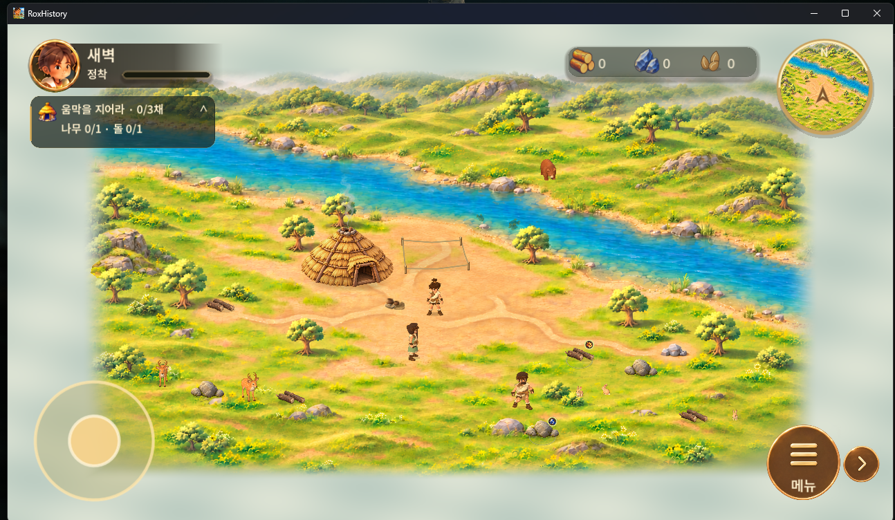

### 02 · RoxHistory 플레이 전체 화면 B

01과 함께 플레이 영역과 HUD 위치를 비교하는 원본 스크린샷.

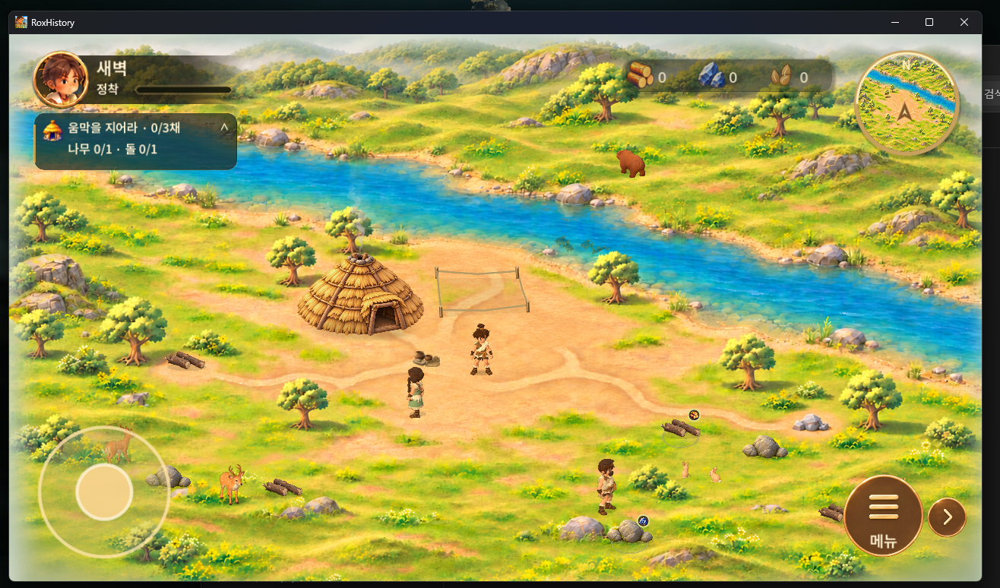

### 03 · 움집 위 현재 표시

움집 위 원형 자원 표시의 현재 상태. 18번 선택 시안과 비교.

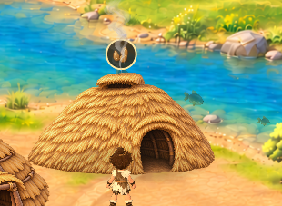

### 04 · 외부 게임 건물 수확 말풍선

건물 위 코인 말풍선의 위치와 형태 참고.

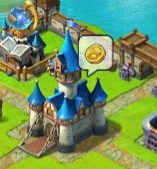

### 05 · RoxHistory 자원 HUD

나무·돌·식량 자원 아이콘과 숫자 배치의 현재 상태.

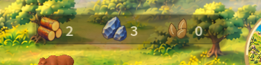

### 06 · 외부 게임 자원 HUD

분리된 자원 슬롯, 아이콘, 숫자, 추가 버튼의 배치 참고.

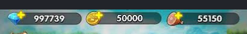

### 07 · 외부 게임 하단 행동 버튼

아이콘과 하단 라벨을 결합한 버튼 형태 참고.


### 08 · RoxHistory 펼친 행동 메뉴

사냥·채집·제작·건설·임무·가방 및 접기 버튼의 현재 상태.

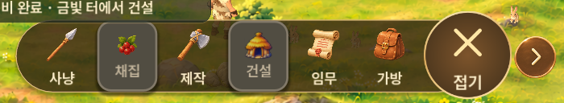

### 09 · 외부 게임 세로 도구 모음

우측 세로 아이콘과 알림 배지, 접기 버튼의 배치 참고.


### 10 · 외부 게임 전체 화면 참고

자원 HUD, 측면 도구 모음, 하단 행동 버튼의 전체 관계 참고.

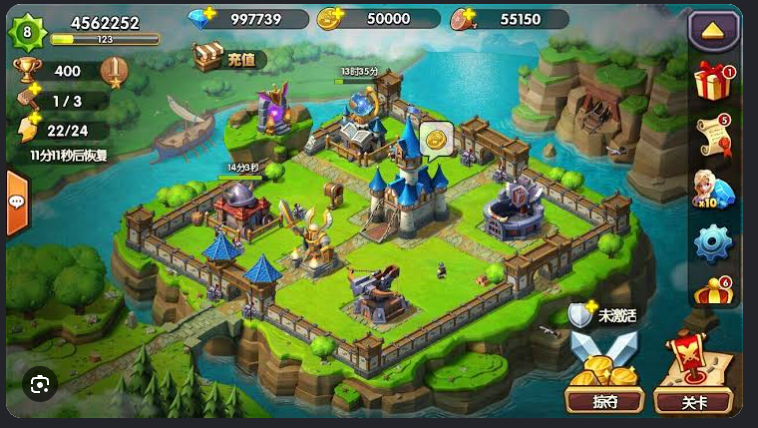

### 11 · RoxHistory 터전 선택 지도

첫 터전 선택 화면의 지도, 지역 표식, 좌상단 안내와 하단 조작 안내.

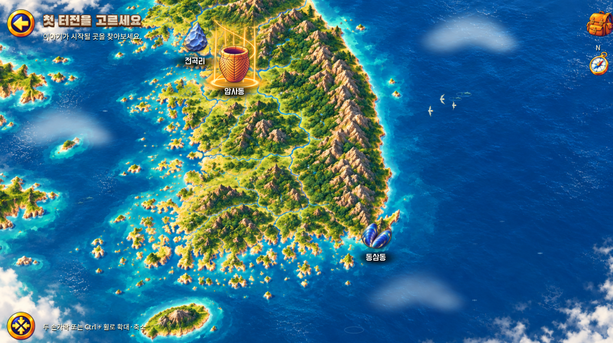

### 12 · RoxHistory 타이틀 화면

타이틀, 여행 메뉴, 우상단 아이콘과 배경의 전체 구성.

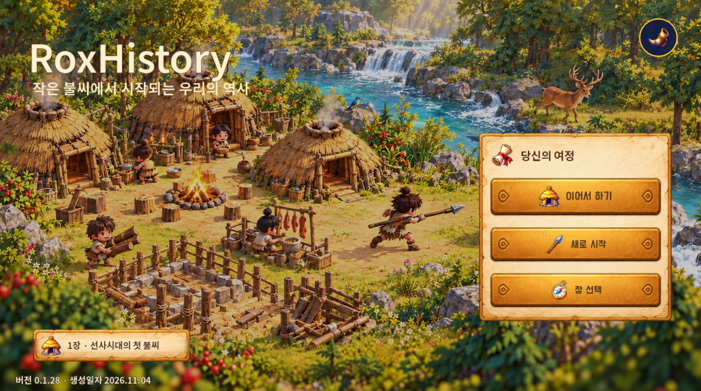

### 13 · 타이틀 뿔피리 영역 A

우상단 뿔피리와 주변 어두운 패널 상태의 확대 참고.

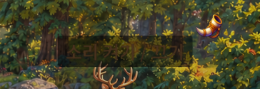

### 14 · 타이틀 뿔피리 영역 B

원형 테두리 안에 표시된 뿔피리 상태의 확대 참고.


### 15 · 지도 제목·뒤로 버튼 영역

뒤로 버튼, 제목 및 부제 영역의 텍스트 배치와 겹침을 확인하는 확대 참고.


### 16 · 지도 확대·축소 도움말 영역

좌하단 조작 아이콘과 도움말 영역의 텍스트 배치와 겹침을 확인하는 확대 참고.


### 17 · 터전 선택 카드

동삼동·신석기 시대 카드의 대표 이미지, 제목, 자원 아이콘과 시작 버튼 구성.

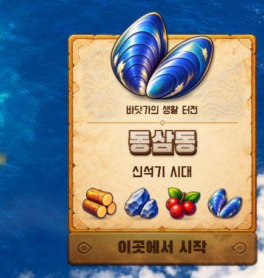

### 18 · 선택 시안: 씨앗 주머니 오프셋 말풍선

선택된 3번 시안. 움집 지붕 오른쪽 위에 말풍선과 씨앗 주머니 아이콘을 배치한 시각 참고.

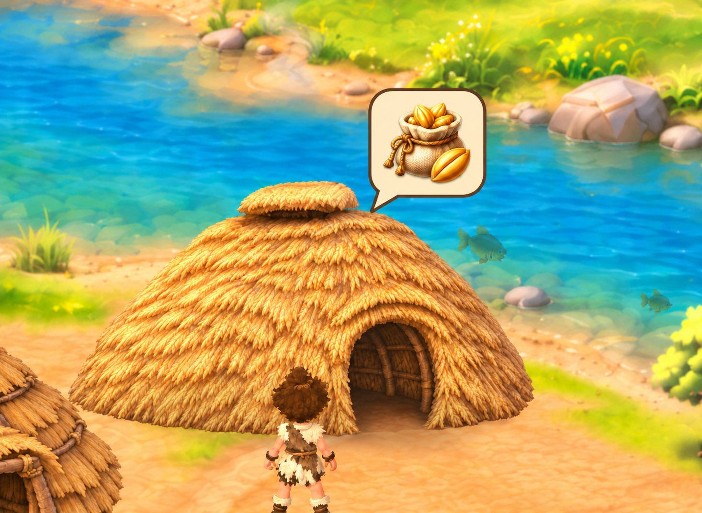

## 원본 대조

[manifest.json](manifest.json)에 원본 파일명, 픽셀 크기, 바이트 크기, SHA-256, Git blob SHA를 기록했습니다. 공유용 폴더에는 대화 식별자나 비공개 다운로드 주소를 넣지 않았습니다.
