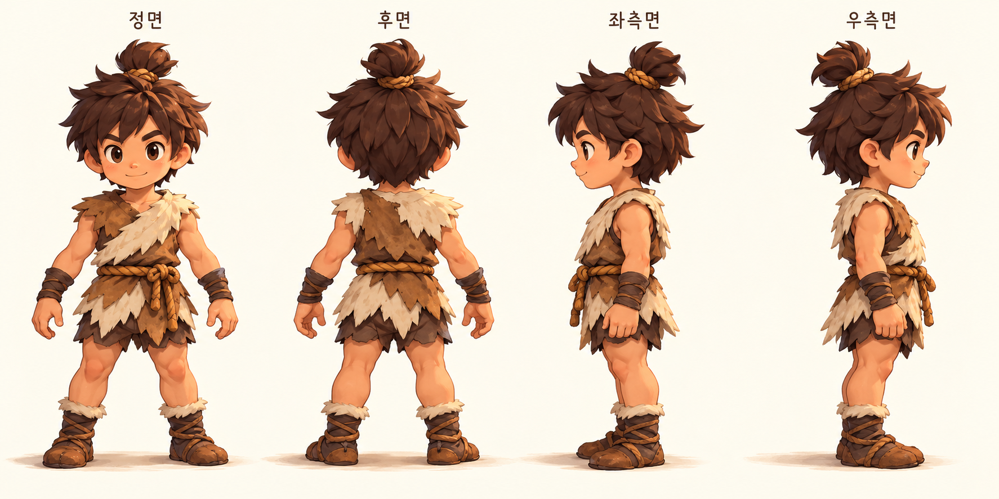

# C001 지정 원화 기반 주인공·UI 교정

- 착수: 2026-10-31 KST
- 상태: 원화 대조·제작 진행. 외형 승인, 게임 적용, 검증, 배포 미완료.
- 기준 main: `b545fc36255df98eb164740d0109e05c70b3c1be`
- 브랜치: `feat/c001-character-ui-v019`
- [최신 사용자 지시](brief.md)
- [원화 Figma](https://www.figma.com/design/zkbflw9fCdAlWbphhw5pSS/RoxHistory-V1.0?node-id=196-11)

## 최우선 원화

Figma 196:11의 실제 이미지 노드 198:868에서 제공한 원본 에셋을 변경 없이 보관했다. 사용자가 게임 제작 기준으로 지정한 자료다. 별도의 공개 라이선스가 확인된 외부 에셋으로 주장하지 않는다.

이전 밝은 가죽옷·맨발 탐색 모델과 달리 갈색 가죽과 크림색 털의 비대칭 레이어, 손목 보호대, 발목 털과 끈 달린 신발이 필요하다. 머리만 확대하지 않고 원화의 활동적인 전신 비율을 따른다. 머리카락은 동일 형태의 반복 배치 대신 비대칭 흐름과 끝의 방향을 조형한다.

## 이전 검토 결과 보존

- [1차 모델](evidence/character-model-study-01.png): 사용자가 머리 뭉침·마른 몸·원본 차이를 지적했다.
- [2차 모델](evidence/character-model-study-02.png): 볼륨·가닥 조정 후 제시. 승인되지 않았으며 새 지정 원화와 의상·비율이 다르다.
- 두 이미지는 실제 Godot 3D 렌더이며 게임에 적용하지 않았다.

## 유지 및 변경 범위

나무·움집·배경, 기존 진행·저장과 나무1/돌1·채집1.2초·건설2초는 유지한다. 원화 외형을 먼저 확인한 뒤 동작과 통합, 세 진입 화면 및 플레이 HUD, 아이콘과 강물 전용 음량을 순서대로 수정한다. 레벨·에너지와 미연결 행동은 새 게임 규칙을 임의로 만들지 않고 표시 연결 여부를 기록한다.

## 전달·검증 상태

게임용 GLB, 편집 원본, 텍스처, 리그·애니메이션, 원화 대조 캡처와 배경 내 캡처, 원속도 동작 영상은 제작 대상이며 아직 완료되지 않았다. 이번 변경에 대한 Android 실행·서명 호환·APK 전달·병합도 아직 수행하지 않았다. 기존 버전의 검사 결과를 이번 결과로 대체하지 않는다.

## 지정 원화 시험 조형 — 품질 미달

[시험 모델 렌더](evidence/c001-study-03.png) / [편집 원본과 한계](../../../assets/characters/c001/README.md)

갈색 의상, 비대칭 밝은 장식, 손목 보호대와 신발을 시험 반영했다. 원화와 대조했을 때 머리의 불규칙한 실루엣·풍성함, 관절 형태, 털·가죽의 겹침이 부족하여 완료 판정을 내리지 않았다. 실제 게임 코드에는 적용하지 않았으며 UI·음량 변경이나 병합·APK 배포도 하지 않았다. 절차식 모델의 소폭 수치 조정만으로 원화 품질을 확보했다는 주장을 하지 않는다. 다음 작업은 머리와 의상의 형태 재제작, 연속적인 신체 조형, 채색 텍스처와 애니메이션을 갖춘 모델로의 개선이다.
