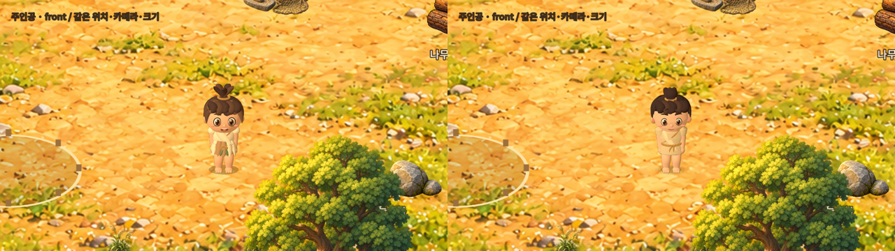

# 주인공 품질 개선 · 1A 외형 / 1B 동작

조사·작업일: 2026-10-31 KST. 담당: 개발 담당. 체감 검토: 팀장·사용자.

이번 전달은 **주인공 개선 구현과 개발 검증**이다. 주인공의 최종 아트 승인, 주민·동물 제작, 전체 데모 완성 판정은 포함하지 않는다. 기존 2D 배경 + 실제 3D 캐릭터 방식을 유지했다.

## 기준과 결과

- 변경 전: `011e0ae4a155e858957d625fc51e150b1d6ab211`.
- 전달 APK의 게임 소스: `dbf83e9831ab478b3b39d2296210f8dfe9267461`.
- 게임 디렉터리 트리: `cfb0025950007f990c71d89e8a16f85f4d5a5724`. 이후 보고서·증거 커밋은 게임 소스를 바꾸지 않는다.
- [PR #15](https://github.com/byungho-cho/roxhistory/pull/15). 최종 병합 SHA와 원격 검사 결과는 PR과 Release에 기록한다.
- [디자인 기준](https://www.figma.com/design/zkbflw9fCdAlWbphhw5pSS?node-id=83-39): 둥근 얼굴, 묶은 머리, 비대칭 가죽 의상, 따뜻한 흙·피부색을 참고했다. Lordrush 모델·애니메이션을 복사하지 않았다.

## 1A — 외형·재질·접지

| 변경 | 의도와 실제 확인 |
| --- | --- |
| 볼·턱의 연속 메시, 작은 곡선 미소, 눈 비율 축소 | 입과 눈의 돌출감을 줄이고 둥근 인상을 유지. 같은 확대 화면의 정면·측면·후면에서 확인 |
| 뒤로 묶은 머리, 옆머리 겹침 정리 | 꽃처럼 벌어진 실루엣과 옆머리의 얼룩진 겹침 완화 |
| 한 벌의 가죽 튜닉, 소매·목 겹침, 허리끈·매듭 | 몸과 의상이 작은 조각으로 흩어져 보이는 문제 완화. 기존 비대칭 장식 유지 |
| 연속 가중치 팔·다리의 기준점 교정 | 팔꿈치·무릎 주변 연결 유지. 확대 이미지와 이동 영상에서 확인 |
| 낮은 광택, 겹친 접지 그림자 | 피부·의상의 번들거림과 딱딱한 검은 그림자 완화. 실제 플레이 크기에서도 확인 |

| 시점 | 변경 전 | 변경 후 |
| --- | --- | --- |
| 정면 | [정면](evidence/screenshots/before-front.png) | [정면](evidence/screenshots/after-front.png) |
| 측면 | [측면](evidence/screenshots/before-side.png) | [측면](evidence/screenshots/after-side.png) |
| 후면 | [후면](evidence/screenshots/before-back.png) | [후면](evidence/screenshots/after-back.png) |
| 실제 플레이 크기 | [전체 화면](evidence/screenshots/before-world.png) | [전체 화면](evidence/screenshots/after-world.png) |

## 1B — 이동·작업·효과 연결

- 대기 호흡, 고개의 작은 움직임, 몸통의 반대 회전을 연결했다. 입력 속도와 이동 속도는 유지한다.
- 이동 거리 기반 발걸음을 유지하고, 발을 되가져오는 구간과 지지 구간을 나눴다. 3D 보폭은 64 월드 단위다. 카메라에 비스듬히 보인다고 발걸음만 빨라지지 않게 했다.
- 준비 → 내려치기 → 회복 곡선을 사용한다. 나무보다 돌의 내려치기 자세가 낮다. 몸통·어깨·팔·손에 붙은 도구가 함께 움직인다.
- 동작과 효과가 하나의 작업 시계를 사용한다. 접촉 시각은 약 0.278초, 반복은 약 0.556초다. 이는 코드의 설계값이며 터치 반응 시간 측정값이 아니다.
- 파편은 대상 중앙 대신 **렌더링된 도구 머리의 투영 위치**에서 나온다. 대상 반응과 재질별 타격음도 같은 이벤트에서 발생한다.
- 확대 검토에서 건설이 허공을 치는 것처럼 보여, 지면에 놓인 작은 작업 목재를 추가했다. 도구가 윗면에 닿고 취소·완료 시 정리된다. 건설 터·영구 건물·재료 차감 로직은 그대로다.
- 중단 시 마지막 자세에서 풀어지고 도구를 정리한다. 이동·팝업·앱 중단의 기존 취소 규칙을 유지한다.
- 나무 1 + 돌 1, 각 1회 채집, 채집 1.2초·건설 2초, 보상 1회, 저장·이어하기는 유지했다.

[나무 접점](evidence/screenshots/wood-contact.png) · [돌 접점](evidence/screenshots/stone-contact.png) · [건설 접점](evidence/screenshots/build-contact.png)

## 비교 영상과 관찰 방법

| 영상 | 길이·속도·소리 | 확인할 장면 |
| --- | --- | --- |
| [동일 조건 전후 비교](evidence/clips/hero-before-after.mp4) | 약 15.4초, 원속도, 무음. 왼쪽 전 / 오른쪽 후 | 0–3초 정면·측면·후면, 3–4초 실제 크기, 4–11.2초 8방향 이동·정지, 11.2–12.4초 급회전, 이후 동작 관찰 |
| [개선 후 단독 화면](evidence/clips/hero-motion.mp4) | 약 15.4초, 원속도 | 비교 영상과 같은 시퀀스. 확대 화면에서 머리·관절·발 확인 |
| [실제 작업 타이머와 효과음](evidence/clips/work-actions.mp4) | 약 7.0초, 원속도, 엔진 소리 포함 | 0–2초 나무, 2.1–4.1초 돌, 4.2–7초 건설. 획득·완공은 실제 앱 처리 |
| [작업 느린 재생](evidence/clips/work-actions-half-speed.mp4) | 약 14.1초, 0.5배속, 소리도 0.5배속 | 도구·손·목재 접점과 파편을 자세히 확인. 반응성 판단은 원속도 영상 사용 |
| [Android 실제 터치 흐름](evidence/clips/android-play.mp4) | 약 55초, 원속도, Android 재생 소리 포함 | 이동·나무·돌·건설·보상·종료·이어하기·중단 후 이동 |

PC 영상은 재현 가능한 테스트 위치·카메라를 사용한 실제 Godot 렌더링이다. 캐릭터 이동 방향을 테스트 코드가 지정하며 자유 플레이 영상으로 주장하지 않는다. 작업 영상은 위치를 명시적으로 배치하지만 실제 작업 타이머와 처리 결과를 사용한다. Android 영상은 화면 터치 입력이며 순간이동·재고 편집을 사용하지 않는다.

녹음은 성공했다. 소리 발생·중단과 신호 크기는 측정했지만 **실제 스피커·이어폰에서의 주관적 청감 승인은 수행하지 않았다**.

## 자동 검사와 실행 검증

### 로컬 Godot

Windows / Godot 4.5.1 / RTX 5060 / 1280×720. 실행 로그의 시각은 UTC이며 아래 날짜는 KST 기준이다. 2026-10-31 약 08:28–08:35 검증.

| 검사 | 결과 | 근거 |
| --- | --- | --- |
| 필수 에셋 | 25개 크기·SHA-256 통과 | [로그](evidence/validation/asset-validation.log) |
| 기존 음원 | 12개 무결성·형식·루프 검사 통과 | [로그](evidence/validation/audio-assets.log) |
| 상태 / 환경 | 345 / 17 통과 | [상태](evidence/validation/state_tests.log), [환경](evidence/validation/environment_tests.log) |
| UI·합성 입력 / 환경·가림 | 76 / 13 통과 | [UI](evidence/validation/ui_smoke.log), [환경](evidence/validation/environment_review.log) |
| 캐릭터 / 3D 혼합 / 가림 | 66 / 30 / 13 통과 | [캐릭터](evidence/validation/character_tests.log), [3D](evidence/validation/hybrid_tests.log), [가림](evidence/validation/hybrid_occlusion.log) |
| 기존 보완 / 상호작용 / 표현 | 62 / 27 / 45 통과 | [보완](evidence/validation/polish_tests.log), [상호작용](evidence/validation/interaction_tests.log), [표현](evidence/validation/presentation_tests.log) |
| 새 주인공 접점·복귀·작업 목재 | 48 통과 | [주인공](evidence/validation/hero_tests.log) |

총 **742개**다. 기존 694개는 유지했고 새 48개를 추가했다. 검사 수는 제품 완성도 백분율이나 아트 승인 근거가 아니다. 기존 검사에는 벽에서 걷기 중지, 방향 전환, 앞뒤 가림, 중복 건설·보상 방지와 저장 복구가 포함된다.

### 원격 CI

[첫 실행 #20](https://github.com/byungho-cho/roxhistory/actions/runs/41144347680)은 검사 조건은 통과했지만 새 테스트 종료 중 `PagedAllocator` 정리 오류로 실패했다. Windows에서도 종료 접근 오류를 확인했다. 테스트 도중 별도의 3D 뷰포트를 생성·제거하던 구조를 실제 앱의 캐릭터 하나를 사용하는 구조로 바꾸고 종료 수명을 정리했다. 검사 삭제·조건 완화·오류 로그 무시는 하지 않았다.

보완 커밋 `6b371bf9b1ab8b1a1814929c9dc2cf9f9607c6d5`의 [원격 실행 #21](https://github.com/byungho-cho/roxhistory/actions/runs/41145000624)은 2026-10-31 KST에 전체 검사·Android 내보내기·서명 검증까지 성공했다. 이후 앱 버전 표시는 프로젝트 설정을 읽도록 고쳤고 로컬 UI·표현 검사를 다시 통과했다. 최종 보고서 커밋의 CI도 병합 전 [PR Checks](https://github.com/byungho-cho/roxhistory/pull/15/checks)에서 확인한다.

CI APK는 실행마다 생성하는 임시 키를 쓰므로 업데이트 배포용이 아니다. 사용자에게 전달하는 Release APK는 기존 로컬 서명 키를 유지한다.

### Android

Android 15/API 35, x86_64 AVD, 호스트 RTX 5060, 1280×720(내부 960×540). 최종 APK SHA-256 `ef254148…0327d9fb` 설치 후 2026-10-31 08:39–08:43 KST에 확인했다.

| 구분 | 실제 결과·근거 |
| --- | --- |
| 전체 흐름 | 나무·돌 각 1회 → 건설 → 보상 10 → 종료·이어하기 통과. 익숙한 자동 터치 경로 **25.11초**, 초심자 플레이 시간 아님. [결과](evidence/validation/android-hero-loop.json), [완료](evidence/screenshots/final-completed.png), [이어하기](evidence/screenshots/final-continued.png) |
| 취소·복귀 | 이동·퀘스트 팝업·Android Back·Home 중 채집 취소, 복귀 후 1회 채집 통과. [결과](evidence/validation/android-interruptions.json), [복귀 화면](evidence/screenshots/android-interruptions-recovered.png) |
| 일반 실행 업데이트 | 공개 v0.1.5 → 최종 v0.1.6, 제거 없이 업데이트. 완공·보상·재고 저장 바이트 동일, 실제 이어하기 상태 동일. [결과](evidence/validation/completed-upgrade.json). 앞선 후보 빌드의 나무 1개 재고 호환성도 [별도 기록](evidence/validation/upgrade.json)에 보존 |
| 비율 | 896×370 커버 비율, 816×616 펼침 비율에서 HUD·버튼·캐릭터가 잘리지 않음을 캡처로 확인. 실제 접힘 기기 아님. [커버](evidence/screenshots/android-cover.png), [펼침](evidence/screenshots/android-unfolded.png), [조건](evidence/validation/android-ratios.json) |
| 일반 실행 소리 | Android playback PCM 녹음. 전경 -45.64dBFS, 복귀 -45.08dBFS. 배경·음소거·음소거 후 재시작은 무음. 뚜렷한 환경음 중복 증폭 없음. [측정](evidence/validation/android-audio.json), [전경 녹음](evidence/clips/ambient-foreground.wav) |
| 실제 실행 성능 | 첫 600프레임 평균 16.75ms / p95 19.16ms. 이어하기 뒤 평균 19.41ms / p95 21.08ms. 에뮬레이터·녹화 중 수치로 실기기 60fps 보장이 아니다. [로그](evidence/validation/android-final-logcat.txt) |

로그에는 캐시된 셰이더를 다시 컴파일했다는 경고가 있었다. 해당 실행에서 스크립트 오류·앱 크래시는 관찰하지 않았다.

원본 AVD와 일반 저장을 보존했다. 추가 새 게임 검증은 앱에 이미 있던 `--test-ui`의 별도 저장(`tests/session`)에서 진행한다. 3D 캐릭터는 메뉴에서 선택한다. 이 모드는 데스크톱 포커스 전용 알림을 무시하지만 Android PAUSED/RESUMED 처리는 유지한다. 일반 실행의 업데이트·이어하기·소리 수명 검증과 구분한다. 자동 승인 검토가 앱 데이터 초기화와 Android 사용자 추가를 차단하여 이 안전한 경로로 대체했다. 일반 앱 데이터 초기화·Android 사용자 추가는 하지 않았고, 이미 생성한 테스트 저장만 게임 내 새 게임 UI로 다시 시작했다.

## 동일 조건 성능 비교

Windows / RTX 5060 / Godot 4.5.1 Compatibility / 1280×720 / VSync off. 두 버전을 차례로 실행했으며 다른 Godot 검사·영상 인코딩은 동시에 돌리지 않았다. 동일 카메라·위치·대기 상태, 각각 10,000프레임. 에뮬레이터는 대기 상태였다.

| 조건 | 평균 프레임 시간 | p95 | 드로콜 | 렌더 객체 |
| --- | ---: | ---: | ---: | ---: |
| 변경 전 | 0.974ms | 1.521ms | 218 | 443 |
| 변경 후 | 0.977ms | 1.595ms | 217 | 442 |

[변경 전 원자료](evidence/validation/performance-before.json) · [변경 후 원자료](evidence/validation/performance-after.json). 평균은 비슷하고 p95는 약 4.9% 높았다. 단일 측정의 차이를 최적화 효과나 확정적인 회귀로 단정하지 않는다. 건설 중 작업 목재의 추가 드로콜, 저가 ARM 기기, 발열·장시간 사용은 별도 검증이 필요하다.

## 자산과 편집 원본

| 구분 | 내용·출처·권한 |
| --- | --- |
| 재사용 | 저장소의 배경·식생·건물·자원·UI·음원, 기존 15본 3D 리그와 연속 가중치 팔다리 |
| 교체·보완 | 얼굴·튜닉·소매·머리·허리끈·재질·그림자, 걷기·작업 곡선. 프로젝트용 직접 작성 코드로 생성 |
| 추가 | 지면에 닿는 건설 작업 목재, 접점·복귀 검사와 비교 촬영 스크립트. 외부 모델·유료 자산 없음 |
| 편집 원본 | [모델·리그·포즈](../../../game/scripts/hybrid_character.gd), [연속 메시 생성](../../../game/scripts/character_geometry.gd), [동작 곡선](../../../game/scripts/hero_motion.gd), [효과 연결](../../../game/scripts/world_feedback.gd) |

새로 그린 프레임 세트나 외부 DCC 리깅 파일을 납품한 것은 아니다. 실제 Skeleton3D와 입체 메시를 코드로 생성하는 기존 구조를 확장했다. 기존 에셋의 출처·권한 기록은 변경하지 않는다.

## 남은 품질 검토와 다음 단계

1. **체감 승인 대기:** 팀장·사용자가 실제 크기와 확대 영상에서 외형·동작을 검토해야 한다. 주민·사슴·멧돼지는 아직 착수하지 않는다.
2. **발 접지 한계:** 지지·회수 동작과 주기를 보완했지만 지면상의 발 위치를 고정하는 월드 공간 풋락은 아니다. 시점 방향과 급회전에서 잔여 미끄러짐을 확인해야 한다.
3. **2D·3D 접점:** 확인한 채집 위치와 건설 작업 목재에서는 접점을 맞췄다. 모든 접근 각도·거리에서 2D 자원 표면을 해석하는 IK는 없으며, 각도별 재검토가 필요하다. 건설 골조와 인물의 세밀한 가림·그림자 일치는 후속 장면 조화 항목이다.
4. **아트 한계:** 절차적 머리카락·천·작업 목재는 실제 크기에서의 가독성을 우선했다. 수작업 조형·텍스처 디테일과 최종 표정 승인까지 끝난 것은 아니다.
5. **기기 한계:** Android 실기기, 실제 접힘 전환, 저가 ARM 성능·발열, 장시간 플레이, 스피커·이어폰 청감은 미검증이다.
6. **후속 로드맵:** [CQ1–CQ6 일정·담당·상태](../../character-quality-roadmap.md), [구조화 현황](../../quality-progress.json), [기존 FigJam](https://www.figma.com/board/60HqJ7ggIuvs9OLva8ZIx2?node-id=23-74). P1–P4는 개발 이력으로 보존한다. [FigJam 갱신 캡처](evidence/screenshots/roadmap.png).

증거 파일의 크기·SHA-256은 [manifest](evidence/manifest.json)에 기록했다. 텍스트 파일은 Git의 줄바꿈 정규화가 적용된 **원격 저장소 blob 바이트** 기준이다.

## Git·작업 보존

원격 main에서 분리한 `feat/hero-quality-pass`에서 작업했다. 사용자의 기존 로컬 저장소에 남아 있던 로드맵·문서 변경은 덮어쓰거나 초기화하지 않았다. 이번 PR에는 위 게임 변경, 검증용 촬영 스크립트, 보고서·증거·로드맵 갱신만 포함한다.

## 전달 APK

- `RoxHistory-0.1.6-hero-debug.apk`, 버전 `0.1.6-hero`, versionCode `7`, 패키지 `com.roxhistory.demo`.
- 크기: **89,352,714바이트**. SHA-256: `ef254148f81fc1d7d6e76ea1e34ef0859a09098682f3af687d87fe210327d9fb`.
- 기존 debug 인증서 SHA-256: `cf65aeecb4e399ba9e2e6b9fa947f34f8c31bd75c8e3b686ad29d8431bb1695f`. v2·v3 검증 통과, 기존 공개 v0.1.5와 동일한 서명.
- [서명 검증](evidence/validation/signature.txt) · [패키지 정보](evidence/validation/package.txt).
- [서명된 APK 단일 파일 직접 다운로드](https://github.com/byungho-cho/roxhistory/releases/download/v0.1.6-hero/RoxHistory-0.1.6-hero-debug.apk). PR 병합 후 Release에 게시한다. 검증 로그·소스 ZIP을 설치 파일과 묶지 않는다.
