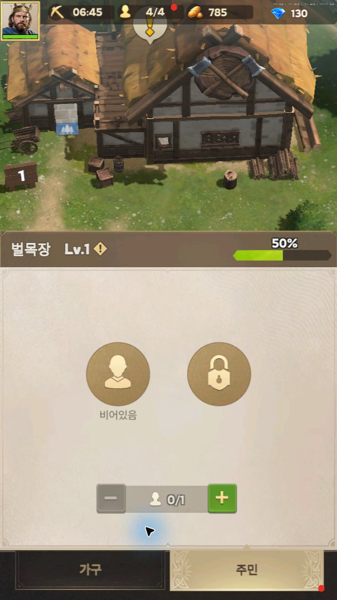
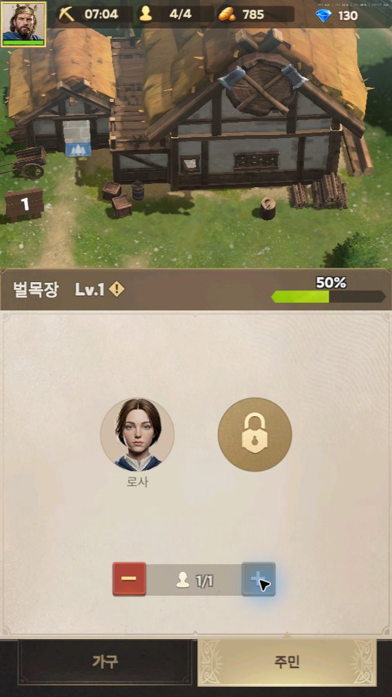
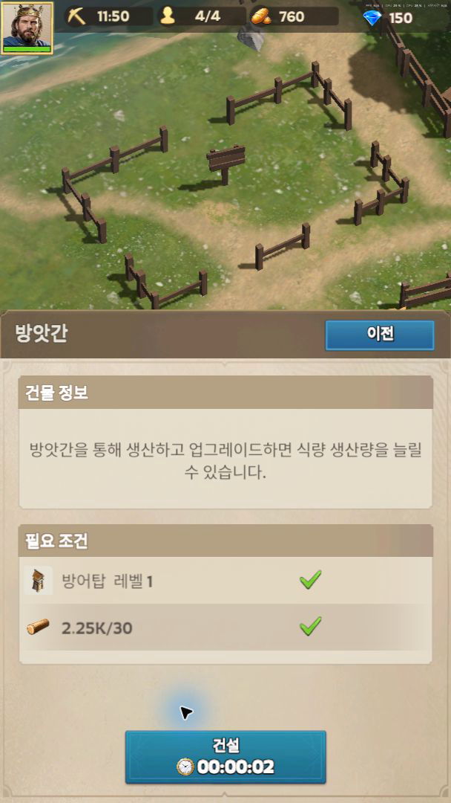

# Lordrush 로컬 직접 조작 조사 — 중간 결과

조사일: **2026-10-31 KST**, 로컬 증거 수집 약 **07:03–07:14**. 상태: **직접 조작 일부 성공 / 조사 중단 시점까지 공유**.

## 목적과 수행 범위

시나리오·성장 시스템을 따라 만들기보다 조작, 캐릭터, 공간, 행동 피드백, UI와 환경 움직임의 조화를 살핀다. RoxHistory의 따뜻한 그림체, 2D 배경＋3D 캐릭터, Android 우선, 나무·돌 각 1개로 건설하는 짧은 흐름을 유지하는 개선 검토 자료다. 게임 코드·설정·APK는 변경하지 않았다.

이전 원격 환경에서는 PC 제어가 불가능했지만, 이번 Windows 세션에서는 캡처→클릭→변경 화면 재확인에 성공했다. 건물 패널, 주민 배치, 작업대 업그레이드, 완료 목표 보상, 방앗간 건설 전 안내를 직접 확인했다. **캐릭터를 직접 이동·작업시키는 전체 흐름, 건설 완료, 소리까지 조사한 것은 아니다.** 사용자가 Esc로 제어를 중단한 뒤, 여기까지 보고서로 정리하도록 요청했다. 중단 이후 게임을 재조작하지 않았다.

[이전 원격 조사 원문](prior-remote-report.md)은 당시 기록으로 보존한다. 그 문서의 ‘직접 플레이 미수행’은 원격 세션에 해당하며 현재 전체 상태를 뜻하지 않는다. 이전 환경 JSON·공식 스토어 이미지도 그대로 보존했다.

## 환경·제어·저장소

| 항목 | 확인 내용 |
| --- | --- |
| 실행 경로 | 사용자 Windows PC에 설치된 Google Play Games의 Lordrush |
| Google Play Games | 파일 버전 26.10.305.0 확인 |
| Lordrush 설치 버전 | 미확인. 스토어 갱신일이나 PC 클라이언트 버전을 게임 버전으로 대신하지 않음 |
| 제어 | Windows 창 캡처, 마우스 클릭·드래그·휠 입력, 입력 뒤 화면 재확인 |
| 화면 | 전체 화면 1920×1080 안의 세로 게임 영역 608×1080을 증거로 추출 |
| 영상 | 데스크톱의 게임 영역만 녹화, 20fps 캡처, H.264 MP4. **모두 무음**. 캡처 fps는 게임 성능 측정값이 아님 |
| 계정·진행 | 나이 확인·필요한 로그인은 사용자가 처리. 기존 진행에서 조사했고 초기화·재설치하지 않음. 주민 1명 배치, 작업대 1회 업그레이드, 완료 목표 보상 수령으로 진행 상태는 변경됨. 유료 구매·프리미엄 재화 소비 없음 |
| 기존 장애 | 이전 ADB 소켓 오류는 인계 기록. 이번에는 설치된 PC 경로를 사용하여 ADB 서버·AVD를 변경하지 않음 |
| 저장소 기준 | main `207c1a54b08a6dcac927c9d09549116a38947d5e`와 대조. 별도 브랜치 `docs/lordrush-local-followup-20261031` 사용 |
| 기존 작업 보존 | 원래 로컬 저장소의 로드맵·문서 수정 및 미추적 파일을 유지. 별도 체크아웃에서 이 보고서 폴더만 수정 |

설치 EXE의 Google LLC 서명 정상도 로컬에서 재확인했다. 공개 증거에는 계정이 포함된 창 제목, 로그인 화면, 다른 앱 화면을 넣지 않았다.

## 직접 관찰 결과

‘직접’은 조사자의 입력 후 상태를 확인한 항목, ‘화면 관찰’은 자동 진행·배경 움직임을 본 항목이다. 인상에 대한 해석은 사실과 구분한다.

| 항목 | 확인한 현상과 증거 | 한계 |
| --- | --- | --- |
| 대상 선택·닫기 — 직접 | 건물 클릭으로 해당 건물을 크게 보여주며 하단 정보 패널을 연다. 상단 월드 영역 클릭으로 패널을 닫고 넓은 화면으로 복귀했다. [건물 패널](evidence/screenshots/02-building-panel.png) | 클릭 지연을 계측하지 않음. 모든 메뉴에 같은 닫기 방식이 적용된다고 일반화하지 않음 |
| 목표와 공간 연결 — 직접 | 미완료 목표를 눌렀을 때 벌목장 위치로 카메라가 이동하고 주민 탭을 열었다. 이후 방앗간 건설 목표도 예정 부지와 조건 패널로 연결됐다. [건설 전 안내](evidence/screenshots/13-build-preview.png) | 자유로운 위치 배치·회전·취소 기능은 확인하지 않음 |
| 주민 배치 — 직접 | 빈 슬롯 0/1에서 초록＋를 누르면 주민 초상화와 1/1 표시가 나타났다. ＋는 회색, −는 빨강으로 바뀐다. [배치 전](evidence/screenshots/05-workers.png) / [배치 후](evidence/screenshots/06-worker-assigned.png) | 주민의 실제 작업 도구 접점과 작업 애니메이션은 미검증 |
| 선택·진행 UI — 직접/화면 관찰 | 가구 탭의 선택 카드에 금빛 테두리, 비용과 증가량, 생산 막대를 함께 표시한다. 잠긴 슬롯·비활성 버튼이 구분된다. [작업대](evidence/screenshots/07-workbench.png) | 패널의 ‘5초’는 생산 주기 표시로 읽어야 하며 건설·업그레이드 대기 시간으로 보고하지 않음 |
| 작업대 업그레이드 — 직접 | 한 번 클릭한 뒤 Lv1→Lv2, 보유 빵 785→760, 생산 수치 21→22로 변했다. 다음 업그레이드 버튼은 회색이 됐다. [결과](evidence/screenshots/10-upgrade-result.png), [25초 영상](evidence/clips/workbench-upgrade.mp4) | 새 건물의 공사 완료와는 별개. 정확한 입력→반응 지연 측정 없음 |
| 보상 — 직접 | 완료 목표를 눌러 수령하자 자원 아이콘이 월드 위로 떠오르고 상단 재화 수치와 다음 목표가 바뀌었다. [획득 표현](evidence/screenshots/12-reward-flight.png) | 이전에 완료된 목표 수령도 포함하므로 그 건물을 조사자가 직접 지었다고 쓰지 않음 |
| 건설 — 직접 안내 확인 | 방앗간 예정 부지를 확대하고 방어탑 조건, 목재 2.25K/30, 충족 체크, 건설 버튼과 00:00:02 표시를 함께 보여준다. [프리뷰](evidence/screenshots/13-build-preview.png) | 건설 시작 클릭 도중 Esc 중단. 입력 적용 여부·차감·실제 소요시간·완공은 **미확인**. 표시된 2초를 실측으로 쓰지 않음 |
| 환경 — 화면 관찰 | 강가의 흰 물결, 굴뚝 연기, 파란 깃발의 변화가 서로 다른 위치에서 이어진다. 건물·울타리·길과 접지 그림자가 장소를 구분한다. [12초 영상](evidence/clips/village-environment.mp4), [주간 장면](evidence/screenshots/11-camera-wheel.png) | 식생의 미세한 움직임과 모든 물체의 그림자 계산 방식은 판정하지 않음 |
| 캐릭터 — 화면 관찰 | 조사 중 자동 이동하는 기마 인물·주민을 보았다. 직접 조작한 캐릭터 이동으로 분류하지 않는다 | 걷기→정지·급회전·대기 호흡·손과 도구·발 미끄러짐·벽 충돌·가림을 합격 판정할 자료 부족 |
| 카메라 입력 — 시도 | 지면 드래그와 휠 입력을 보냈으나 해당 튜토리얼 상태에서 뚜렷한 자유 이동·확대는 확인하지 못했다 | 입력 매핑 문제인지 튜토리얼 제한인지 미확인. 휠 뒤 캡처 파일 이름은 확대 성공을 뜻하지 않음 |
| 소리·성능 | 청취·FPS·반응시간 측정 없음 | 음색·음량·타격음 동기화 품질에 대한 평가 없음 |

### 비교해서 볼 증거

[전체 캡처 설명](evidence/screenshots/README.md), [영상별 관찰 시점](evidence/clips/README.md), [로컬 증거 크기·SHA-256 목록](evidence/local-manifest.json)을 함께 제공한다.

## 2D·3D 구성: 제작 방식은 미확정

- **공식 사실:** [Google Play Games PC 페이지](https://play.google.com/pc-store/games/details?id=com.s01.global)와 [Lordrush 공식 사이트](https://lordrush.centurygames.com/)를 확인했다. 확인한 자료에서 엔진·렌더 파이프라인을 확정하는 기술 설명은 확보하지 못했다. 공개 자료 전체에 없다는 뜻은 아니다.
- **화면에서 본 것:** 건물의 지붕과 측면, 사선 시점, 겹침과 접지 그림자, 대상 건물로 이동·확대되는 카메라, 물·연기·깃발의 연속 변화가 보인다.
- **추정 가능한 방식:** 고정 카메라 3D, 미리 렌더한 2D와 정렬·효과의 조합, 혼합 방식 모두 일부 관찰을 설명할 수 있다. 확대만으로 원본 자산 차원을 확정할 수 없다.
- **미확인:** 자유 회전 시 면 변화, 실내 구조, 실제 동적 그림자, 캐릭터의 건물 뒤 통과, 엔진·원본 자산 형식.

**‘2D 배경＋3D 캐릭터·오브젝트’라는 가설은 여전히 미확정이다.** 이번 조사로 RoxHistory 전체 3D 전환을 제안하지 않는다.

## RoxHistory 적용 제안 — 팀장 검토용

기존 [P4 검토](../../stage4-review.md)와 [품질 현황](../../quality-progress.md)의 구현을 우선 재사용한다. 아래는 이번에 구현한 변경이 아니며, 신규 기능 확장보다 기존 흐름의 체감 품질 검토안이다.

| 우선순위 | 관찰한 표현 → 느끼는 효과(해석) → 우리 게임 적용안 → 필요한 자산·작업 → 검토 방법 |
| --- | --- |
| P1 목표·공간 연결 | 목표 선택이 관련 건물·패널로 연결됨 → 다음 행동을 찾는 부담 감소 → 암사동의 나무·돌·건설 터를 목표 패널과 같은 이름·상태로 표시하고 짧은 강조나 완만한 카메라 안내 검토 → 기존 표식·카메라 재사용, 추가 메뉴 없이 강조 상태 정리 → 처음 보는 사용자가 각 1회 채집 후 건설까지 안내 없이 대상과 다음 행동을 설명할 수 있는지 확인 |
| P1 상태 가독성 | 빈 슬롯→초상화, ＋/− 활성 변화, 비용·결과 동시 표시 → 입력이 수락됐는지와 가능한 행동을 구분 → 기존 채집·건설 버튼의 대기/진행/취소/완료 상태와 재료 1+1 표기를 일치 → 현재 아이콘·버튼 상태와 대비 조정 → 작은 Android 화면과 펼침 화면에서 활성 상태를 색만으로 판단하지 않아도 되는지 검토 |
| P1 결과 연결 | 업그레이드 뒤 수치·버튼이 바뀌고 보상 아이콘이 떠오름 → 행동과 결과의 인과관계가 읽힘 → 기존 타격·획득 +1·완공 카드·보상·저장 성공 표시를 하나의 짧은 흐름으로 점검 → 현재 효과·소리 재사용, 이벤트 시점과 취소 처리 대조 → 준비→접촉→대상 반응→획득을 녹화하고 취소·중복 입력 때 허위 획득·중복 보상이 없는지 확인. Lordrush의 타격·소리 동기화를 검증했다는 뜻은 아님 |
| P2 환경 강약 | 물·연기·깃발이 다른 위치에서 계속 움직임 → 정지 화면에도 생활감이 남음 → 기존 강물·풀·잎의 주기와 세기를 다르게 유지하고 채집 접점을 가리지 않도록 조절 → 기존 셰이더 우선, 필요하면 시대에 맞는 화덕 연기 1종만 별도 검토. 깃발·중세 건물은 차용하지 않음 → 가만히 있을 때와 채집 중 시선 경쟁을 비교하고 Android에서 효과 전후 부하 측정 |
| P2 접지·가림 | 길·울타리·건물의 겹침과 그림자가 공간을 구분 → 인물과 배경이 같은 장소에 있다는 느낌 → 현재 3D 캐릭터의 발·그림자·나무/움집 앞뒤 정렬 집중 검토 → 기존 마스크·그림자 재사용, 필요한 부분만 보정 → 같은 구도에서 앞/뒤 이동·급회전·작업 중 손·도구 가림 비교. Lordrush의 캐릭터 가림 합격 판정은 아님 |

추가 자산이 필요하더라도 외부 게임의 모델·음원·이미지를 RoxHistory 제품에 가져오지 않는다. 참고 캡처의 권리는 원권리자에게 있다. 새 지역·전투·성장·주민 AI 확대는 제안 범위 밖이다.

## 한계·중단 지점·다음 조치

1. 로그인·나이 확인 후 로컬 PC 입력은 성공했다. 이전 ‘PC 제어 연결 없음’은 이번 세션에서 해소됐지만, 창 캡처가 간헐적으로 과거 로고 화면을 반환했다. 창을 다시 선택해 실제 상태를 확인했다. 이를 게임 재시작·크래시로 단정하지 않는다.
2. 창 제목 방식 녹화는 흰 화면만 나와 폐기하고, 고정된 게임 영역의 데스크톱 녹화로 전환했다. 다른 앱·계정 영역이 나온 테스트 녹화, 로고만 있는 캡처, 중단 순간 자료는 공개하지 않는다. 정상 장면 2개 클립만 발췌했다.
3. 사용자의 Esc 중단 이후 추가 조작을 하지 않았다. 방앗간 건설 완료는 확인하지 못했다. 재개 시 현재 상태부터 확인하고 같은 건설·소비를 반복하지 않는다.
4. 다음 조사는 캐릭터 직접 이동·정지·회전, 실제 작업 접점, 건설 완료·취소, 앞뒤 가림, 사용자 청취를 포함한 소리 확인에 집중한다. 지금 자료로 해당 항목을 완료 처리하지 않는다.
5. 공유 전 상대 링크·증거 해시·영상 디코딩·변경 범위를 확인한다. 이번은 문서·증거 변경만 있으므로 게임 테스트·APK 빌드를 새로 수행하지 않는다. 자료 공유 완료는 플레이 조사 전체 완료를 의미하지 않는다.

## 공유 자료 검증 결과

2026-10-31 KST: 보고서 폴더의 상대 링크 54개 존재 확인, 추가 MP4 2개 전체 디코딩 오류 없음, PNG 8장과 영상의 초 단위 미리보기 시각 검토, 증거 파일 10개 크기·SHA-256 기록, Git 공백 오류 검사 통과. 변경 범위는 docs/shared-reports뿐이다. Android 빌드 CI는 게임 경로 변경 대상이며 이번 문서 변경에서는 새 빌드를 요구하지 않는다.

## 추가 공유: 외부 플레이 영상

사용자가 지정한 킷싱 채널의 3분 11초 YouTube 영상을 다운로드하여 [외부 영상 공유 폴더](evidence/external-video/README.md)에 추가했다. 소리가 포함된 전체 구간의 검토용 MP4이며, 직접 플레이 증거와 구분한다. 파일 전체 디코딩을 확인했지만 장면별 분석·소리 평가는 아직 수행하지 않았다. 기존 직접 조사 결과와 미검증 판정은 변경하지 않는다.
