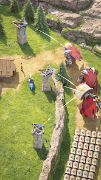
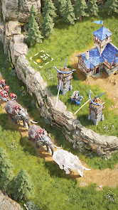

# Lordrush 조사: 직접 플레이 막힘·공식 이미지 관찰

조사일: **2026-10-31 KST**. 상태: **보고서 공유용 작성 완료, 직접 플레이 미수행**.

## 목적과 실제 수행 범위

Lordrush의 시나리오·세계관·성장 시스템을 복제하지 않고, 컨트롤·캐릭터·공간·행동 피드백·UI·환경 움직임이 게임다운 느낌을 만드는 방식을 조사한다. RoxHistory의 따뜻한 그림체, Android 우선, 나무·돌 각 1개로 움집을 짓는 짧은 흐름을 기준으로 한다. 이번 변경은 이 공유 보고서 폴더에 한정하며 게임 코드·설정·APK를 변경하지 않았다.

수행한 일은 제어 연결 확인, 공식 PC 지원 자료 조회, 공식 스토어 정지 이미지 2장 관찰, 최신 RoxHistory 코드·검토 문서와 제안의 중복 확인이다. 게임 실행·계정 로그인·입력·녹화·소리 청취·반응시간 측정은 수행하지 못했다. 외부 영상을 시청한 기록도 없다.

## 환경·시각·직접 제어 여부

| 항목 | 이번 확인 결과 |
| --- | --- |
| 조사 실행 환경 | Linux 6.18.57 x86_64 원격 작업 공간. 사용자의 Windows PC와 다른 환경 |
| 시각 | 2026-10-31 06:50 KST에 환경·코드 근거 기록. 개별 파일의 정확한 기록 시각은 [환경 기록](evidence/environment.json) 및 [증거 목록](evidence/manifest.json) 참고 |
| 앱 창 목록 | 연결된 네이티브 앱 0개. 브라우저만 표시되고 탭도 없음. Windows 게임 화면은 노출되지 않음 |
| 화면 캡처 | Lordrush 창 캡처 불가. 아래 이미지는 직접 플레이 캡처가 아닌 공식 스토어 원본 |
| 마우스·키보드 입력 | Windows 게임 창 대상이 없어 실행하지 못함 |
| 입력 후 화면 재확인 | 입력 자체가 불가능하므로 미검증 |
| Android 대안 | 현재 PATH에서 adb/emulator 미발견, 확인한 일반 SDK·AVD 경로 및 /dev/kvm·USB 경로 미발견. 별도 설치·AVD 변경·ADB 재시도 안 함 |
| 설치된 Lordrush 버전 | 미확인. 스토어의 갱신 날짜를 사용자의 설치 버전으로 대신하지 않음 |
| 사용한 제어 방법 | 게임 제어 없음. 제어 가능 표면의 목록 조회만 수행 |
| 기준 저장소 | main `3538ca2cb03b39601d093ee49206178233dd53f2` / v0.1.5-stage4 문서·코드 |
| 진행 작업 대조 | 원격 개발 브랜치 `demo/android-first-playable`은 `98f1b1c`. 조회 시 열린 PR 목록은 비어 있었음. 기존 작업 폴더의 미추적 생성 파일을 그대로 두고 main 기반 별도 worktree·브랜치 사용 |

사용자 인계에 따르면 Windows에는 Google Play Games와 Lordrush가 설치됐고 ‘플레이 가능’ 화면을 확인했다. 설치 EXE의 Google LLC 서명 정상 기록도 사용자 제공 정보이며 이번 조사에서 파일·서명을 다시 검사하지 못했다. 경로는 `C:\Users\sentr\Downloads\Install-로드러쉬-GooglePlayGames.exe`이다. Windows 저장소의 미커밋 상태 역시 이번 환경에서는 직접 확인하지 못했다.

이전 ADB 오류 `failed to create fdevent interrupt socketpair: Invalid argument`와 포트 5038 재시도 실패는 **인계 기록**이다. 이번 환경에서 동일 오류를 재현한 것으로 쓰지 않는다. 현재 실패 지점은 게임 실행 후가 아니라 **게임 창·입력 제어 연결 확보 전**이다. 같은 실행을 반복하거나 계정·진행 상태를 변경하지 않았다.

## 증거와 확인된 사실

표기: **공식**은 게시 주체의 설명, **이미지 관찰**은 정지 화면에서 보이는 것, **추정**은 가능한 해석, **미확인**은 실행 근거가 없는 항목이다. 홍보 이미지가 설치 게임과 동일하다고 보장하지 않는다.

| ID | 근거 | 확인한 범위 |
| --- | --- | --- |
| E0 | [환경 기록](evidence/environment.json) | 네이티브 앱 없음, Linux 실행 환경, Windows 제어 연결 부재 |
| E1 | [공식 자료 목록](evidence/sources.md) | Google Play Games의 Lordrush Windows PC 지원 페이지, Century Games 공식 페이지 확인. 엔진·렌더 파이프라인을 설명하는 기술 자료는 찾지 못함 |
| E2 | [스토어 장면 A](evidence/screenshots/store-scene-a.jpg) | 바위 경계를 사이에 두고 탑·유닛 배치, 녹색 지면과 밝은 공격선의 대비 |
| E3 | [스토어 장면 B](evidence/screenshots/store-scene-b.jpg) | 푸른 지붕 건물·수목·바위의 사선 구도와 겹침, 지면 그림자 |
| E4 | [RoxHistory P4 검토](../../stage4-review.md), [현재 품질 현황](../../quality-progress.md) | 기존 팀의 개발·검증 기록. 이번 조사에서 게임을 재실행해 확인한 결과는 아님 |

### 공식 스토어 정지 이미지

장면 A: 전경 유닛과 상단 수목·바위가 크기·겹침으로 공간을 구분한다. 녹색 지면 위에 밝은 선과 불꽃 형태가 보여 행동 위치를 시각적으로 분리한다. 이것은 정지된 효과의 외형 관찰이며 발사→접촉→피해의 실제 순서·간격·소리는 확인하지 못했다.

장면 B: 지붕과 건물 측면이 함께 보이며 바위·수목이 여러 층으로 겹친다. 접지 그림자가 형태를 지면에 붙여 보이게 한다. 실제 카메라 회전·확대, 동적 가림, 그림자 계산 방식은 확인하지 못했다.

두 파일은 각각 166×296 JPEG 원본 응답이다. 저해상도이므로 손·도구 접점과 작은 UI 글자를 판정하지 않는다. 출처·해시·크기는 [증거 목록](evidence/manifest.json), 이미지별 설명은 [캡처 안내](evidence/screenshots/README.md)에 있다. 원본의 권리는 Century Games 등 원권리자에게 있으며 RoxHistory 게임 자산으로 사용하지 않는다.

## 항목별 관찰과 미확인 사항

| 항목 | 실제 확인 | 남은 확인 |
| --- | --- | --- |
| 이동·대상 선택 | 직접 입력 없음 | 클릭/드래그/키 방식, 입력 반응, 대상 강조, 취소, 팝업 후 입력 차단 |
| 캐릭터 | 이미지에서 유닛의 방향·입체감을 표현한 외형이 보임 | 회전 보간, 걷기→정지, 대기·작업, 발 미끄러짐, 손·도구 접점 모두 미확인 |
| 상호작용 | 장면 A에 밝은 공격선·불꽃 형태가 보임 | 준비→접촉→대상 반응→이펙트·소리→결과 순서 미확인. 정지 효과만 보고 동기화 품질을 평가하지 않음 |
| 건설 | 장면 B의 건물 완성 외형만 보임 | 위치 선택, 취소, 공사 진행, 완공 변화, 카메라·안내 연결 미확인 |
| 환경 | 녹색 지면·수목·바위·건물과 그림자의 시각적 층 관찰 | 물·풀·연기·깃발·주민의 움직임, 주기·강약 미확인 |
| UI | 두 이미지에는 메뉴/확인/닫기 흐름을 판정할 근거가 없음 | 선택 상태·비활성·모달 배경·닫기·완료 알림 전부 미확인 |
| 성능·소리 | 측정·청취 없음 | FPS·반응시간·프레임 수·지연·음량·음색을 보고하지 않음 |

## 2D·3D 구성: 결론을 유보한다

- **공식 확인:** 이번에 확인한 공식 페이지에는 사용 엔진, 2D/3D 자산 구성, 투영 방식의 기술 설명이 없었다. 공개 자료 전체에 설명이 없다는 뜻은 아니다.
- **화면 관찰:** 사선 시점, 건물의 지붕·측면, 지면 그림자, 수목·바위·유닛의 겹침은 보인다.
- **가능한 구현 추정:** 고정 카메라 3D 월드, 미리 렌더한 2D 스프라이트와 정렬·그림자 조합, 2D 배경과 3D 오브젝트의 혼합 모두 이 정지 표현을 만들 수 있다. 이번 자료로 어느 쪽인지 순위를 매기지 않는다.
- **미확인:** 카메라 회전 시 측면 변화, 연속 줌, 캐릭터의 건물 뒤 통과, 동적 그림자, 실내 전환, 조명 변화. 이 현상을 추가 관찰해도 원본 제작 방식의 최종 확정에는 공식 기술 근거가 필요하다.

따라서 **‘Lordrush는 2D 배경＋3D 캐릭터·오브젝트’라는 가설은 미확정**이다. RoxHistory 전체 3D 전환의 근거로 삼지 않는다. 현재 2D 강변과 3D 캐릭터를 유지하면서 접지·가림·상호작용의 일관성을 먼저 검토한다.

## RoxHistory 현재 상태와 제안 범위

기준 main의 [demo.json](../../../game/data/demo.json)은 건설 비용 나무 1·돌 1이다. [hybrid_character.gd](../../../game/scripts/hybrid_character.gd), [world_feedback.gd](../../../game/scripts/world_feedback.gd), [player.gd](../../../game/scripts/player.gd)와 P4 문서에는 3D 캐릭터, 타격·획득·완공 피드백, 건설 프리뷰, 카메라 평활화, 효과음·환경음이 이미 있다. 코드 존재를 체감 품질 합격으로 간주하지 않으며 아래 항목은 신규 시스템 도입보다 **기존 구현의 P5 검토·미세 조정 제안**이다. 실제 개선 구현은 별도 승인된 작업으로 진행한다.

| 우선순위 | 관찰한 표현 → 느끼는 효과(해석) → 우리 적용안 → 자산·작업 → 검토 방법 |
| --- | --- |
| P0 조사 보완 | E0에서 입력 제어 연결 부재 → 체감 조작 품질을 판단할 수 없음 → Windows 연결 후 Lordrush 이동·채집·건설·메뉴를 먼저 녹화해 가설 검증 → 캡처·입력 연결과 사용자 로그인만 필요, 게임 시스템 추가 없음 → 입력 전·중·후 화면과 취소를 짧은 클립에 남기고 직접 관찰표 보완 |
| P1 접지·가림 | E2·E3의 겹침과 접지 그림자 → 인물이 바닥과 같은 공간에 있는 듯한 효과라는 해석 → 현재 암사동 캐릭터·나무·움집의 발밑 그림자 방향·밀도와 앞뒤 가림을 한 구도로 대조 → 기존 원본을 재사용하고 필요한 경우 전경 마스크·접지 그림자 1세트 검토 → 같은 나무·움집 앞/뒤로 이동한 화면을 비교, 발과 그림자 분리·갑작스런 정렬 역전·목표 가림 확인 |
| P1 행동 읽기 | E2의 지면 대비가 큰 밝은 효과 → 행동 위치를 찾기 쉽다는 해석 → 기존 타격 이벤트·작은 파편·나무/돌 반응·효과음의 접점을 집중 검토, 재고 +1은 저장 성공 뒤 유지 → 현재 WorldFeedback·3D 도구 궤적을 우선 재사용, 접점 기준 표시와 재생 시점 기록 필요 → 준비/접촉/반응/획득 장면을 느린 재생으로 대조하고 취소·저장 실패 때 획득 표시가 남지 않는지 확인. Lordrush의 실제 동기화를 확인했다는 뜻 아님 |
| P1 화면 집중 | E3에서 건물과 경계 지형이 시각적 기준점을 형성 → 어디가 중요한지 찾기 쉬워질 수 있음 → 기존 목표·작업 막대·완공 카드가 손·도구·움집 변화와 경쟁하는지 P5에서 확인 → 현재 패널·금빛 강조·카메라 재사용, 새 메뉴 불필요 → 나무·돌 각 1회→건설→보상을 안내 없이 처음 해 보는 사용자가 대상·다음 행동을 설명할 수 있는지 관찰. 이는 우리 설계 제안이며 Lordrush UI 관찰 결과가 아님 |
| P2 환경 강약 | E3의 수목·지형 층은 관찰, 움직임은 미확인 → 작은 환경 운동은 생동감에 도움이 될 수 있다는 가설 → 이미 있는 강물·풀·잎의 움직임을 주인공 타격보다 약하게 조절, 주민 추가는 후순위 → 기존 환경 셰이더 재사용, 필요한 경우 배경 소품 1종 루프만 검토 → 조작·채집 대상의 인지가 유지되는지, 환경 루프가 눈에 띄게 동시에 반복되지 않는지, Android GPU 부하를 적용 전후 비교 |

걷기·회전·정지·대기는 Lordrush에서 직접 보지 못했으므로 비교 우열을 쓰지 않는다. RoxHistory 쪽에서는 기존 P2의 발 접점·도구 부착·중단 복귀를 P5 첫 사용자 검토에서 재확인한다. 이것은 Lordrush 관찰에서 나온 사실과 별개다.

## 필요한 자산·기술 검증

새 지역·퀘스트·성장·전투를 추가하지 않는다. 외부 게임의 이미지·음원·모델을 제품으로 가져오지 않는다. 우선 기존 자산으로 비교 장면을 만들고 부족한 경우에만 따뜻한 색감의 전경 마스크·그림자, 도구 접촉 자세 보정을 검토한다.

기술 검토는 2D 지면과 3D 캐릭터 투영·발 기준점, 앞뒤 가림 규칙, 타격 이벤트와 소리의 연결, 취소·저장 성공 시 결과 표시, 비율 변경 시 목표·손·도구 가림에 한정한다. 실제 Android 폰·폴더블 화면에서 입력과 가림을 확인하며 에뮬레이터 결과와 구분한다. 성능·반응 시간 목표는 측정 계획과 장비가 정해진 다음 정한다.

## 막힌 항목과 다음 조치

1. 사용자 PC의 Windows 창을 캡처·입력할 수 있는 로컬 실행 세션에서 이 보고서를 이어간다. 연결 확인 기준은 같은 창에서 캡처→안전한 메뉴 입력→변경 화면 재확인의 성공이다. 일반 브라우저 연결만으로 Google Play Games를 제어할 수 있다고 가정하지 않는다.
2. 이미 설치된 Google Play Games 경로를 우선한다. 로그인·인증은 사용자가 직접 완료한다. 계정 초기화·재설치·진행 삭제·과금·불필요한 게임 진행을 하지 않는다.
3. PC 경로가 불가능할 때만 로컬 SDK·AVD·기존 진행 상태를 먼저 확인한다. 이전 ADB 소켓 오류는 전체 로그와 함께 진단하고 같은 실패 명령을 반복하지 않는다.
4. 장면별로 이동/정지, 작업 접점, 건설 전후, 메뉴 취소를 짧게 녹화한다. 소리가 없는 영상은 무음 자료로 표기한다. 새 클립마다 장면·입력·관찰 시점·기기·게임 버전을 적고 계정 식별 영역을 제거한다.
5. 직접 제어가 계속 불가능하면 사용자가 같은 장면을 녹화한 자료를 보완할 수 있다. 이 경우도 ‘사용자 녹화 관찰’로 표기하고 직접 플레이로 바꾸지 않는다.

이번에는 녹화가 없으므로 [clips 안내](evidence/clips/README.md)에 미수행 상태를 남겼다. 존재하지 않는 게임 캡처·영상·측정값을 만들지 않았다. 자료 공유는 완료해도 직접 플레이 조사는 후속 작업으로 남는다.
