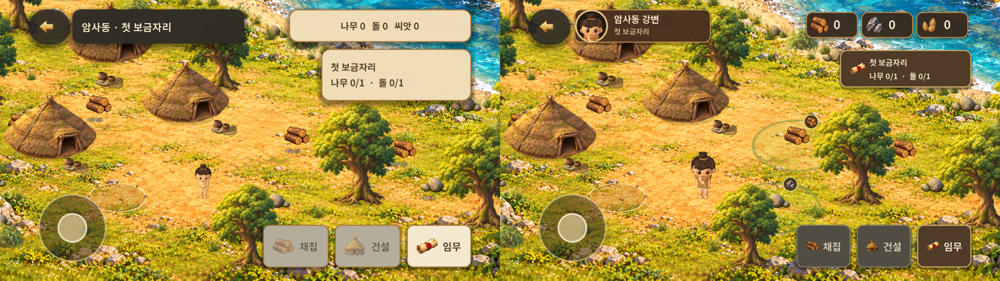
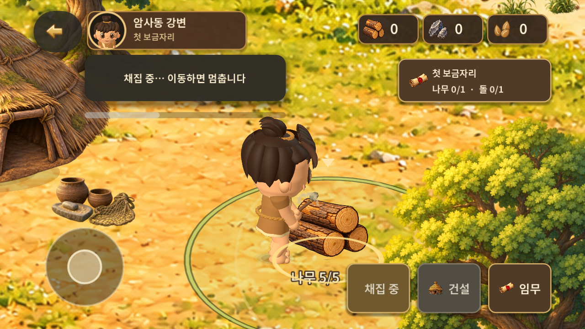
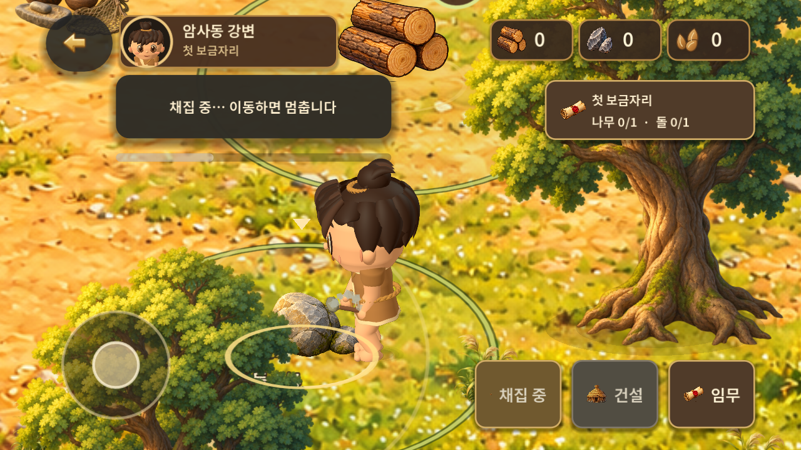

# 주인공·플레이 화면 체감 고도화 — v0.1.7-play

2026-10-31 KST · **구현·PC/Android 에뮬레이터 검증 완료, 팀장·사용자 체감 승인 대기**. 전체 베타나 주민·동물 단계의 완료 보고가 아니다.

[PR #16](https://github.com/byungho-cho/roxhistory/pull/16) · [서명 APK 한 파일](https://github.com/byungho-cho/roxhistory/releases/download/v0.1.7-play/RoxHistory-0.1.7-play-debug.apk) · [릴리스/병합 기록](https://github.com/byungho-cho/roxhistory/releases/tag/v0.1.7-play)

## 같은 구도의 전후 화면

왼쪽 v0.1.6, 오른쪽 v0.1.7. 같은 에뮬레이터·1280×720·기본 배율·저장 위치 `(1060,1030)`에서 촬영했다. 비교 촬영은 격리된 저장을 배치했고, 아래 전체 플레이 영상은 새 시작 UI부터 실제 입력으로 진행했다.

[이전 원본](evidence/screenshots/before-world.png) · [이후 원본](evidence/screenshots/after-world.png) · [Android 확대 화면](evidence/screenshots/after-zoom.png)

실제 플레이 크기에서 머리·눈·머리카락과 갈색 옷의 구분이 선명해지고 주인공 표시 크기가 약 32% 커졌다. 상단은 초상화·짧은 지역명과 자원 아이콘/정수 수량으로 정리했다. 새 체력·레벨·재화 시스템은 추가하지 않았다.

## 순서별 구현과 확인

| 순서 | 구현 | 확인과 범위 |
| --- | --- | --- |
| 1. 주인공 | 기존 실제 3D 모델·15본 리그 재사용. 볼·턱 인상, 눈, 앞머리·묶음 머리, 옷 마감·색·재질·조명 개선. 2D 비교 메뉴 제거와 이전 설정 무시 | 정면·옆·뒤 및 기본/확대 화면 검토. Android의 이전 `character_3d=false` 설정에서도 3D 표시 확인 |
| 2. 확대 | 두 손가락 사이의 월드 지점 기준 1~3배 확대. 카메라 지도 경계, UI 고정, UI/월드 터치 소유권, 잔여 손가락/앱 중단 정리 | Android 실제 동시 두 포인터, 한 손가락 고정/다른 손가락 이동, 조이스틱·버튼 충돌, 홈 복귀 확인. Native에서 해제 직후/안정 후 기준점 유지도 추가 확인 |
| 3. 목표·UI | 필요한 나무·돌의 짧은 동선을 묶는 넓은 영역, 자원 아이콘, 선택/상호작용 거리 분리. 목표 선택 시 강조·필요 시 카메라 안내. 같은 모델의 초상화, 갈색/금색 버튼과 비활성 이유 | 목표 완료 시 표시 정리, 획득 후 자원칸 반응, 커버/펼침 비율을 시각 검토 |
| 4. 채집 | 실제 충돌 이동으로 자원 옆에 짧게 자리 잡은 뒤 1.2초 작업. 손·도구·몸통, 재질별 파편·대상 반응·타격음, 성공한 자원 아이콘의 HUD 이동 | 26가지 접근에서 도구 접촉 위치와 1회 지급 확인. 취소·저장 실패·중복 요청은 획득 연출/지급 없음. Android 확대 영상과 전체 루프 확인 |
| 5. 강물 | 큰 저음 부풀림/주기적 파도형 패턴을 제거한 12초 원본 합성. 작은 찰랑임과 거리별 완만한 음량, 기존 음소거·중단 동작 유지 | 같은 위치의 전후 PCM, 경계·피크 검사, 앱 중단/음소거/복귀 출력 확인. 사람의 실제 청취는 미검증 |

기본 준비 비용은 **나무 1 + 돌 1, 각 1회 채집**, 실제 채집 시계 **1.2초**, 건설 **2초**다. 접점이 맞지 않는 방향에서는 준비 이동이 추가된다. 26가지 Native 접근 검사에서 준비를 포함한 총 시간은 1.20~1.93초였다. 준비 이동도 조이스틱·팝업·뒤로가기·중단으로 취소할 수 있다. 막히면 1.5초 안에 중단하고 이동 안내를 표시한다.

## 실행 영상과 시각 검토

| 자료 | 볼 장면 |
| --- | --- |
| [전체 플레이, 약 26초](evidence/clips/play-loop.mp4) | 이동 → 나무 한 번 → 돌 한 번 → 돌을 돌아 건설 터 입구로 이동 → 건설·보상. 별도 새 시작/이어하기 포함 자동 조작 측정은 29.5초 |
| [핀치·8방향 짧은 이동, 26초](evidence/clips/pinch-directions.mp4) | 초반 확대, 중간 방향 전환·정지/재이동, 이후 한 손가락 고정 확대와 축소·목표 안내. UI 크기 유지 |
| [나무 확대 작업, 7초](evidence/clips/wood-gather.mp4) | 초반 확대·자리 잡기, 중간 도구/파편, 후반 아이콘 이동·자원칸 강조·대기 복귀 |
| [돌 확대 작업, 7초](evidence/clips/stone-gather.mp4) | 돌 재질 반응과 도구 접점, 획득 흐름. 나무 영상과 별도 촬영한 격리 위치 |

영상은 실제 Android playback의 H.264/AAC 캡처를 짧게 압축했다. 소리는 녹음돼 있지만 사람이 청취한 결과로 표시하지 않는다. 영상 프레임과 실행 캡처를 직접 시각 검토했다. 확대 촬영은 주인공과 작업 부위가 UI 아래에 가리지 않도록 두 손가락 위치를 조정했다.

[정면](evidence/screenshots/hero-front.png) · [옆](evidence/screenshots/hero-side.png) · [뒤](evidence/screenshots/hero-back.png)는 최종 소스를 Native Godot에서 별도 카메라로 촬영한 외형 검토 자료다. [커버](evidence/screenshots/cover.png) · [커버 확대](evidence/screenshots/cover-zoom.png) · [펼침](evidence/screenshots/unfolded.png) · [펼침 확대](evidence/screenshots/unfolded-zoom.png)는 Android 화면 크기 변경 자료다. 실제 폴더블 기기의 접힘 센서·힌지·터치 하드웨어 검증은 아니다.

## 검사 기준·시각과 환경

빌드/실행 소스: [`6f1a99ef5ba5d35272e184cf10d194fdfe429cec`](https://github.com/byungho-cho/roxhistory/commit/6f1a99ef5ba5d35272e184cf10d194fdfe429cec). 이후 전달 문서만 추가했으며 APK의 게임 트리는 `33ab7dc0832d1c6a19fe6418c56af8aa6f3b85c2`다. 병합 결과와 동일한 게임 소스인지 확인하는 기준으로 사용한다.

| 구분 | 실행 시각·환경 | 결과·근거 |
| --- | --- | --- |
| 로컬 | 2026-10-31 11:15~11:19 KST, Windows, Godot 4.5.1 Compatibility, RTX 5060, 고정 60Hz 엔진 시간 | 13개 묶음 **939건 통과**, 이미지/벡터 27개·음원 12개 무결성. [실행별 결과/시각](evidence/validation/validation.json) |
| 원격 CI | 2026-10-31 11:21:39~11:33:32 KST, Ubuntu 24.04, llvmpipe/Xvfb, Godot 4.5.1 | 같은 소스 939건·에셋 검사·Android export 성공. [CI #28](https://github.com/byungho-cho/roxhistory/actions/runs/41159639919) · [기록](evidence/validation/ci-source.json). 전달 문서 HEAD의 추가 검사 상태는 PR Checks에서 확인 |
| Android | 2026-10-31 11:31 이후 KST, Android 15/API35 x86_64, 기존 RoxHistoryP3 AVD의 읽기 전용 세션, RTX 5060 host | 실제 터치 전체 루프 29.5초. 한 번씩 채집, 연속 입력 중복 방지, 비용 차감, 보상 10, 종료 후 동일 저장 확인. [결과](evidence/validation/android-play-loop.json) |
| 입력·중단 | 같은 최종 APK, Android MotionEvent 두 포인터 / ADB 터치·Back·Home | [다중 터치 10항목](evidence/validation/android-controls.json), [작업 취소/복귀 5항목](evidence/validation/android-interruptions.json), [확대 접촉](evidence/validation/android-contact.json), [비율](evidence/validation/android-ratios.json) |
| 추가 카메라 확인 | 2026-10-31 11:43 KST, Native Godot | 손가락 해제 직후/안정 후 기준점 유지 2항목 추가 확인. [로그](evidence/validation/pinch-release-probe.log)·[방법](evidence/methods/pinch-release-probe.gd). CI 939건에 중복 합산하지 않음 |

937건까지 진행한 뒤 대기 중 HUD 갱신과 상태 변경 시 재표시 검사 2건을 추가해 939건이 됐다. 기존 검사를 삭제하거나 지급·취소 조건을 완화하지 않았다. 준비 이동이 생긴 검사에서는 준비 완료를 확인한 다음 기존 1.2초 작업 시간을 측정한다.

일반 `save.json`은 전후 바이트 일치를 확인했다. 새 게임·비교용 위치·설정 변경은 `--test-ui`의 별도 저장/설정에만 적용했다. 이 모드는 PC 포커스 전환 알림을 무시하지만 Android PAUSED/RESUMED는 처리한다. 실기기 검증으로 대체하지 않는다. [보존/소스 증거](evidence/validation/provenance.json) · [조작 방법과 원본 스크립트](evidence/methods/README.md)

## 성능과 강물 비교

같은 위치·기본 배율·3D 대기·1280×720 물리 화면(960×540 논리 화면), 녹화 없이 첫 60프레임을 제외한 600개의 처리 간격을 비교했다.

| 빌드 | 평균 간격 | 95백분위 | 평균 간격의 역수 |
| --- | --- | --- | --- |
| v0.1.6 | 32.98ms | 59.35ms | 약 30.3fps |
| 최종 v0.1.7 | 31.05ms | 40.54ms | 약 32.2fps |

[측정 조건·APK 해시](evidence/validation/android-performance.json). 앞선 같은 호스트의 기준 버전 측정은 약 17ms이기도 해 변동이 컸다. 단일 구간으로 일반적인 성능 향상이나 실기기 성능을 확정하지 않는다. 조작·확대 영상은 녹화 부하가 있으므로 이 표와 혼합하지 않는다. 실기기에서 확대 유지·발열·장시간 성능을 후속 확인해야 한다.

기본 캐릭터 렌더는 384×480, 1.5배 이상 확대는 768×960이며 1.25배 이하에서 되돌린다. 전환 첫 프레임의 표시·크기·발 접점 유지 검사를 통과했다. 변화가 없는 HUD/목표 표시는 재사용하고 획득·강조 중에만 계속 갱신한다.

[이전 강물 12초](evidence/audio/before-ambience.wav) · [최종 강물 12초](evidence/audio/after-ambience.wav). 같은 저장 위치 `(1060,1030)`·미디어 음량 15/15의 Android PCM이다. RMS는 이전 -44.77dBFS, 이후 -50.93dBFS. 음량뿐 아니라 원본 합성의 저음 주기와 작은 물결 패턴을 변경했다. [비교 조건](evidence/validation/audio-comparison.json)

앱 중단·음소거·음소거 상태 재시작에서는 디지털 무음, 복귀에서는 출력 재개를 확인했다. [출력 검사](evidence/validation/android-audio.json). 사용 출력은 **에뮬레이터 playback 캡처**이며 물리 스피커/헤드폰으로 실제 청취하지 않았다. 잔잔한 강물로 들리는지, 타격음과의 균형은 사용자 청취 승인이 남는다.

## 검증 중 수정한 문제

- Android의 대칭 핀치가 PC 합성 입력과 달리 이동 이벤트를 받지 못했다. Godot 4.5.1의 Android 스크롤 임계값을 끄고 원시 터치 소유권을 유지해 실제 두 포인터 확대를 확인했다. [엔진 구현](https://github.com/godotengine/godot/blob/4.5.1-stable/platform/android/java/lib/src/org/godotengine/godot/input/GodotGestureHandler.kt)
- 불러온 재고의 `0.0` 표시를 정수로 고쳤고, 목표 배지가 근접 주인공을 가리지 않게 했다. 영역 외곽선의 대비도 보완했다.
- 위쪽/반경 끝에서의 헛타격을 막기 위해 실제 이동으로 접촉 자세를 맞춘다. 움집과 겹치는 자세는 대체 위치를 선택한다.
- 첫 CI #25의 캐릭터 취소 검사가 느린 렌더링과 물리/작업 시간의 불일치로 실패했다. 엔진 시간 기준을 통일한 후 #26~#28이 성공했다.
- 확대용 해상도를 항상 사용하는 부담과 정적 UI의 반복 생성을 줄였다. 외형·조명은 유지했다.

## 자산·편집 원본과 사용 조건

| 항목 | 재사용/변경과 원본 |
| --- | --- |
| 3D 주인공 | 기존 자체 제작 절차형 모델·15본 리그 수정. [모델](../../../game/scripts/hybrid_character.gd), [형상](../../../game/scripts/character_geometry.gd), [동작](../../../game/scripts/hero_motion.gd). 새 외부 모델·애니메이션 사용 없음 |
| 초상화 | 같은 3D 모델을 Godot에서 렌더. [UI 자산 설명](../../../game/assets/ui/README.md), [재생성 코드](../../../game/tests/play_capture.gd)의 `--portrait` 옵션 |
| 자원·버튼 아이콘 | 기존 사용자 제공 Figma 목재·돌·움집·임무 아이콘 재사용. [씨앗 SVG](../../../game/assets/ui/seed.svg)는 이번 작업의 편집 가능한 원본. 기존 보상만 표시 |
| 파편 | 기존 효과 코드를 확장한 나무 조각·돌 다각형. [효과 원본](../../../game/scripts/world_feedback.gd) |
| 강물 | 외부 녹음 없는 자체 합성. [river_audio.py](../../../scripts/river_audio.py), [생성기](../../../scripts/build_demo_audio.py), seed 7017. 생성 환경 Python 3.14 / NumPy 2.5.4. 다른 11개 WAV 바이트 유지 |
| 배경·오브젝트·폰트 | 기존 자산과 사용 조건 유지. [디자인 기준](https://www.figma.com/design/zkbflw9fCdAlWbphhw5pSS?node-id=83-39). 유료/출처 불명 외부 자산 추가 없음 |

## 전달·남은 과제

- **APK**: `RoxHistory-0.1.7-play-debug.apk`, versionCode 8, `89,415,045`바이트(약 89.42MB), Android 7.0/API24 이상, arm64-v8a/x86_64.
- **SHA-256**: `af38b854dd3b1562b430feca21000a694e6c0e5997ca70938da3bf9e11a1ca41`.
- **기존 서명 유지**: 인증서 SHA-256 `cf65aeecb4e399ba9e2e6b9fa947f34f8c31bd75c8e3b686ad29d8431bb1695f`. v2/v3 검증 및 v0.1.6→v0.1.7 덮어쓰기 설치 성공. [서명](evidence/validation/signature.txt) · [패키지](evidence/validation/package.txt)
- GitHub Actions의 별도 빌드 APK는 임시 CI 키를 쓴다. 사용자 전달 링크는 기존 키로 서명한 이 파일이며 소스·로그 ZIP이 아니다.
- 최대 확대에서 기존 2D 배경의 래스터 선명도 한계가 보인다. 손수 제작한 최종 아트 수준의 머리카락/의상 세부와 발 접지의 체감 승인은 아직 별도다.
- Android 실기기, 실제 폴드 전환 중 터치, 장시간 발열·확대 성능, 물리 출력 장치 청취는 미검증이다.
- CQ1의 구현/개발 검증과 체감 완료를 분리한다. 주민·사슴·멧돼지 및 CQ2 이후는 팀장·사용자 검토 뒤 판단한다. [최신 진행](../../quality-progress.md) · [로드맵](../../character-quality-roadmap.md) · [FigJam 카드](https://www.figma.com/board/60HqJ7ggIuvs9OLva8ZIx2?node-id=23-75) · [갱신 캡처](evidence/screenshots/figjam-status.png)
- 원래 로컬 저장소의 기존 미반영 기획/로드맵 문서는 수정·초기화하지 않았다. 별도 작업 복사본의 `feat/play-experience-v017`에서 개발했다. 기존 저장소를 강제로 동기화하지 않는다.

[APK 직접 다운로드](https://github.com/byungho-cho/roxhistory/releases/download/v0.1.7-play/RoxHistory-0.1.7-play-debug.apk)
