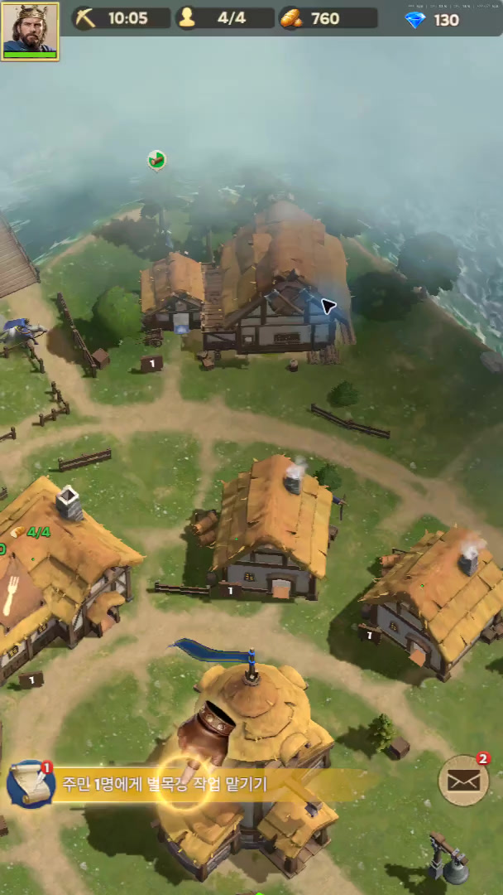
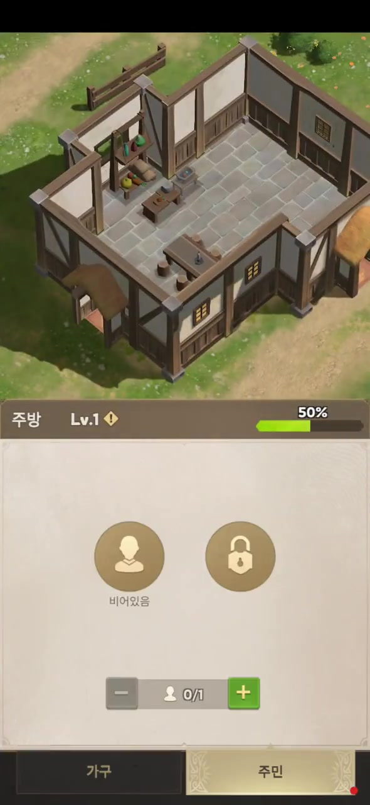
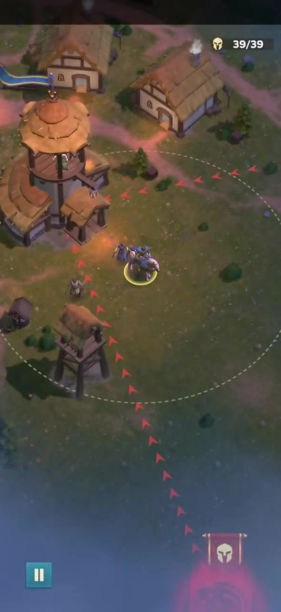
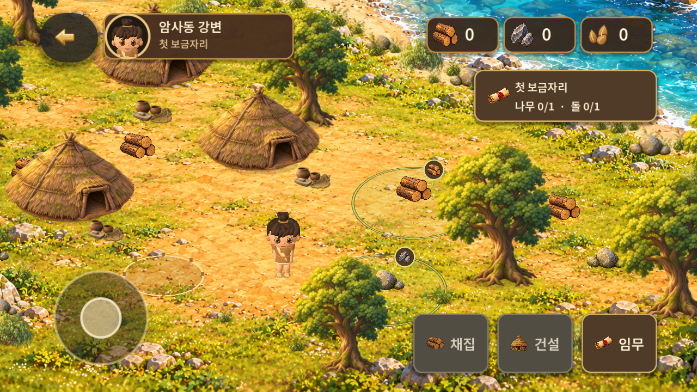
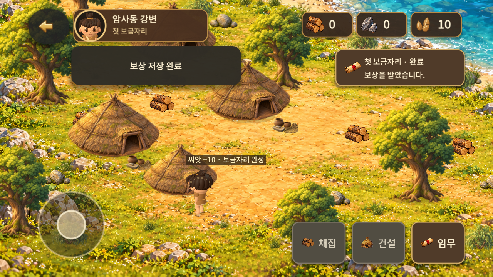

# 플레이 화면 리팩토링 비교 참고

2026-10-31 KST. 사용자가 지적한 Lordrush와 RoxHistory의 화면 완성도 차이를 개발 담당과 함께 검토하기 위한 자료다. 주인공·배경·오브젝트·UI가 하나의 공간으로 어울리는 대표 구역을 먼저 완성한다.

**자료 범위:** 아래 이미지는 기존 GitHub 공유 영상에서 추출한 Lordrush 참고 프레임 3장과 기존 v0.1.7 개발 보고서의 RoxHistory 캡처 2장이다. 이번 대화에 새로 첨부된 JPG 원본 5장은 포함하지 않았다. 이 이미지들은 원본 첨부와 같은 게임의 관련 장면을 보여주는 대체 참고 자료이며 동일 시점·동일 구도의 복제본이 아니다.

## 개발 담당이 먼저 볼 자료

| 파일 | 분류·출처 | 참고할 부분 |
| --- | --- | --- |
| [01 Lordrush 주간 배치](images/01-lordrush-day-layout.jpg) | 기존 로컬 직접 조사 영상의 00:00 프레임 | 차분한 지면, 길과 잔디의 구분, 건물 간 여백, 상단 정보 압축 |
| [02 Lordrush 실내와 패널](images/02-lordrush-interior.jpg) | 킷싱 외부 플레이 영상의 01:18.5 프레임 | 건물·소품·인물의 상대 크기와 월드/정보 패널의 역할 구분 |
| [03 Lordrush 야간 명암](images/03-lordrush-night-layout.jpg) | 같은 외부 영상의 02:20.5 프레임 | 지면의 명암과 따뜻한 국소 조명, 인물·건물의 시각적 구분 |
| [04 RoxHistory 기본 화면](images/04-roxhistory-current-world.png) | v0.1.7 보고서 after-world.png 원본 blob 재사용 | 바닥 밀도·주인공 크기·자원 배치·UI 점유 비교 |
| [05 RoxHistory 완료 화면](images/05-roxhistory-completed.png) | 같은 보고서 completed.png 원본 blob 재사용 | 완료 안내·자원바·행동 버튼이 플레이 공간에 미치는 영향 |

주간 참고는 [기존 직접 조사 보고서](../2026-10-31-lordrush-playtest/report.md)의 [village-environment.mp4](../2026-10-31-lordrush-playtest/evidence/clips/village-environment.mp4)에서 추출했다. 이 문서를 작성하면서 새로 게임을 조작한 것은 아니다.

외부 영상 원본은 킷싱 채널의 [로드러쉬 게임플레이 영상](https://www.youtube.com/watch?v=LEAWRWjgh_M)이다. [공유 MP4와 출처](../2026-10-31-lordrush-playtest/evidence/external-video/README.md)의 전체 구간 재인코딩본에서 프레임을 추출했다. 제3자 플레이 자료로 분류한다.

우리 게임의 원본 캡처와 실행 조건은 [v0.1.7 개발 보고서](../2026-10-31-play-experience/report.md)에 있다. 이 문서는 v0.1.7 구현 결과와 사용자의 체감 품질 만족을 동일하게 취급하지 않는다.

## 리팩토링에서 해결할 점

| 관찰·판단 | 적용 방향 | 실제 실행에서 확인할 기준 |
| --- | --- | --- |
| 우리 화면의 바닥·식생·물결에 강한 세부 묘사가 몰려 있다 | 생활 공간과 이동 경로의 밀도·채도·대비 조정 | 기본 배율에서 주인공·길·행동 대상이 먼저 읽힐 것 |
| 주인공의 매끈한 재질과 배경의 세밀한 묘사 차이가 크다 | 얼굴·의상·머리의 형태와 재질·빛·크기를 함께 조정 | 기본/확대 화면, 정면/측면/후면에서 같은 그림체로 느껴질 것 |
| 통나무가 월드 물체보다 큰 자원 아이콘처럼 보인다 | 월드 자원의 크기·방향·접지·그림자와 배치 정리 | 지면에 놓인 채집 대상으로 읽히고 도구 접점이 맞을 것 |
| 헤더·안내·하단 버튼의 화면 점유가 크다 | 간결한 정보 배치, 완료 안내 축소, 터치 영역을 유지한 버튼 정리 | 커버/펼침 화면에서 플레이 공간과 가독성을 함께 확보할 것 |
| 작은 보정만으로 전체 인상 변화가 충분히 드러나지 않았다 | 대표 구역 한 곳에서 아트 기준을 통일하고 다른 곳으로 확장 | 같은 카메라·배율·비율의 전후 실행 화면에서 개선이 명확할 것 |

시각적 판단은 첨부 화면과 기존 캡처를 비교한 팀장 검토 의견이다. 서로 다른 화면 비율과 구도이므로 성능·입력 지연·물리 치수의 실측 비교로 사용하지 않는다.

## 유지할 결정과 후속 검증

- 따뜻하고 귀여운 기존 그림체, 한국 선사시대 분위기, 2D 배경과 실제 3D 주인공을 유지한다. 2D 비교 메뉴 제거 결정을 유지한다.
- 핀치 확대·축소, 목표 구역 안내, 헤더·자원바·버튼, 채집과 자원 획득 연출, 잔잔한 강물 소리는 기존 구현을 확인하고 필요한 부분을 보완한다.
- 최소 데모는 나무 1 + 돌 1, 각 1회 채집, 채집 1.2초·건설 2초, 저장·보상 1회 규칙을 유지한다.
- 주인공·움집·나무·자원·강이 함께 보이는 작은 구역의 크기·밀도·명암·접지와 UI를 먼저 맞춘다. 주민·사슴·멧돼지는 이후 단계다.
- 실내 화면과 야간 프레임은 비율·배치·명암을 살피는 참고다. 실내 시스템·밤낮 주기·전투 추가를 지시하는 자료가 아니다.
- 정지 프레임으로 애니메이션·소리·조작감을 합격 판정하지 않는다. 이동·회전·가림·채집·건설·확대·음향은 실제 실행 영상과 Android 입력·청취로 검증한다.
- 외부 게임의 모델·텍스처·음원·이미지를 제품 자산으로 가져오지 않는다. 참고 이미지의 권리는 각 원권리자에게 있다.

## 이미지 미리보기

### Lordrush 주간 공간과 정보 배치

### Lordrush 실내의 크기 관계와 정보 패널

### Lordrush 야간의 명암과 국소 조명

### RoxHistory v0.1.7 기본 화면

### RoxHistory v0.1.7 완료 화면

## 검증과 변경 범위

파일 크기·SHA-256·Git blob SHA·출처와 추출 시점은 [manifest.json](manifest.json)에 기록한다. 이미지 열기와 문서의 상대 링크를 확인한다. 이번 변경은 공유 문서·참고 이미지에 한정하며 게임 코드·설정·APK를 변경하지 않는다.
