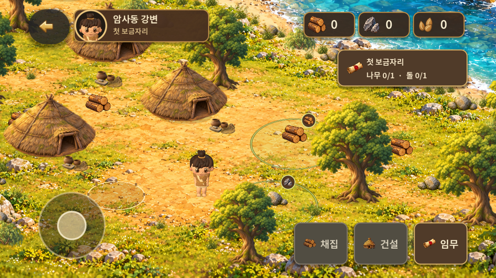
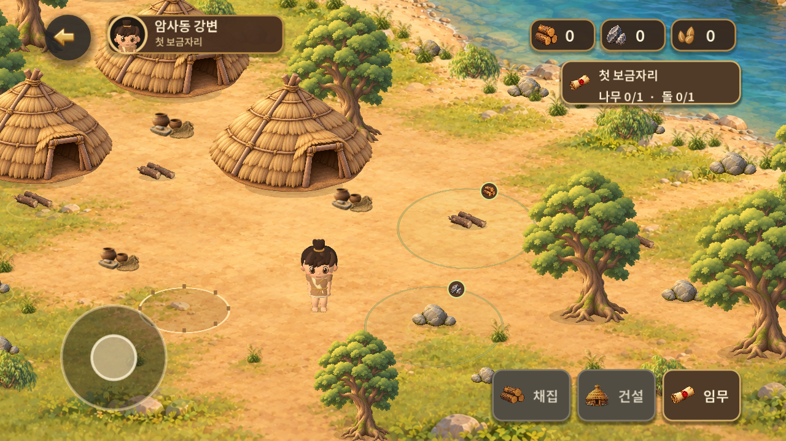
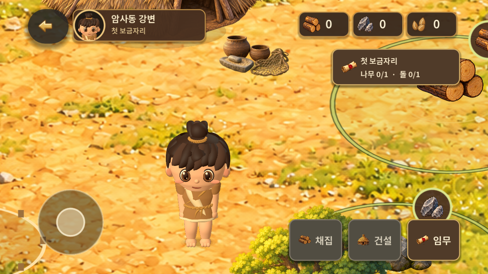
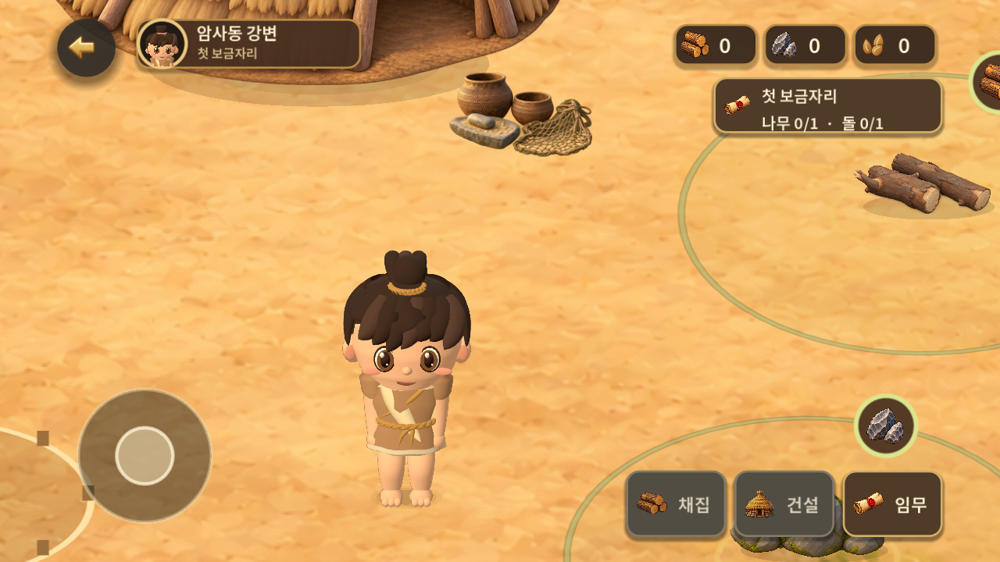
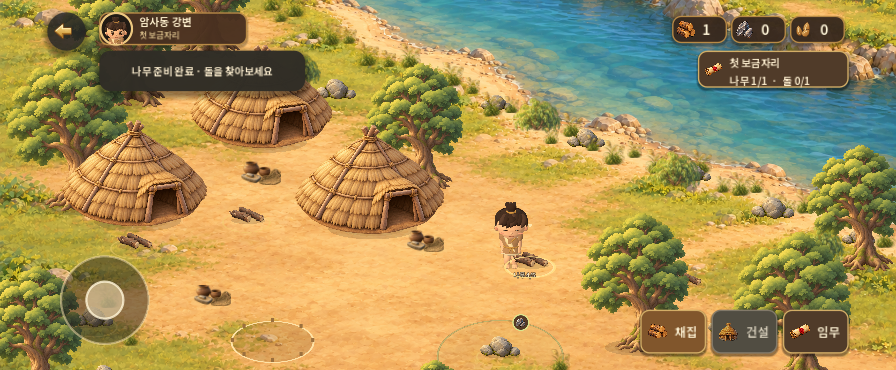
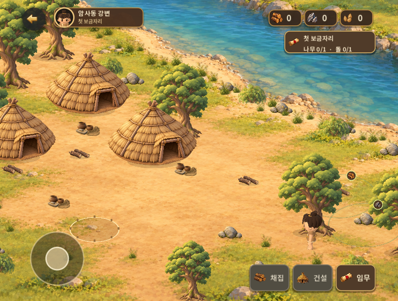
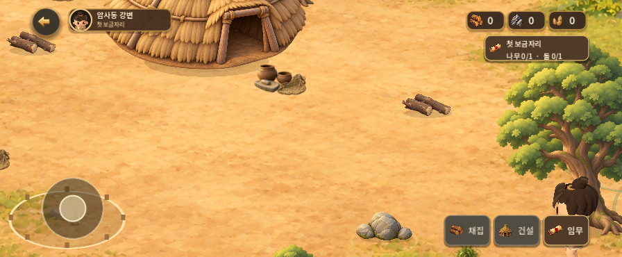
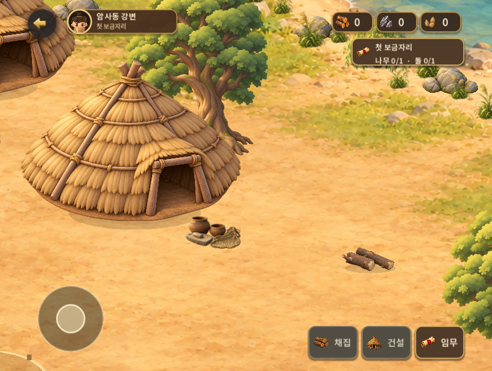

# 대표 정착지 아트·공간 리팩토링 v0.1.8

2026-10-31 KST. **개발·로컬/에뮬레이터 검증 완료, 팀장·사용자 체감 품질 검토 대기.** 주민·동물 및 전체 베타 완료 판정은 아니다.

[비교 참고 README와 5장](../2026-10-31-visual-refactor-reference/README.md)을 먼저 검토했다. 해당 README의 출처·대체 캡처·추출 조건을 따랐고 외부 게임 자산은 제품에 사용하지 않았다. Figma `83:39`의 따뜻한 자연광·둥근 형태를 기준으로 실제 장면의 밀도와 크기를 조정했다.

- 시작 main: `4e4ea429c1315106d7705a484a74292d06247c76`. 별도 브랜치 `feat/visual-refactor-v018`.
- 아트/접점 변경: `c5e15a662f3f785863946b04447d1c193477b44c`.
- 최종 게임 소스: `25853f4096c6db686ee19e0b4beadcd41a76f2bb`. 게임 트리 `3677793eea88488ca6732b2a6f8e70bfae1f9d92`. 이후 보고서 커밋은 게임 내용이 동일하다.
- [PR #18 · 최종 변경/병합 기록](https://github.com/byungho-cho/roxhistory/pull/18), [최종 HEAD 원격 체크](https://github.com/byungho-cho/roxhistory/pull/18/checks). 병합 커밋과 최종 CI 실행 링크는 PR 본문/병합 기록에 보존한다.

## 같은 구도의 전후

Android 15/API35 x86_64 에뮬레이터, 1280×720, 저장 위치 `(1060,1030)`, 기본 카메라·3D 캐릭터. 비교용 격리 저장만 동일 조건으로 준비했으며 일반 저장은 보존했다. 확대는 동일한 두 포인터 좌표·이동 시간으로 2.75배 핀치했다. 물·호흡의 시간 위상은 별도 실행이라 일치시키지 않았다.

| v0.1.7 이전 | v0.1.8 이후 |
| --- | --- |
|  |  |
|  |  |

[이전 원속도 영상](evidence/clips/before-comparison.mp4) · [이후 원속도 영상](evidence/clips/after-comparison.mp4). 각각 0~2초 기본 구도, 2~5초 핀치, 5~15초 방향 전환·짧은 이동, 이후 축소·대기. 입력 시간이 소폭 달라 장면 경계는 대략적인 안내다. 30fps 재인코딩했으며 재생 속도는 변경하지 않았다.

## 대표 구역과 적용 내용

1. **생활 공간과 길:** 기존 지형의 강/강둑 구조를 유지하고 작은 풀·자갈·노란 반사와 흰 물결을 줄였다. 넓은 흙 생활 공간과 가장자리 식생으로 이동 길을 구분했다. 배경에 건물·주인공·UI를 합성하지 않았다.
2. **독립 오브젝트:** 움집·나무·돌·목재를 각각 배치했다. 왼쪽 움집을 `(360,720)`으로 옮겨 기존 목재와 겹침을 해소하고 입구 공간을 확보했다. 대표 움집 폭 400, 대표 나무 290, 전경 나무 210, 목재 96, 돌 108 월드 단위. 전경 나무를 뒤로 옮겨 초기 주인공 발이 드러나게 했다.
3. **접지와 재질:** 투명 이미지의 불투명 외곽을 측정해 바닥 기준점을 정리하고 공통 그림자 색을 적용했다. 돌의 생성 번짐은 런타임 알파 재질로 제거했다. 물 움직임은 청록색 물 영역에 제한해 마른 강둑의 흔들림을 피했다. 식생 위상은 유지하면서 진폭을 낮췄다.
4. **실제 3D 주인공:** 기존 리그·절차적 메시를 재사용해 피부/머리의 광택, 가죽색·주름, 머리 비율·눈 깊이를 조정했다. 같은 모델로 초상화를 다시 렌더했다. 2D 비교 메뉴는 없고 과거 false 설정도 3D로 표시한다. 전면 재제작 모델로 보고하지 않는다.
5. **UI:** 헤더 216×48, 행동 버튼 96×64, 뒤로가기 56×56의 논리 크기로 정리했다. 목표 영역·아이콘 강도를 낮추고 완료 안내는 2초 후 줄어든 요약으로 남긴다. 연속 건설 확인 입력에서 작업 중 안내가 자원 접근 안내로 덮이던 문제도 수정했다.
6. **채집:** 낮은 목재에 맞춰 손목·몸통 자세와 준비 거리를 조정했다. 도구 변환을 포함한 실제 접촉점에서 대상 반응·재질별 파편·타격음이 발생한다. 성공한 저장/지급 뒤에만 자원 아이콘이 HUD로 이동한다. 파편 수와 크기, 중복 완료 문구를 줄였다.

[중간 실행 캡처](evidence/screenshots/representative-interim.png)는 최종 배치 이전 기록이다. 최종 결과는 위 Android 비교가 기준이다. [확대 정면](evidence/screenshots/play-front.png) · [측면](evidence/screenshots/play-side.png) · [후면](evidence/screenshots/play-back.png)은 네이티브 Godot 외형 검토 자료다. 네이티브 외형 캡처는 아트 커밋 `c5e15a6`에서 촬영했고, 이후 변경은 진행 중 안내 문구 우선순위뿐이다.

## 실제 플레이·가림·화면 비율

[최종 APK 전체 플레이 영상](evidence/clips/android-play-loop.mp4): 약 4~7초 나무, 9~12초 돌, 18~22초 건설, 22~24초 보상, 이후 종료·이어하기·복귀. 나무/돌 각 1개, 각 1회, 채집 1.2초·건설 2초 유지. 접근 이동 시간은 작업 시간과 별도다. 반복 입력에도 지급/건설/보상 중복이 없었다.

자동 터치 시나리오의 새 게임 메뉴부터 보상까지 **28.08초**. 메뉴·짧은 녹화 준비 대기를 포함한 스크립트 실행 시간이며 사람의 첫 플레이 시간/권장 플레이 시간은 아니다. 완료 뒤 나무0·돌0·씨앗10·움집1을 저장하고 재진입 상태가 일치했다.

[실제 두 손가락·8방향·복귀 영상](evidence/clips/android-controls.mp4) · [나무 앞/충돌/뒤/복귀 영상](evidence/clips/android-occlusion.mp4). 가림 검사는 격리 저장의 시작점만 `(1700,1150)`으로 준비하고 이후 실제 Android 터치로 이동했다. 나무 앞에서 막힌 뒤 옆으로 돌아 잎 뒤에 가려지고 다시 앞으로 나오는 것을 캡처로 확인했다. 중간 일시정지 팝업은 저장 좌표 확인용이다.

| 커버 비율 | 펼침 비율 |
| --- | --- |
|  |  |
|  |  |

`wm size`로 896×370 / 816×616 가로 화면을 모사했다. 실제 폴드 기기의 접힘·힌지·센서·디스플레이 전환 시험은 아니다. HUD와 버튼의 잘림/겹침은 발견하지 않았다. 손가락 중심을 유지한 커버 확대에서 하단 월드 자원 라벨 일부가 화면 밖으로 나가는 경우는 남아 있다.

## 검증과 성능

기준 소스 `25853f4096c6db686ee19e0b4beadcd41a76f2bb` / 최종 APK SHA-256 `ded2320f2be5621f0a6259f5eab3482aa99f9b79bda003282ac146af7521a1d9`. 로컬 검사는 2026-10-31T14:26:42.100134+09:00 ~ 2026-10-31T14:28:10.491606+09:00. 자동 통과와 시각·청취 판단은 구분한다.

| 로컬 검사 | 건수 | 결과 |
| --- | ---: | --- |
| state_tests | 345 | 통과 |
| environment_tests | 17 | 통과 |
| ui_smoke | 81 | 통과 |
| environment_review | 13 | 통과 |
| character_tests | 68 | 통과 |
| hybrid_tests | 30 | 통과 |
| hybrid_occlusion | 13 | 통과 |
| polish_tests | 62 | 통과 |
| interaction_tests | 27 | 통과 |
| presentation_tests | 53 | 통과 |
| hero_tests | 51 | 통과 |
| play_experience_tests | 45 | 통과 |
| gather_contact_tests | 160 | 통과 |
| 합계 | 965 | 통과 |

기존 939개 조건을 유지하고 투명 여백이 아닌 **불투명 자원 표면 접촉 26개**를 추가했다. 기존 트리 충돌 검사는 고정 좌표 대신 실제 옮긴 나무를 참조하도록 했으며 충돌 허용 범위는 그대로다. 자산 32개 크기/SHA-256, 음원 12개 수치 검사, 새 Git 아카이브로 추출한 소스의 자산 무결성도 통과했다. [로컬 원본 결과](evidence/checks/local-validation.json).

원격 CI는 로컬 결과와 별도다. 선행 아트 커밋 `c5e15a6`의 [CI #30](https://github.com/byungho-cho/roxhistory/actions/runs/41171854017)은 성공했다. 최종 소스가 포함된 PR HEAD의 [원격 체크](https://github.com/byungho-cho/roxhistory/pull/18/checks)를 병합 조건으로 사용하며 정확한 HEAD·실행 시각·최종 실행 링크는 PR 본문과 해당 실행 기록에서 확인한다.

Android 최종 APK: 업데이트 설치, 새 게임/채집/건설/보상/재진입, 실제 두 포인터 핀치, 조이스틱/UI 터치 분리, 이동·임무 팝업·Back·Home 취소, 복귀 후 입력 정리, 과거 비교 설정, 두 화면 비율, 음소거/복귀 출력 확인. [각 실행 시각·결과 JSON](evidence/checks/). 실기기는 미검증이다.

| 동일 조건 성능 | 평균 프레임 간격 | P95 |
| --- | ---: | ---: |
| v0.1.7 | 25.01 ms | 32.25 ms |
| v0.1.8 | 25.05 ms | 32.46 ms |

RTX5060 호스트의 Android15/API35 x86_64, 물리1280×720/논리960×540, 대표 위치·기본 배율·3D 대기. 녹화와 다른 Godot 실행 없이 최초60프레임 제외 후600프레임, 버전별 1회. 통계적 개선이나 실기기 60fps 보장으로 해석하지 않는다. [원본 측정 조건·시각·APK 해시](evidence/checks/android-performance.json).

## 강물과 소리

강물은 v0.1.7의 조용한 흐름 음원을 유지했다. 이번에는 음원을 다시 교체하지 않았다. 반복 경계 수치·출력·음소거·중단/복귀를 확인했지만 **개발 환경에서 실제 스피커/헤드폰으로 청취했다고 보고하지 않는다**. 청감 승인은 팀장·사용자 검토 대기다.

[최종 APK의 강물 출력 WAV](evidence/audio/river-output.wav), 위 플레이 영상의 채집·건설·UI 소리. 출력 경로는 에뮬레이터 Android playback capture → scrcpy PCM, 미디어 볼륨15/15. 전경 -47.39 dBFS / 복귀 -47.79 dBFS, 백그라운드·음소거·음소거 재실행은 디지털 무음. 복귀 후 중복 증폭은 없었다. 이 수치를 잔잔하다는 청감 평가로 대체하지 않는다.

## 남은 품질 과제와 자산

- 확대 시 절차적 머리 덩어리·어깨/옷 마감과 2D 배경의 붓질 차이가 보인다. 동일한 아트 표현으로 완전히 통일했다고 판정하지 않는다.
- 큰 확대에서는 래스터 배경의 선명도와 일부 화면 밖 월드 라벨, 획득 아이콘이 잠깐 머리 실루엣과 겹치는 경로를 더 다듬을 여지가 있다.
- 목재는 비대칭 원본 1종 재사용이다. 방향별 추가 원본과 다양한 생활 소품은 대표 구역 승인 후 판단한다.
- 실제 Android 기기·물리 폴드·장시간 발열·다른 GPU·직접 청취·최종 체감 승인은 미검증/대기다.
- 주민·사슴·멧돼지·실내·밤낮·전투는 착수하지 않았다. CQ5의 대표 구역 부분을 CQ1과 함께 먼저 진행했으며 전체 CQ5/CQ6 완료가 아니다.

[사용 자산·생성 지시 요약·편집 원본·수정 책임](assets.md). [환경 PNG 원본](../../../game/assets/environment/) · [3D 모델/재질/리그 원본](../../../game/scripts/hybrid_character.gd) · [메시 생성기](../../../game/scripts/character_geometry.gd). 기존 원본과 저장 형식을 보존했다. 원래 로컬 저장소의 미반영 로드맵 파일들은 수정/초기화하지 않았다.

[로드맵](../../character-quality-roadmap.md) · [진행 JSON](../../quality-progress.json) · [FigJam CQ1/CQ5](https://www.figma.com/board/60HqJ7ggIuvs9OLva8ZIx2?node-id=23-74). PDF는 새로 만들지 않았다.

[증거 파일 목록·SHA-256](evidence/manifest.json)은 Git 저장소에 정규화된 파일 바이트 기준이다. 이미지·영상·음원 원본 바이트를 보존했다.

## APK 전달

서명된 디버그 APK **한 파일**, `com.roxhistory.demo`, v0.1.8-scene/code9, **95,572,641 bytes (91.15 MiB)**. SHA-256 `ded2320f2be5621f0a6259f5eab3482aa99f9b79bda003282ac146af7521a1d9`. 기존 인증서 SHA-256 `cf65aeecb4e399ba9e2e6b9fa947f34f8c31bd75c8e3b686ad29d8431bb1695f`와 일치하며 v0.1.7 위 업데이트 설치와 일반 저장 보존을 확인했다. [빌드/서명 정보](evidence/checks/build-info.json).

[APK 단일 파일 직접 다운로드](https://github.com/byungho-cho/roxhistory/releases/download/v0.1.8-scene/RoxHistory-0.1.8-scene-debug.apk)
