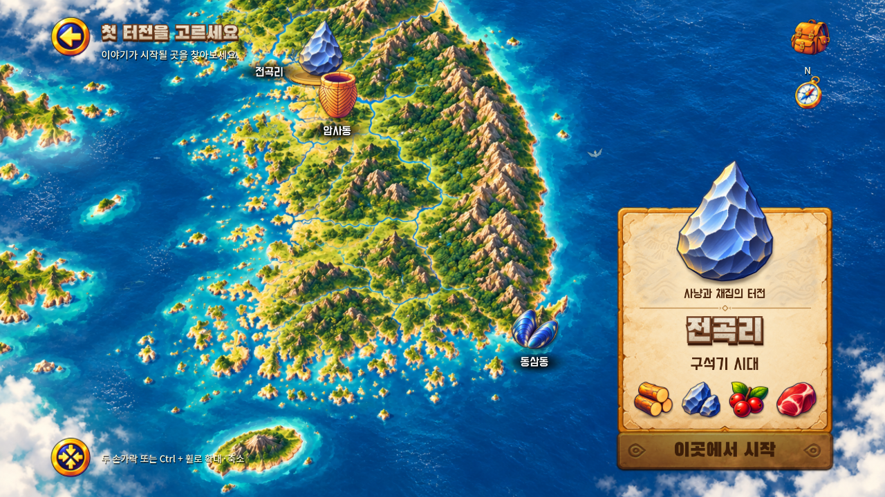
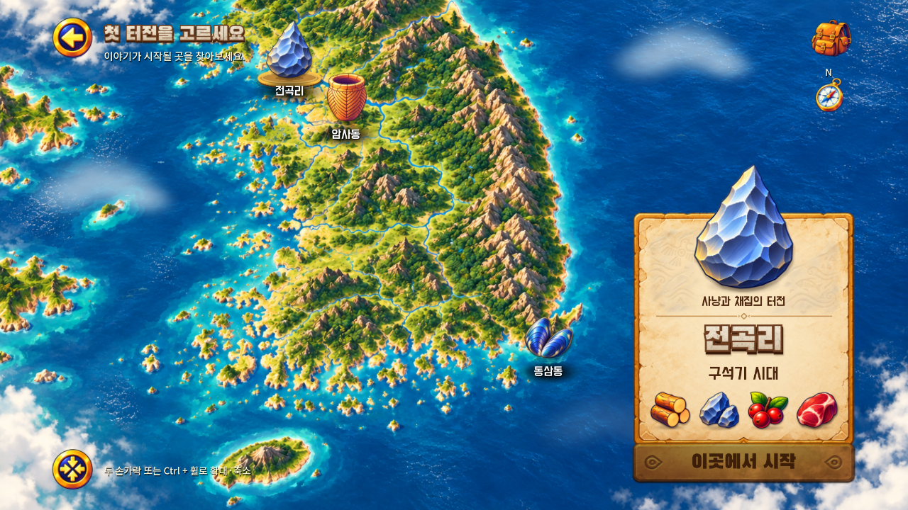

# A303 새 비행 방향·전곡리 지명·구름 보완 — v0.1.14

2026-11-01 KST. 사용자 v0.1.13 플레이 캡처의 피드백을 반영했다. [이전 보고서](../2026-11-01-a303-living-map/report.md).

## 변경

- **새:** 고정된 그림 회전값을 없애고 실제 이동 경로의 접선 방향을 바라보게 했다. 오른쪽 바다의 가파른 사선 인상을 줄이도록 완만한 수평 경로로 바꾸고, 줄지어 선 대각선 배치 대신 서로 다른 옆 간격·날갯짓을 적용했다. 반대편 무리는 왼쪽 방향으로 흐른다.
- **전곡리:** 유물 아래 중앙에 지명을 정렬했다. 기존 지점에서 텍스트만 옮기면 암사동 유물과 겹치므로 전곡리 유물·이름 묶음을 지도 기준 70px 왼쪽으로 정리했다(1280×720 전체 지도에서는 약 56px). 선택 시 자동 이동 없이 그 위치를 유지한다. 세 지역의 이름 정렬 규칙을 통일했다.
- **구름:** 가장자리에서 거의 보이지 않던 희미한 두 효과를 바다 위 세 구역의 부드러운 구름띠로 보강했다. 밝은 윗면과 옅은 아랫면, 느린 바람 방향 이동과 출현·퇴장을 적용했다. 지도 표식·고정 UI 근처에서는 강도를 줄인다.

지도·유물·UI 원본 이미지는 변경하지 않았다. 핀치·드래그·복원·패널·저장·기존 게임 흐름은 유지한다. 편집 원본은 `game/scripts/region_ambience.gd`, `region_markers.gd`, `region_catalog.gd`이며 새로운 외부 자산은 사용하지 않았다.

## 실제 화면·영상

아래 비교는 같은 에뮬레이터 1280×720 전체 지도이다.

| 이전 v0.1.13 | 수정 v0.1.14 |
| --- | --- |
|  |  |

[새 방향·구름 이동·지역 선택 영상, 원속도 24초](evidence/flight-clouds.mp4). 처음 약 8초는 가만히 둔 지도, 이후 지역 선택과 버튼 반응이다. 새 무리와 구름은 서로 다른 주기이며, 녹화는 실제 Android 내부 화면·오디오를 압축한 것이다.

- [암사동](evidence/android-amsa.png), [동삼동](evidence/android-dongsam.png), [수동 확대](evidence/android-manual-zoom.png)
- [커버 비율](evidence/android-cover-final.png), [펼침 비율](evidence/android-unfolded-final.png): 에뮬레이터 해상도 모사이며 실제 폴드 기기 촬영이 아니다.

## 검증

코드 기준 `e2d5359e2684e7a637e7a964a2b926b3fe900af5`, 게임 소스 트리 `e037d54c36576fb78a11cc05481c7595a2b12179`. [PR #27](https://github.com/byungho-cho/roxhistory/pull/27).

- **로컬:** 2026-11-01 19:53~19:54 KST, Godot 4.5.1 / Windows / RTX 5060. [801검사 통과](evidence/local-validation.json): 상태 345, UI 93, 지도 82, 아트 157, 기존 선택 36, 환경·모션 88. 마지막 검사군에 새의 몸 방향과 실제 경로 일치, 이름 정렬·이웃 유물 비겹침, 구름 이동을 확인하는 30검사를 추가했다. 기존 검사는 유지했다. 에셋 107개·음원 12개 무결성 통과.
- **Android:** 19:55~19:56 KST, Android15/API35 x86_64 에뮬레이터, 1280×720와 커버·펼침 비율. [지도 12시나리오](evidence/android-selection.json), [비율 검사](evidence/android-ratios.json), [추가 입력 검사](evidence/android-extras.json) 통과. 실제 두 포인터 핀치, 연속 선택, 패널·지도 입력 분리, Home 도중 제스처 중단·복귀를 확인했다. 서명 호환 업데이트에서 일반·테스트 저장을 보존했다.
- **시각:** 네이티브·Android 실행 화면과 영상 프레임에서 이름 위치, 이웃 표식의 간격, 새 방향, 구름 표시를 검토했다. 기본·확대·커버·펼침에서 확인했다.
- **원격:** [Android CI #44](https://github.com/byungho-cho/roxhistory/actions/runs/41299567235) **성공**. 2026-11-01 19:55~20:08 KST, 기준 `e2d5359e2684e7a637e7a964a2b926b3fe900af5`. 전체 **1,346검사·Android export 통과**. [검사 요약](evidence/ci-validation.json). PR #27은 main `e964e8a27cd5e0883c045a3328d51d878e92eb20`으로 병합됐다.

이번 Android 검증은 지도 수정에 집중했다. 새 게임 전체 채집·건설 루프는 이번 작은 수정에서 다시 자동 주행하지 않았으며, 기존 상태·게임 회귀 검사와 최종 APK의 저장된 완료 상태 이어하기로 연결을 확인한다. v0.1.13의 전체 자동 주행 시간을 이번 버전 결과로 재사용하지 않는다.

[네이티브 환경 효과 OFF/ON/ON/OFF 측정](evidence/native-benchmark.json)은 Windows·RTX5060·1280×720·60fps 제한에서 진행했다. 모든 구간의 프레임 간격 중앙값은 약 16.666ms였다. 각 구간 메인 처리 평균은 OFF 1.91/2.14ms, ON 4.15/2.87ms로 편차가 있어 단일 고정 비용으로 해석하지 않는다. Android 실기기 성능 측정은 아니다.

## 남은 범위

실제 Android 기기의 터치·발열·배터리·폴드 전환과 사람의 직접 청취는 미검증이다. 구름은 가독성을 위해 반투명한 구름띠로 표현했으며 사실적인 대형 적운을 새로 제작한 것은 아니다. 새·물고기는 지도 장식이며 사냥·낚시 시스템을 추가하지 않았다.

## APK 전달

버전 **0.1.14-map-polish**, versionCode **15**. 기존 인증서 SHA-256 `cf65aeecb4e399ba9e2e6b9fa947f34f8c31bd75c8e3b686ad29d8431bb1695f` 유지. APK 기준 main: `e964e8a27cd5e0883c045a3328d51d878e92eb20`. 파일 크기 **129,583,235 bytes**, SHA-256 `7715c954294d977868f56077a164fc84c75e1fa6f4c4b292a95f78549daf608e`. [최종 빌드·업데이트 설치·이어하기 증거](evidence/final-build.json), [설치 화면](evidence/final-main-installed.png). 20:10 KST에 저장된 완료 상태 이어하기를 확인했다. 이후 문서 추가는 게임 소스 트리를 변경하지 않는다.

공개 링크에서 실제 다운로드한 APK의 크기·SHA-256이 원본과 일치했다. [다운로드 검증](evidence/download-verification.json).

[APK 한 파일 직접 다운로드](https://github.com/byungho-cho/roxhistory/releases/download/v0.1.14-map-polish/RoxHistory-0.1.14-map-polish-debug.apk)
