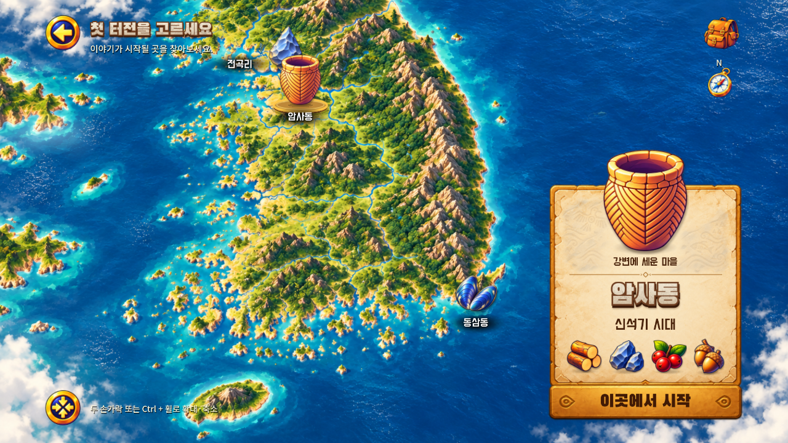

# A303 선택 모션과 살아 있는 지도 — v0.1.13

조사·검증일: 2026-11-01 KST. 개발 검증과 사용자 체감 승인은 구분한다. 이번 범위는 **첫 터전 선택 A303의 효과 고도화**이며, 게임 속 주민·동물 시스템의 완료를 뜻하지 않는다.

## 적용 범위

사용자가 선택한 효과 1~6, 8번과 새·물고기 장식을 적용했다. 기준은 [이전 선택 효과 보고서](../2026-11-01-a303-selection-effects/report.md)와 [승인한 Figma 선택 시안](https://www.figma.com/design/zkbflw9fCdAlWbphhw5pSS/RoxHistory-V1.0?node-id=387-8)이다.

| 항목 | 실제 구현 |
| --- | --- |
| 선택 시작 | 0.28초 동안 작은 솟음과 안착, 0.55초 파문. 최종 크기는 기본의 120%이며 누적되지 않음 |
| 선택 유지 | 금빛 받침 테두리의 느린 호흡과 작은 입자. 아이콘 바닥 좌표는 지도상의 위치에 고정 |
| 선택 전환 | 이전 아이콘의 크기·금빛 강조가 서서히 해제되고 새 선택으로 연결 |
| 상세 패널 | 0.22초 위로 나타나기·아래로 사라지기. 숨김 시작 즉시 마우스·터치·키보드 시작 입력 차단 |
| 지역 정보 | 0.2초 시각 교체. 이름·시대·먹거리·플레이 지원 상태는 즉시 최신 선택으로 갱신. 연속 선택의 이전 그림은 최대 한 겹 |
| 버튼 | 그림만 약 5.5% 눌리고 살짝 내려감. 실제 터치 영역 유지, 기존 UI 효과음과 음소거 사용 |
| 바다·구름 | 파란 바다 영역의 작은 반짝임과 가장자리의 아주 느린 얇은 구름 |
| 새·물고기 | 작은 새 무리의 날갯짓·이동, 물속 물고기의 꼬리·지느러미 움직임과 작은 흔적. 서로 다른 주기와 부드러운 출현·퇴장 |

장식은 지도 좌표를 따라 움직이며 지역 표식과 고정 UI 근처에서 약해지거나 사라진다. 장식 노드는 입력·게임 상태·음향을 소유하지 않는다. 앱 중단과 팝업에서는 장식을 정지하고, 선택·패널 전환은 안전한 상태로 정리한다.

**유지한 동작:** 세 지역의 같은 지도, 수동 드래그·핀치·Ctrl+휠, 선택 시 자동 카메라 이동 없음, 빈 지도 탭으로 상세 패널 숨김, 지역 재선택으로 표시, 복원 시 선택 유지. 전곡리·동삼동은 소개만 지원하고 암사동만 시작 가능하다. 기존 저장과 3D 주인공, 나무 1 + 돌 1, 각 1회 채집·1.2초, 건설 2초를 유지했다.

**이번에 넣지 않은 항목:** 7번 시작 버튼의 대기 반짝임, 9번 새 진입 시네마틱, 사냥·낚시·주민 AI·신규 지역 플레이. 새·물고기는 지도 장식이다.

## 실행 화면과 영상

전후 비교는 Android 에뮬레이터 1280×720, 같은 암사동 전체 지도 구도이다. 정지 이미지보다 선택 순간과 환경 움직임은 영상에서 확인해야 한다.

| 이전 v0.1.12 | 이번 v0.1.13 |
| --- | --- |
|  |  |

- [전곡리](evidence/screenshots/android-jeongok.png), [동삼동](evidence/screenshots/android-dongsam.png): 지역별 아이콘·패널·시작 지원 상태.
- [패널을 닫은 상태](evidence/screenshots/android-panel-hidden.png), [수동 확대](evidence/screenshots/android-manual-zoom.png).
- [커버 비율](evidence/screenshots/android-cover-final.png), [펼침 비율](evidence/screenshots/android-unfolded-final.png): 에뮬레이터의 해상도 변경으로 확인한 결과이며 실물 폴드 기기 촬영이 아니다.
- [버튼 누름](evidence/screenshots/android-button-pressed.png), [손을 뗀 상태](evidence/screenshots/android-button-released.png): 같은 위치의 버튼 그림 변형과 복귀.
- [지도 선택·제스처 영상, 23초](evidence/clips/map-selection-gestures.mp4): 약 2.7초 전곡리 → 4.4초 암사동 → 6.2초 동삼동, 이어서 빈 지도 탭·재표시·두 포인터 확대·드래그·복원. 음성 트랙 없음.
- [환경 움직임·버튼음 영상](evidence/clips/map-environment-sound.mp4): 처음 약 8초는 새·물고기·바다와 선택 유지 효과, 이후 지역 선택·패널·버튼 반응. Android 내부 재생음을 포함한다.
- [기존 플레이 회귀 영상, 39초](evidence/clips/demo-loop.mp4): 자동 이동·채집·건설·보상 구간. 원속도 압축이며 장면 합성이나 배속이 아니다.

## 검증 결과

기준 코드: `ccb6ed6a6e67c360d1736622b4f433d1dbe434fa` ([PR #25](https://github.com/byungho-cho/roxhistory/pull/25)). 게임 소스 트리: `a580457e8f979120221401d94db57ba9d2014d5a`.

### 로컬 자동 검사

Windows / Godot 4.5.1 / NVIDIA RTX 5060 / 기본 캡처 1280×720. 2026-11-01 19:20~19:21 KST 실행. 검사 총 **771건, 실패 0**: 상태 345, UI·합성 입력 93, 지도 82, A303 아트 157, 기존 선택 36, 이번 모션·환경 58. 에셋 107개와 음원 12개 무결성도 통과했다. [검사 기록](evidence/local-validation.json).

추가 검사는 빠른 연속 선택, 패널 닫힘 도중 재선택, 숨김 시작 버튼 입력 차단, 지도 좌표 유지, 선택 크기 누적 방지, 모달·앱 중단, 버튼 터치 영역·단일 효과음·음소거, 장식의 입력 비소유와 바다 배치를 다룬다. 기존 검사를 삭제하지 않았고, 닫힘 효과가 생긴 검사에는 즉시 입력 차단과 0.22초 후 실제 숨김을 각각 확인했다.

### Android 에뮬레이터

Android 15 / API 35 / x86_64 / emulator-5580, 같은 Windows 호스트. 일반 플레이는 1280×720. 커버·펼침은 896×370 및 816×616 물리 표시 비율을 모사했다. 2026-11-01 19:15 이후 최종 변경 APK에서 재검증했다.

- [지도 12개 시나리오](evidence/android-selection.json): 동일 서명 업데이트 후 일반·테스트 저장 보존, 세 지역 정보, 실제 Android 두 포인터 입력, 지도·UI 입력 소유권, 패널 표시, 복원, 연속 선택, Home 복귀.
- [화면 비율](evidence/android-ratios.json): 모든 표식과 고정 패널·버튼의 영역 확인.
- [전체 루프 11개 시나리오](evidence/android-loop.json): 새 게임 → 나무 한 번 → 돌 한 번 → 건설 → 보상 한 번 → 종료·이어하기, 팝업·뒤로가기·복귀. 자동 조작의 이동 시작부터 보상까지 **44.8초**. 실제 사용자의 평균 플레이 시간은 아니다.
- [추가 입력·음향 기록](evidence/android-extras.json): 실제 두 포인터 제스처 도중 Home 중단·복귀 후 새 선택과 입력 해제, 버튼 누름·해제, 소리 켜짐 상태의 영상 기록.

확인한 로그에 스크립트 오류·Android 크래시는 없었다. 일반 저장은 수정하지 않았으며 테스트 전용 저장만 사용했다. 에뮬레이터 복귀 후 표면이 입력을 받을 때까지 약 2초 기다리고 새 입력으로 준비 상태를 확인했다. 즉시 복귀 반응이나 실기기 성능을 보장하는 결과로 확대 해석하지 않는다.

### 원격 CI와 최종 전달

[Android CI #43](https://github.com/byungho-cho/roxhistory/actions/runs/41296657891): **성공**, 기준 `ccb6ed6a6e67c360d1736622b4f433d1dbe434fa`, 2026-11-01 19:15~19:33 KST. 17개 검사군 총 **1,316건, 실패 0**, 원격 Android export·서명 검사 통과. [원격 검사 요약](evidence/ci-validation.json). PR #25는 main `0384ef46ba49781cfe25abb9648364715610b3d7`로 병합됐다. 로컬 검사와 원격 CI는 별개이다. CI 임시 서명 APK는 일반 설치용으로 배포하지 않고, 최종 배포 APK는 기존 서명을 유지해 main에서 다시 빌드했다. 최종 업데이트 설치·기존 완성 상태 이어하기를 19:35 KST에 확인했다.

## 성능·시각·음향 판단

[동일 장면 환경 효과 OFF/ON/ON/OFF 측정](evidence/living-map-benchmark.json)은 Windows 네이티브 1280×720, 60fps 제한, 고정 시뮬레이션 FPS 옵션 없이 수행했다. 각 구간은 예열 60프레임 뒤 180프레임을 측정한다. OFF 두 구간의 평균 메인 처리 시간은 2.28ms, ON은 2.71ms로 약 0.43ms 증가했다. 양쪽 모두 프레임 간격 중앙값은 16.666ms였다(60fps 제한). 평균 드로 호출은 84 → 약 152로 증가했다. 측정 시 로컬 APK 빌드와 Android 게임 실행은 종료한 동일 조건이다. 이것은 새 환경 장식의 비용 비교이며 이전 버전 전체와의 비교나 Android 실기기 측정이 아니다.

실제 네이티브·Android 화면과 영상 프레임에서 아이콘 안착, 한 지도 유지, 패널 교체, 작은 새와 물고기, 읽을 수 있는 UI를 검토했다. 물고기는 지도 축척에 맞춘 작은 실루엣이므로 기본 배율에서는 은은하다. 물결 자체를 전면 변형하는 셰이더나 커다란 동물 연출을 추가하지 않았다.

버튼 소리는 기존 음원을 재사용했다. 단일 재생·음소거는 자동 검사하고 Android 내부 오디오를 녹화했다. [오디오 신호 검사](evidence/audio-recording-check.txt)의 최대 레벨은 -24.1dBFS로, 무음 트랙이 아님을 확인했다. **사람이 스피커·헤드폰으로 직접 청취한 품질 평가는 이번 검증에 포함하지 않는다.** 사용자는 녹화 영상이나 APK에서 직접 확인할 수 있다.

## 자산·편집 원본과 책임

| 대상 | 원본·관리 위치 | 출처·사용 범위 |
| --- | --- | --- |
| 기존 지도·유물·종이·버튼 | `game/assets/figma-latest/`, `game/scripts/figma_art.gd` | 기존 승인 Figma 에셋 그대로 재사용. 이번에 외부 이미지나 새 폰트 추가 없음 |
| 새·물고기·구름·반짝임 | `game/scripts/region_ambience.gd` | 이번 작업에서 직접 만든 절차적 2D 도형·애니메이션. 편집 원본은 이 코드이며 외부 생물 사진·모델 사용 없음 |
| 선택 받침·파문·입자 | `game/scripts/region_markers.gd` | 기존 받침 표현에 전환·움직임 보강 |
| 패널 전환·상태 | `game/scripts/region_panel.gd`, `region_selection.gd` | 표현 전환과 실제 선택·입력 상태를 분리 |
| 공통 버튼 반응 | `game/scripts/touch_button.gd` | A303 원본 그림에만 별도 눌림 구조 적용. 공통 터치의 눌린 상태 판정 보완 |
| 효과음 | `game/assets/audio/ui.wav`, `game/scripts/soundscape.gd` | 기존 음원과 음소거·중복 방지 구조 재사용 |

## 남은 항목과 검토 요청

- 실제 Android 기기의 성능·발열·배터리·손가락 조작과 폴드 전환은 미검증이다.
- 새·물고기의 크기·빈도, 금빛 선택 효과의 강도는 사용자 체감 검토 대상이다. 환경 장식은 약하게 시작했으며 화면 가독성을 우선했다.
- 주민·사슴·멧돼지와 사냥·낚시, 신규 지역 플레이는 이번 작업과 별개 후속이다.
- 별도 작업 폴더의 기존 미커밋 문서는 덮어쓰거나 초기화하지 않았다.

## APK

버전 **0.1.13-map-effects**, versionCode **14**, 서명된 debug APK, arm64-v8a + x86_64. 기존 인증서 SHA-256 `cf65aeecb4e399ba9e2e6b9fa947f34f8c31bd75c8e3b686ad29d8431bb1695f`와 일치한다. 최종 APK 기준 main: `0384ef46ba49781cfe25abb9648364715610b3d7`. 파일 크기: **129,583,235 bytes (약 129.58MB)**. SHA-256: `f5bcfcd52468c276b010ef6671c1038bd2e749fcb2381346b1330940dbd941f2`. [최종 빌드·설치 증거](evidence/final-build.json). 이후 공유 문서 반영은 이 게임 소스 트리를 변경하지 않는다.

공개 링크에서 실제 APK를 내려받아 크기와 SHA-256이 원본과 같은지 확인했다. [다운로드 검증](evidence/download-verification.json).

[APK 단일 파일 직접 다운로드](https://github.com/byungho-cho/roxhistory/releases/download/v0.1.13-map-effects/RoxHistory-0.1.13-map-effects-debug.apk)
