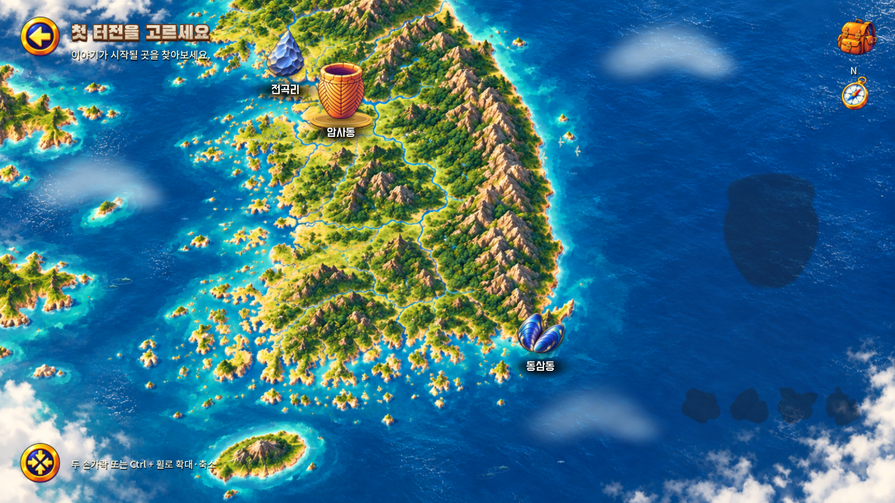
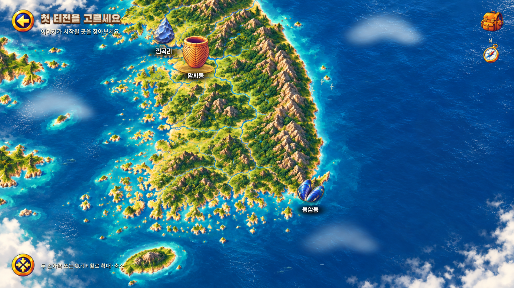

# A303 지역 상세 팝업 잔상 수정 — v0.1.15

2026-11-01 KST. [이전 새·구름 보완](../2026-11-01-a303-flight-clouds/report.md) 이후 사용자 피드백을 조사했다.

## 원인과 수정

팝업이 투명해져도 유물·자원 아이콘의 그림자 셰이더가 부모의 투명도를 반영하지 않아 검은 실루엣이 남았다. 그림자도 팝업 및 내용 전환의 투명도를 따르게 수정했다. 지역을 빠르게 바꿀 때 이전 내용 복사본의 투명도·위치를 강제로 초기화하던 부분도 제거해, 흐려지던 이미지가 갑자기 진하게 되돌아오는 현상을 막았다.

기존 약 0.22초 표시·닫기와 약 0.2초 내용 전환을 유지한다. 원본 아트·지도·선택 효과·게임 로직·음향은 변경하지 않았다. 수정 원본은 `game/scripts/art_shadow.gdshader`, `game/scripts/region_panel.gd`이다. 새 외부 자산은 없다.

## 전후 증거

아래는 같은 1280×720 네이티브 화면에서 팝업 투명도를 **1%로 고정한 진단 장면**이다. 실제 게임의 정지 시간이거나 전환 속도가 아니다. 지도 환경 움직임을 고정하고, 팝업을 완전히 숨긴 기준 화면과 RGB 채널 차이 0.035를 초과하는 픽셀을 비교했다. 기준 초과 영역이 **27,008개 → 0개**로 줄었다.

| 수정 전 | 수정 후 |
| --- | --- |
|  |  |

[Android 원속도 실행 영상, 18초](evidence/panel-transitions.mp4): 약 0~6초는 세 지역의 표시·닫기·재열기, 약 6~8초는 빠른 연속 선택과 닫기 도중 재열기, 이후는 최종 상태와 닫기이다. 음향 변경이 없어 이 클립은 무음 녹화다. [닫힘](evidence/android-panel-hidden.png), [정상 열린 상태](evidence/android-panel-open.png), [앱 복귀 후](evidence/android-panel-resumed.png)도 확인했다.

## 검증

수정 기준: `7a9b9713fbce259f9c28b896132265701be03e1a`. [PR #29](https://github.com/byungho-cho/roxhistory/pull/29).

- **로컬:** 20:20 KST, Windows / Godot4.5.1 / RTX5060 / Compatibility. [819검사 통과](evidence/native-tests.json): 상태345·UI93·지도82·아트157·선택36·환경88·신규 팝업18. 픽셀 비교, 연속 선택, 닫기 도중 재열기, 닫힌 버튼 입력 차단, 저장 불변을 확인했다. [수정 전 재현 결과](evidence/before-tests.json).
- **Android:** 20:22 KST, Android15/API35 x86_64 에뮬레이터 / 1280×720. [8항목 통과](evidence/android-panel-tests.json). 실제 Android 터치 이벤트를 주입해 세 지역과 빠른 선택·재열기·Home 복귀를 확인했다. 입력 완료 로그의 연속 선택 간격은 77/79/78ms, 닫기→재열기는 88/105ms였다. 이는 입력→화면 반응 지연 측정이 아니다. [입력 시각](evidence/tap-timing.txt), [입력 도구 원본](evidence/methods/TapSequence.java).
- **시각:** 네이티브 비교 이미지와 Android 녹화의 표시·닫기·연속 선택 프레임을 직접 검토했다. 별도로 남던 검은 유물·자원 실루엣이 없어지고, 팝업과 함께 흐려지는 것을 확인했다. 실제 화면 검토와 자동 검사는 구분한다.
- **원격 CI:** [#45 성공](https://github.com/byungho-cho/roxhistory/actions/runs/41301463261). 20:20 KST 시작, 20:37 KST에 마지막 기능 검사 완료 후 Android 빌드·서명 검증과 결과 업로드까지 성공했다. 전체 **1,364검사**이며 [원격 검사 요약](evidence/ci-validation.json)에 근거를 남겼다. PR #29는 main `89086934bded85d0fd12d350550d302b12a10f73`으로 병합됐다.

정상 저장과 임시 테스트 저장을 모두 보존했다. 이 수정에서는 Android 새 게임 채집·건설 전체 흐름이나 실기기·폴드 비율을 다시 검증하지 않았다. 기존 회귀 검사와 최종 업데이트 설치·이어하기로 연결을 확인한다. 사용자 체감 확인은 후속이다.

## 최종 APK

버전 **0.1.15-panel-fade**, versionCode **16**, 기존 인증서 SHA-256 `cf65aeecb4e399ba9e2e6b9fa947f34f8c31bd75c8e3b686ad29d8431bb1695f`를 유지했다. [서명 검증](evidence/signature.txt), [패키지 정보](evidence/package.txt).

APK 기준 main: `89086934bded85d0fd12d350550d302b12a10f73`. 게임 소스 트리: `a0ef8d7a9d14873eace088702a5af929b6119035`. 파일 크기 **129,583,235 bytes**, SHA-256 `59dcd0b0bacbe1f4384389dea08ddfcd881306e8a2f98d6a4816221228245c22`.

20:41 KST에 병합 main에서 빌드한 최종 파일을 업데이트 설치하고 기존 저장의 완성 건물·보상 상태 이어하기를 확인했다. [최종 빌드·설치 증거](evidence/final-build.json), [이어하기 화면](evidence/final-main-installed.png). 이후 보고서 추가는 게임 소스 트리를 변경하지 않는다.

공개 링크에서 APK를 실제 다운로드해 크기와 SHA-256이 빌드 원본과 일치함을 확인했다. [다운로드 검증](evidence/download-verification.json). 에뮬레이터에는 최종 APK의 [암사동 팝업 화면](evidence/final-main-panel.png)을 열어 두었다.

[서명된 APK 한 파일 직접 다운로드](https://github.com/byungho-cho/roxhistory/releases/download/v0.1.15-panel-fade/RoxHistory-0.1.15-panel-fade-debug.apk)
