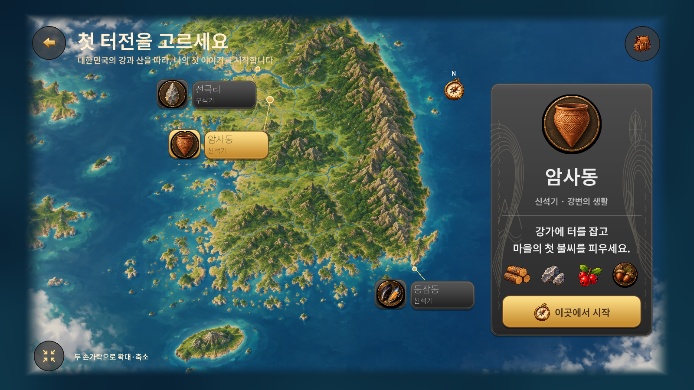
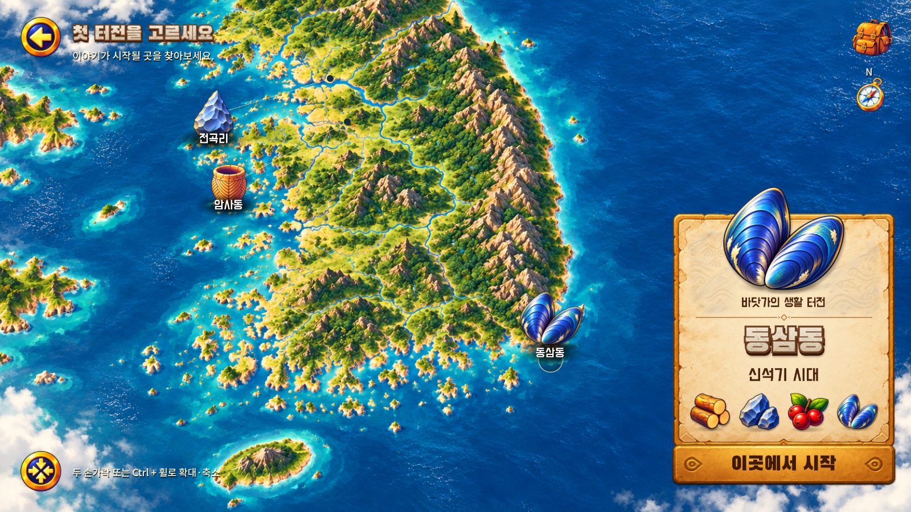
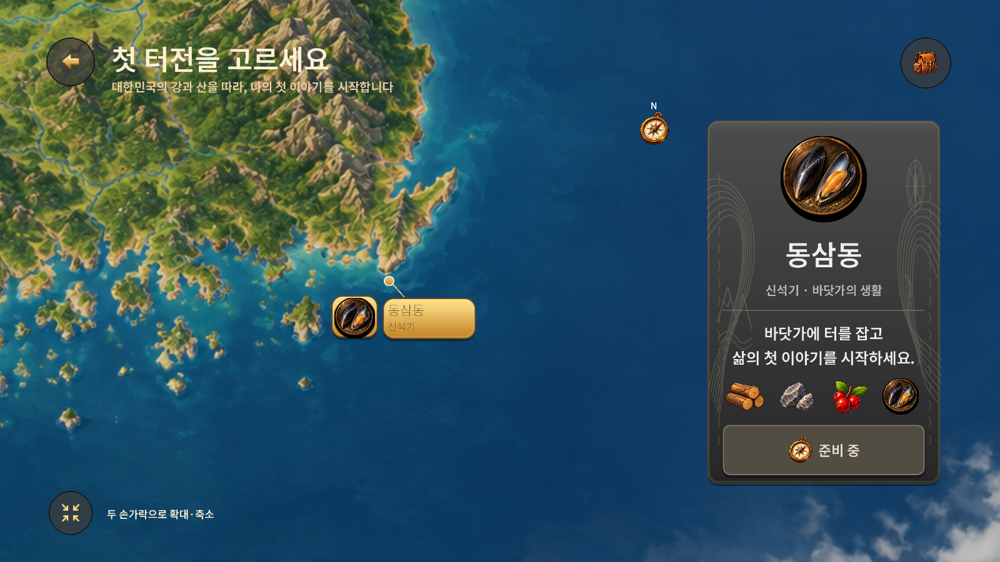
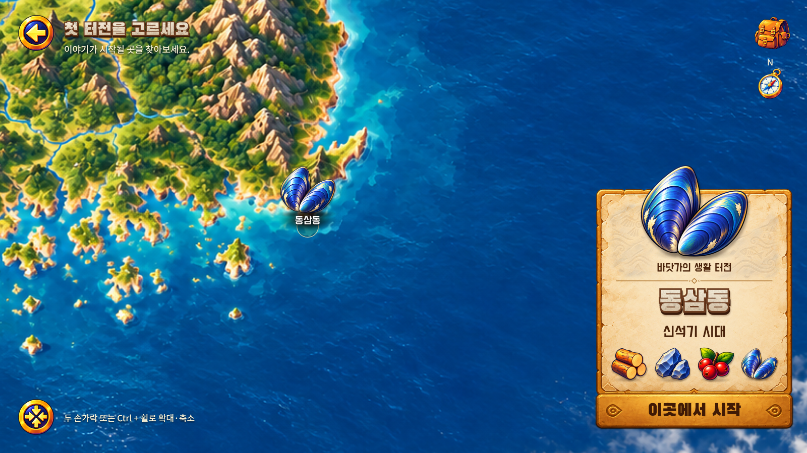

# A303 최신 Figma 원본 재현·공통 UI — v0.1.11

조사·구현일: 2026-11-01 KST. 기준 main `aa589012214c4b35690268944b229dccabb5d289`, 구현 커밋 `bbdbcd1511537e295ee50aac1db7ae8cecf4ee60`. [PR #21](https://github.com/byungho-cho/roxhistory/pull/21) main 병합 완료: `aa0ada5f1e21afef484aee443bf90577cbfc546c`. 문서·증거는 후속 문서 PR로 함께 공유한다.

## 실제 적용 범위

최신 [A303](https://www.figma.com/design/zkbflw9fCdAlWbphhw5pSS?node-id=219-1031)와 [동삼동 전체 지도](https://www.figma.com/design/zkbflw9fCdAlWbphhw5pSS?node-id=215-1136)를 측정했다. 지도·유물·자원·종이 패널·금색 버튼·석재 제목을 실제 Figma 원본으로 교체했다. 이전 아카이브를 새 에셋 대신 사용하지 않았다.

지도 카메라(`region_camera`), 지역 정의(`region_catalog`), 표식(`region_markers`), 상세 패널(`region_panel`), 원본/크롭/폰트(`figma_art`), 공통 패널/버튼(`figma_slice`)을 분리했다. 화면 상태와 기존 게임 진입은 `region_selection`과 `main`에서 연결한다.

선택 110%·미선택 90%는 고정 기본 크기에서 계산하며 바닥 기준점을 유지한다. 전곡리·암사동 이름은 유물 하단에 겹치고 앞으로 표시한다. 패널은 특징→큰 지역명→시대→4종 자원→시작 순서이며 새김 무늬는 26%다. 전곡리 고기·암사동 도토리·동삼동 홍합을 표시한다.

핀치 중심 확대, 한 손가락 지도 이동, Ctrl+휠, 0.6초 지역 이동, 0.5초 복원, 선택 유지, UI 터치 우선권을 연결했다. 전곡리 확대 시안은 별도 상세 원화여서 지도 좌표에 붙인 상세 레이어로 사용하고 확대/선택 전환에 맞춰 부드럽게 표시한다.

A300의 안내·시작·플레이·장 선택·퀘스트 팝업에도 같은 원본 아이콘, 종이 패널, 금색 버튼과 글꼴을 적용했다. 3D 주인공·정착지·음향과 저장 로직은 기존 결과를 재사용했다. 사냥·제작의 준비 중 안내와 장 선택 흐름을 유지했으며 신규 사냥/지역 플레이를 만들지 않았다. 실제 플레이는 암사동만 지원한다. 다른 지역은 소개·선택·확대가 가능하지만 시작 버튼은 비활성이고 이유를 표시한다.

## 같은 크기의 실제 실행 비교

Windows / RTX 5060 / Godot 4.5.1 / 1600×900 네이티브 실행. 비교는 이미지를 늘리거나 재배치하지 않고 같은 픽셀 좌표에서 수행했다. 전후 모두 같은 전체 지도와 동삼동 선택 구도다.

| 이전 실행 | 변경 후 실행 | Figma 기준 |
| --- | --- | --- |
|  |  |  |
|  |  |  |

[전곡리 전체](evidence/a303-jeongok-full.png) · [전곡리 확대](evidence/a303-jeongok-selected.png) · [암사동 전체](evidence/a303-amsa-full.png) · [암사동 중간](evidence/a303-amsa-mid.png) · [암사동 최대](evidence/a303-amsa-max.png)

[안내](evidence/a303-onboarding.png) · [시작](evidence/a303-title.png) · [장 선택](evidence/a303-chapter.png) · [플레이](evidence/a303-play.png) · [퀘스트](evidence/a303-quest.png)

픽셀 차이 수치는 품질 점수나 사용자 승인율이 아니다. 평균 절대 RGB 차이(0~255)는 동삼동 전체 1.951, 암사동 전체 2.002, 전곡리 확대 2.218, 암사동 최대 3.254, 동삼동 확대 3.633, 암사동 중간 6.124다. 렌더러의 보간·문자 래스터·그림자가 차이에 포함된다. 겹치기 및 4배 강조 차이 이미지는 evidence에 함께 저장했다.

## 검증

에셋 107개 크기/SHA-256 일치. 로컬 15개 검사군 총 1,213건 통과, 실패 0. 상세 실행 시각과 검사 결과는 [native-tests.json](evidence/native-tests.json)에 기록했다. 기존 검사를 삭제하거나 완화하지 않았으며 지역 화면 검사 좌표/텍스처 기대값만 최신 디자인에 맞췄다. 마지막 지도 상세 레이어 수정 후 지역 73건과 A303 157건을 재실행해 통과했다.

Android: API 35 / Android 15 / x86_64 / 읽기 전용 임시 RoxHistoryP3 AVD / RTX 5060 호스트. 실제 ADB 탭·드래그와 두 포인터 MotionEvent를 사용한다. 원본 AVD와 일반 저장을 보존하고 `--test-ui`의 별도 저장에서 검사한다. [Android 플레이 결과](evidence/android-loop.json): 새 게임·나무/돌 각 1회·중복 탭·건설 비용 1+1·보상 1회·강제 종료 후 정확한 이어하기·팝업/뒤로·복귀 후 이동·일반 저장 보존 통과. 핵심 자동 조작 흐름 26.51초(첫 이동~보상, 안내·재시작 제외); 사람의 수동 플레이 시간은 아니다. 실기기는 미검증이다.

원격 CI: [Android #40](https://github.com/byungho-cho/roxhistory/actions/runs/41280785834). 기준 커밋은 위 구현 커밋이며 2026-11-01 실행 성공을 확인했다. CI의 임시 디버그 키로 생성된 아티팩트와 사용자 전달용 기존 서명 APK를 구분한다.

## 남은 차이와 판단

- 지도·유물·패널·제목 원본 및 주요 배치는 재현했다. 텍스트 획과 부드러운 그림자는 Godot와 Figma 렌더링 차이가 남는다.
- 암사동 중간 확대에서는 상호작용 가능한 동삼동 표식을 유지한다. Figma의 해당 정적 프레임에는 이 표식이 없어 차이 이미지에 크게 나타난다.
- Android의 실제 안전 영역에서는 고정 UI가 안쪽으로 이동한다. 1600×900 무안전영역 기준 이미지와 같은 위치를 강제해 잘림을 만들지 않는다.
- A300에는 공통 UI 규칙을 적용했으나 실시간 3D 플레이 장면을 원화 한 장과 픽셀 단위로 동일하다고 주장하지 않는다. 현재 주인공과 플레이 배경은 이전 빌드의 결과다.
- 전곡리 상세 원화와 전체 지도 사이의 확대 전환은 부드러운 혼합이다. 원화들이 동일 해상도의 단일 타일 지도는 아니므로 중간 배율에서 지형 세부가 달라지는 표현은 남는다.
- 최종 사용자 시각 승인, 실제 폴드 기기의 터치·컷아웃·성능, 직접 청취는 미검증이다. 이번 작업에서 음원을 변경하지 않았다.

## 원본·전달

[에셋 목록·Figma 원본·사용 조건](assets.md). 원본은 저장소 안에 보존한다. PDF는 새로 만들지 않았다. 병합 커밋과 최종 APK 해시는 릴리스 본문에 기록하며, 기존 서명 인증서를 유지한다.

## Android 실제 플레이 증거

[첫 진입](evidence/android-fresh.png) · [나무 1](evidence/android-wood.png) · [돌 1](evidence/android-stone.png) · [건설 확인](evidence/android-build-confirm.png) · [보상](evidence/android-reward.png) · [이어하기](evidence/android-continued.png). 기존 서명 인증서 SHA-256 `cf65aeecb4e399ba9e2e6b9fa947f34f8c31bd75c8e3b686ad29d8431bb1695f`와 일치하며 `install -r` 업그레이드가 성공했다.

## 지도 입력·비율·영상

[Android 지도 검사 결과](evidence/android-region-tests.json): 14개 시나리오 통과, 실패 0. 세 지역 정보와 지원 상태, 실제 두 포인터 핀치, 드래그와 탭 구분, 패널에서 시작한 터치 차단, 최소/최대 및 경계 제한, 빠른 재선택, 복원 시 선택 유지, 앱 복귀 후 새 핀치, 커버·펼침 비율을 확인했다. 커버 896×370, 펼침 816×616은 에뮬레이터 표시 크기 변경이며 실제 폴드 기기 검증이 아니다.

[커버 화면](evidence/android-region-cover.png) · [펼침 화면](evidence/android-region-unfolded.png) · [Android 전곡리](evidence/android-region-jeongok.png) · [암사동](evidence/android-region-amsa.png) · [동삼동](evidence/android-region-dongsam.png)

- [지역 선택 원속도 영상, 약 24초](evidence/region-selection.mp4): 약 2초 전곡리, 6초 암사동, 10초 동삼동, 13초 핀치·드래그, 20초 선택 유지 복원. [기록 시점](evidence/region-clip-events.json). UI 동작을 보기 위한 무음 녹화다.
- [실제 채집→건설→보상 원속도 영상, 26초](evidence/android-play-loop.mp4): 나무·돌 각 1회, 재료 차감, 움집 완공, 보상·저장 상태. 음성 트랙은 앱 출력 녹음이며 별도의 직접 청취 품질 승인을 뜻하지 않는다. 이어하기는 위 화면과 저장 상태 비교로 확인했다.

처음에는 포트 5556의 중복 읽기 전용 세션과 제어 도구 오류(ADB 종료, 화면 크기 변경 후 응답 지연)가 있었다. 같은 포트의 기존 세션을 유지하고 최종 검증을 별도 5580 세션으로 분리했다. 분리 후 위 검사가 모두 통과했다. 앱 복귀 직후 화면 안정화 전 입력에서는 뒤로 버튼으로 전달된 사례가 있어 최종 검사는 복귀 후 2초 안정화 조건이다. 손가락을 누른 채 Home 전환하는 경우와 즉시 복귀 입력은 실기기 후속 항목이다.

16:9 외 비율에서는 빈 배경 노출을 막기 위해 지도 가장자리가 일부 크롭되며 세 지역과 고정 UI는 유지된다. 사용자 시각 승인이나 전체 게임 완성을 자동 검사 통과로 대체하지 않는다.

최종 배포: [v0.1.11-a303 릴리스](https://github.com/byungho-cho/roxhistory/releases/tag/v0.1.11-a303). APK는 코드 및 보고서가 반영된 최종 main에서 빌드하며 정확한 main SHA·파일 크기·SHA-256은 릴리스 본문에 기록한다.
