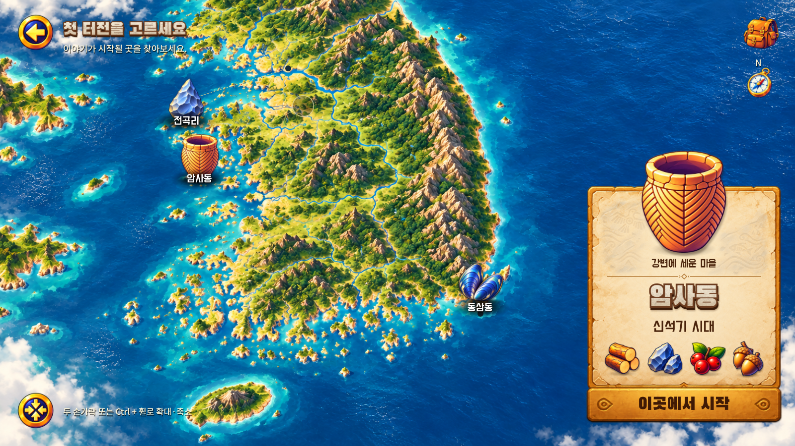
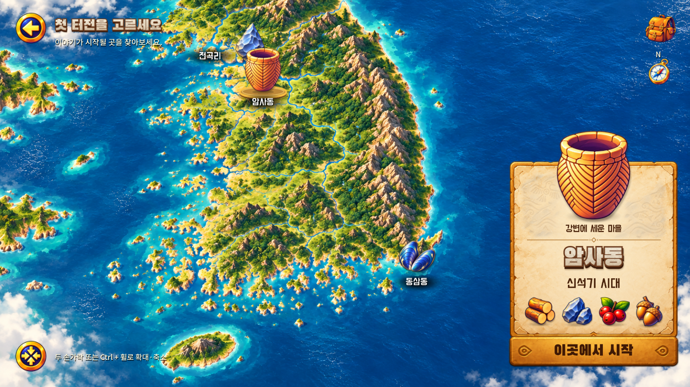

# A303 고정 지도와 지역 선택 효과 — v0.1.12-selection

2026-11-01 KST. 구현 소스 커밋: `4d23753c91ba1b55f687e4dee09810b54556e039`.
게임 소스 트리: `e3396b94ee2bf5e275c7797276682dcb94cc3b40`.

## 승인 기준과 반영 내용

[사용자 승인 선택 효과 참고](https://www.figma.com/design/zkbflw9fCdAlWbphhw5pSS/RoxHistory-V1.0?node-id=387-8)를 기준으로 기존 게임에 적용했다. 이 이미지는 효과의 참고 자료이며 지도 전체를 평면 UI 이미지로 교체하지 않았다. 이전 A303의 자동 확대·지역별 배경 전환 규칙은 이번 사용자 지시로 대체한다.

- 전곡리·암사동·동삼동의 기본 아이콘은 같은 최대 길이 86 디자인 단위로 통일하고 원본 비율을 보존한다. 이전 연결선과 확대 배율에 따라 달라지던 아이콘 위치를 제거했다. 아이콘의 바닥은 기존 지도 좌표에 고정된다.
- 선택 아이콘만 기본의 120%로 약 0.28초 동안 확대된다. 반복 선택해도 누적되지 않으며 이전 선택은 기본 크기로 돌아간다.
- 선택 아이콘 아래에 낮은 타원형 금빛 받침, 청동색 두께, 접촉 그림자를 넣었다. 선택 순간 약 0.55초의 파문이 한 번 퍼지고, 선택 유지 중에는 약 2.8초 주기의 은은한 테두리 빛만 유지한다. 미선택 아이콘에는 받침·금빛 이펙트가 없다.
- 세 지역 모두 같은 지도 원본을 사용한다. 선택 시 자동 이동·확대와 전곡리 별도 배경 합성을 제거했다. 암사동으로 바꿔도 지도 원본·배율·위치가 바뀌지 않는다.
- 수동 드래그·핀치·Ctrl+휠 확대와 전체 지도 복원은 유지한다. 복원은 선택 및 패널 표시 여부를 유지한다.
- 빈 지도 탭은 오른쪽 상세 패널 전체와 시작 버튼을 숨긴다. 선택 자체와 아이콘 강조는 유지한다. 지역 아이콘 또는 이름을 누르면 해당 상세 패널이 다시 나타난다. 드래그·핀치 해제는 패널 숨김으로 처리하지 않는다.
- 가까운 북쪽 두 지역의 글자가 겹치지 않도록 전곡리 이름은 아이콘 왼쪽에 둔다. 유물의 지도 좌표는 이동하지 않았다.
- 커버 화면의 최소 배율에서 북쪽 아이콘이 잘리지 않도록 초기/복원 구도를 조정했다. 지역 선택 때 카메라는 움직이지 않는다.
- 실제 플레이는 기존대로 암사동에서만 시작한다. 전곡리·동삼동은 소개와 먹거리 표시만 제공하며 시작 불가 이유를 유지한다.

## 실제 실행 화면

같은 1600×900, 최소 배율, 암사동 선택 기준이다. 아이콘 위치·크기는 이번 수정 대상이므로 서로 다르다.

| 변경 전 | 변경 후 |
| --- | --- |
|  |  |

- [전곡리 선택](evidence/after-jeongok.png), [동삼동 선택](evidence/after-dongsam.png)
- Android: [전곡리](evidence/android-jeongok.png), [암사동](evidence/android-amsa.png), [동삼동](evidence/android-dongsam.png)
- [빈 지도 탭으로 패널 숨김](evidence/android-panel-hidden.png), [수동 확대·이동](evidence/android-manual-zoom.png)
- [Android 원속도 실행 영상](evidence/selection-effects.mp4): 약 2–7초 세 지역 선택, 이후 패널 숨김/재표시·핀치·지도 이동·복원·연속 선택. 24초, 무음 녹화이며 음향 변경 작업은 아니다.

## 검증

Godot 4.5.1, Windows, 실제 렌더링을 사용하는 자동/합성 입력 검사. 2026-11-01 17:59–18:00 KST, 위 소스 기준.

| 로컬 검사 | 결과 |
| --- | --- |
| 기존 게임 상태 | 345 통과 |
| 화면·합성 입력 | 93 통과 |
| 지역 선택·비율·안전 영역 | 82 통과 |
| A303 아트·원본·스케일 | 157 통과 |
| 신규 고정 선택·패널·제스처 회귀 | 35 통과 |
| 합계 | 712 통과, 실패 0 |
| 원본 에셋 무결성 | 107개 통과 |
| 음원/출처 검사 | 12개 통과, 음원 변경 없음 |

[지역 검사](evidence/region-tests.json), [아트 검사](evidence/a303-art-tests.json), [신규 회귀](evidence/selection-effect-tests.json). 기존 90/110 스케일 및 자동 2배 확대 기대값은 승인된 100/120·수동 카메라 규칙으로 수정했으며 검사를 삭제하지 않았다.

Android 15/API 35 x86_64 에뮬레이터, 1280×720, RTX 5060 호스트. 최종 지도 검사는 18:05 KST 실행했다. 실제 Android 탭·드래그와 두 포인터 MotionEvent 입력으로 [12개 시나리오](evidence/android-selection.json)를 확인했다. 세 지역 선택, 패널 숨김·복원, 핀치, 드래그, UI 터치 소유권, 전체 지도 복원, 연속 선택, Home 복귀 후 핀치, 업데이트 전후 일반/테스트 저장 보존을 포함한다. 지도/패널 스크린샷과 영상을 직접 시각 검토했다.

플레이 로직이 동일한 첫 구현 커밋 `fa771566`에서 추가로 17:47 KST [Android 전체 흐름 11개 항목](evidence/android-loop.json)을 확인했다. 나무·돌 각 한 번 → 건설 → 보상 1회 → 강제 종료/이어하기 → 팝업/뒤로가기 → Home 복귀 후 이동을 통과했다. 자동 터치 입력 기준 채집 시작부터 완료까지 42.38초이며 사람의 플레이 시간 측정값이 아니다. [완료 화면](evidence/android-completed.png), [이어하기 화면](evidence/android-continued.png). 최초 전체 흐름 시도는 예전 조이스틱 좌표를 사용한 검사 도구 때문에 서쪽 이동이 실패했으며, 화면에서 현재 중심을 확인하고 중심에서 바깥으로 드래그하도록 도구를 수정한 뒤 통과했다. 게임 이동 코드는 변경하지 않았다.

원격 CI는 별도 PR의 Checks에서 기준 SHA와 최종 결과를 확인한다. 위 로컬 결과를 원격 CI 성공으로 대체하지 않는다.

## 자산·구현과 남은 확인

- 기존 Figma 지도 `94b86.png`, 주먹도끼·토기·홍합 원본, 종이 패널, 제목, 버튼을 재사용했다. 신규 외부 자산은 없다.
- 선택 받침과 이펙트는 `game/scripts/region_markers.gd`의 편집 가능한 Godot 도형으로 구현했다. 카메라·선택/패널 상태는 각각 기존 `region_camera.gd`, `region_selection.gd`에서 관리한다.
- 게임 진행·3D 주인공·음향·재료 조건은 변경하지 않았다. 나무 1·돌 1, 채집 1.2초·건설 2초 유지.
- 실제 폴드 기기 터치·가독성은 미검증이다. 로컬 비율/안전 여백 검사 외에 Android 에뮬레이터에서 화면 전환을 확인했다. [커버](evidence/android-cover-final.png), [펼침](evidence/android-unfolded-final.png), [전환 상태 기록](evidence/android-ratios.json). 최초 전환 검사에서 북쪽 아이콘 잘림을 발견해 전체 지도 상태만 새 비율에 재구성하도록 수정했다. 사용자가 수동으로 움직인 카메라 상태는 기존 중심을 보존한다.
- 손가락을 누른 채 Home으로 나가는 경우는 이번 Android 재검증 범위에 포함하지 않았다. 일반 Home 복귀 후 새 핀치와 로컬 입력 취소 회귀는 통과했다. 재검증 중 에뮬레이터 복귀 직후 첫 탭이 유실된 시도가 있어 화면이 새 입력을 받는지 먼저 확인하도록 검사 도구를 보완했다. 최종 실행은 2초 화면 복원 대기 뒤 0.72초 내 새 입력이 확인됐으며 이후 핀치를 통과했다. 즉시 복귀 입력의 실기기 응답성을 보장하는 결과는 아니다.
- 금빛 받침은 승인 이미지의 방향을 실제 도형으로 구현한 결과이며 사용자 체감 승인은 후속이다. 주인공 외형 개선이나 주민·동물 단계 완료를 의미하지 않는다.
- 다른 작업 폴더의 기존 미반영 문서는 수정하지 않았다.

## APK

`0.1.12-selection`, versionCode 13, `com.roxhistory.demo`, arm64-v8a/x86_64 서명 디버그 APK.
기존 서명 SHA-256 `cf65aeecb4e399ba9e2e6b9fa947f34f8c31bd75c8e3b686ad29d8431bb1695f`와 동일하며 Android 업데이트 설치로 저장 보존을 확인했다. 최종 main의 게임 소스 트리가 위 트리와 같은지 확인한 후 배포한다. 다운로드는 ZIP이 아닌 APK 단일 파일로 제공한다.
