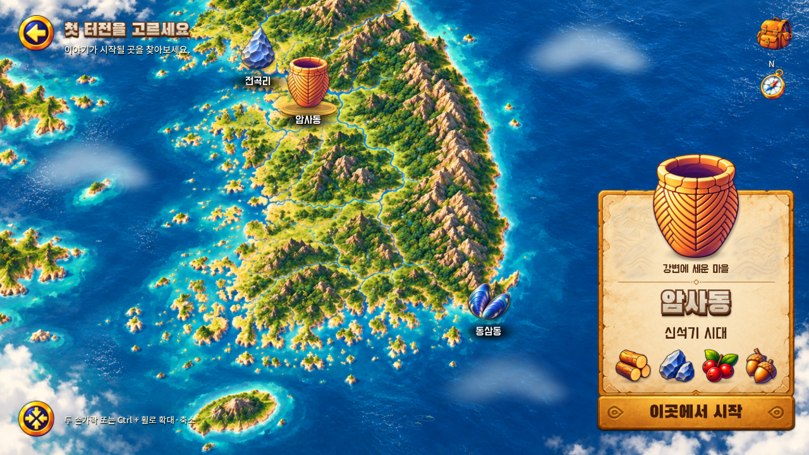

# A303 음악·선택음·잔잔한 지도 연출 — v0.1.16

2026-11-02 KST. 사용자가 채택한 **‘별빛의 환상’**을 A303에 연결했습니다. 지역을 바꿔도 음악이 이어지고, 부드러운 선택음과 잔잔한 새·물소리가 함께 들리도록 정리했습니다.

## 반영한 동작

- 112 BPM·24마디 채택곡을 원본 WAV 그대로 반복 재생. 지역 선택·수동 확대·화면 재배치에서 음악이 처음으로 돌아가지 않습니다. 앱 전환·음소거는 위치를 보존하고 A303 이탈 시 부드럽게 종료합니다.
- 일반 터치와 지역 선택을 별도 짧은 소리로 교정. 75ms 공통 제한과 기존 6개 슬롯으로 연타의 겹침을 제한합니다. 원본과 수정 버전을 [오디오 폴더](../../../assets/audio/README.md)에 보관했습니다.
- 물소리는 기존 실제 녹음을 낮게 사용하고, A303에서 바람을 함께 쌓지 않습니다. 새소리는 드물고 낮은 합성 호출입니다. 음악 -10dB, 물 -25dB, 새 -20dB 재생 게인이며 실제 출력 청취 승인 음량은 아닙니다.
- 현재 main의 선택 120%·기본 86 디자인 단위와 고정 지도 구도를 유지하며 짧은 반짝임을 추가했습니다. 새 비행 간격과 물고기 등장 밀도를 낮추고 작은 수면 파문을 더했습니다. 새·물고기는 지도 장식이며 게임 배우 시스템이 아닙니다.
- 패널 잔상 수정, 지역별 시작 가능 상태, 수동 조작, 진행·저장 규칙을 유지했습니다.

## 실제 실행 자료

- [최종 소스의 PC 실행 영상 — 게임 믹스 포함](evidence/a303-preview.mp4)
- [게임 믹서 녹음 WAV](evidence/a303-game-mix.wav): 13.44초, 48kHz 스테레오. 재생 음량을 임의 정규화하지 않았습니다. 실물 스피커 청취를 대신하는 자료는 아닙니다.
- Android: [암사동](evidence/android-amsa.png), [동삼동](evidence/android-dongsam.png), [소리 끄기](evidence/android-muted.png), [곡 전체 반복 이후](evidence/android-after-natural-loop.png).

## 검증

Godot 4.5.1, Windows 실제 렌더링과 엔진 검사입니다. 음향 재생 상태 검증과 사용자 청취 승인은 구분합니다.

| 검사 | 결과 |
| --- | --- |
| state-tests | 345 통과 |
| region-tests | 82 통과 |
| a303-art-tests | 157 통과 |
| selection-effect-tests | 36 통과 |
| living-map-tests | 88 통과 |
| panel-transition-tests | 18 통과 |
| presentation-tests | 56 통과 |
| a303-audio-tests | 26 통과 |
| PC 합계 | **808 통과, 실패 0** |
| 기존 아트 무결성 | 107개 통과 |
| 런타임 음원·출처·반복 경계 | 15개 통과 |
| Android 실제 입력·음악·설정·앱 전환 | **13개 항목 통과** |

Android는 **Android 15 API35 x86_64 전용 에뮬레이터, NVIDIA host GPU, 1280×720**입니다. 지역별 지명 탭, 음악 위치 유지, 소리 끄기·켜기, Home 복귀, 업데이트와 기존 저장 파일 바이트 보존을 확인했습니다. [Android 결과](evidence/android-checks.json), [빌드·검증 요약](evidence/build-validation.json), [음원 검증](evidence/audio-assets.json).

### 반복 경계 종료 수정

개발 중 Android의 AudioTrack에서 약 51.43초 경계에 SIGSEGV가 발생하는 것을 발견했습니다. [Godot 4.5 WAV 믹서](https://github.com/godotengine/godot/blob/4.5-stable/scene/resources/audio_stream_wav.cpp)의 경계 처리와 [동일 경계 문제 보고](https://github.com/godotengine/godot/issues/119778)를 확인했습니다. 이는 Android에서 드러난 접근 문제이며 Android 전용 결함이라고 단정하지 않습니다.

PCM 재생 리소스 메모리 끝에 시작 프레임을 한 번 더 배치해 경계 읽기를 보호했습니다. 원본 파일과 2,268,000프레임 반복 구간은 유지합니다. 메모리 경계 회귀 검사를 추가했으며, Android에서 **55.733초** 연속 재생해 자연 반복을 넘겨 확인했습니다. 같은 프로세스가 유지됐고 새 네이티브 종료가 없었습니다. 음악 위치와 실제 경과의 차이는 약 0.018초입니다.

초기 에뮬레이터의 SwiftShader 드라이버는 Godot 셰이더 uniform 한계 때문에 화면을 그리지 못해 NVIDIA host GPU로 바꿔 확인했습니다. 실제 폴드 기기·물리 출력의 음색과 음량 균형은 미검증입니다. 이번 실행은 사용자 최종 청취 승인이나 실기기 품질 승인으로 표시하지 않습니다.

## 설치 파일

`RoxHistory-0.1.16-a303-audio-debug.apk`, versionCode 17, `com.roxhistory.demo`, arm64-v8a/x86_64. 기존 디버그 서명 `cf65aeec…b1695f`를 유지했습니다. APK 크기·SHA-256·서명은 [검증 요약](evidence/build-validation.json)에 있습니다. APK는 작업 결과물로 제공하며 이 문서만으로 main 병합이나 공개 릴리스 완료를 뜻하지 않습니다.

## 이후 역할

이번 개선은 사용자가 현재 대화의 구현·검증을 계속하도록 허용한 예외입니다. **다음 작업부터 이 대화는 팀장 역할로 정리·Figma·문서를 담당하고, 사용자가 요청하면 개발 담당 지시문을 남깁니다.** 구현·검증은 개발 담당이 수행합니다. [역할 분담](../../team-workflow.md).
