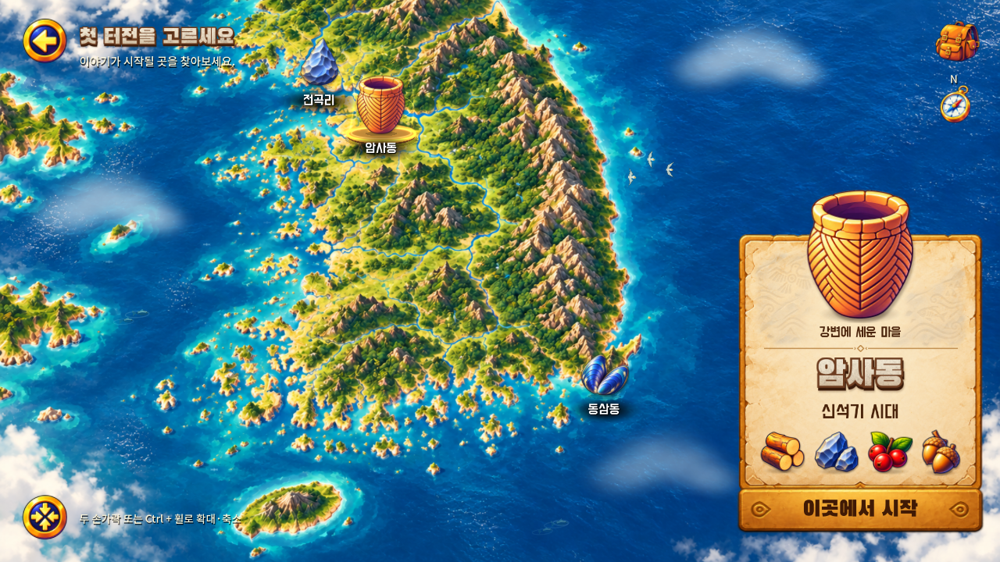
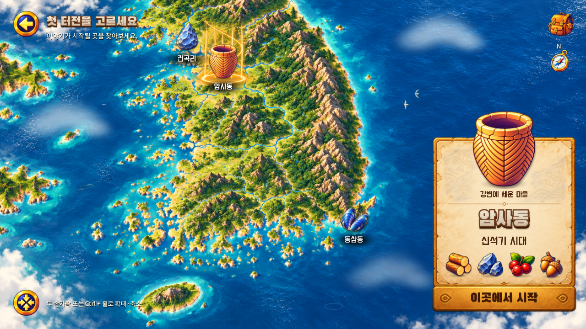

# 채택 B안 원화에 맞춘 금빛 오로라 재교정

2026-11-02 KST / v0.1.18-aurora-reference / versionCode 19.

사용자는 v0.1.17의 효과가 원화보다 너무 희미하고 다른 인상이라고 지적했다. 기존 자동 검사가 통과해도 원화의 시각적 특징이 재현됐다는 뜻은 아니었다. 이번 변경은 새 시안을 만드는 작업이 아니라 **사용자가 이미 채택한 B안**에 실제 효과를 다시 맞추는 작업이다.

## 비교 기준과 수정

- [채택 원화](../2026-11-02-a303-aurora-icon/evidence/approved-b-preview.png): 아이콘보다 높은 금빛 기둥, 넓은 빛 번짐과 밝은 중심, 아이콘을 감싸는 곡선, 뜨거운 흰빛 중심의 바닥 링, 상승하는 작은 입자.
- 사용자 제공 이전 APK: [기본 화면](evidence/user-before.jpg), [확대 화면](evidence/user-before-zoom.jpg). 기기·촬영 조건은 별도로 전달되지 않았으며 이 JPG를 새로운 실행 검증으로 취급하지 않는다.
- 효과 영역을 136×140에서 180×220 디자인 단위로 높였다. 실제 지도 접점은 유지한다. 아이콘 자체는 선택 110%·미선택 90% 그대로다.
- 밝은 녹색 지형 위에서 희미해지는 가산 합성을 금색 알파 합성으로 바꿨다. 넓은 호박색 번짐·밝은 크림색 중심선을 따로 계산하여 단순한 얇은 선이 되지 않게 했다.
- 곡선 광선의 중심과 번짐, 밝은 바닥 링과 주변 광륜, 서로 다른 속도로 올라가는 입자를 추가·강화했다. 선택 순간만 강해지고 유지 상태에서 사라지는 방식이 아니다.
- 지도·배경·유물·패널·음악 파일은 교체하지 않았다. 수동 확대/이동, 선택음 제한, 팝업 전환, 저장 로직은 유지한다. 셰이더의 상단 화면 경계는 부드럽게 감쇠한다.

Figma와 채택 원화 자체를 새 구현에 맞춰 낮춰 바꾸지 않았다. 구현 파일은 `game/shaders/region_aurora.gdshader`, 배치 상수는 `game/scripts/region_markers.gd`다. 신규 외부 이미지나 음원 없이 자체 셰이더를 수정했다.

## 실제 실행 비교

같은 기본 카메라·1280×720의 Windows Godot 실행 캡처다. 지도 위치와 UI 배치를 바꾸지 않았으며 구름·새와 오로라의 시간 위상은 다를 수 있다.

| 이전 v0.1.17 | 수정 후 선택 유지 상태 |
| --- | --- |
|  |  |

- [Android 암사동](evidence/android-amsa.png) · [전곡리](evidence/android-jeongok.png) · [동삼동](evidence/android-dongsam.png).
- [실제 핀치 확대 후](evidence/android-zoom.png) · [1280×810 비율](evidence/android-1280x810.png) · [빠른 전환 완료](evidence/android-rapid-final.png).
- [25초 원속도 Android 영상](evidence/android-aurora.mp4): 초반 세 지역 유지 상태, 중간 핀치 확대·복원, 후반 빠른 선택 및 팝업 닫기/다시 열기. 실제 앱 내부 소리가 포함된다.
- 데스크톱: [전곡리 유지](evidence/aurora-jeongok-held.png) · [동삼동 유지](evidence/aurora-dongsam-held.png) · [확대](evidence/aurora-zoom.png).

## 검증

구현 SHA: `15945eec70a7d9cb156591e57f66be5c79bfa3de` / [PR #34](https://github.com/byungho-cho/roxhistory/pull/34).

Windows / Godot 4.5.1 실제 렌더링, 2026-11-02 12:02~12:03 KST:

| 검사 | 결과 |
| --- | ---: |
| 오로라 선택·가림·좌표·앱 복귀 | 23 통과 |
| 선택 효과·고정 지도·크기 | 36 통과 |
| 팝업 전환·잔상 | 18 통과 |
| 지역 조작 | 82 통과 |
| 지도 환경 | 88 통과 |
| A303 아트 | 157 통과 |
| 합계 | **404 통과** |

각 JSON 결과는 이 폴더의 evidence에 보존했다. 원격 [CI #49](https://github.com/byungho-cho/roxhistory/actions/runs/41381527868)는 같은 구현 SHA의 전체 회귀와 Android 빌드를 수행한다.

Android는 API35/Android15 x86_64 `emulator-5554`, host GPU, 1280×720 및 1280×810 조건이다. [7개 검증 항목](evidence/android-checks.json)이 통과했다. 기존 서명 업데이트 전후 유효 테스트 저장·일반 저장 파일이 동일하고, 세 지역·실제 두 손가락 핀치·복원·빠른 전환·팝업·Home 복귀를 확인했다. 화면 비율 확인 후 에뮬레이터의 원래 크기로 복원했다.

## 남은 범위

- 실물 Android/폴드 기기에서는 아직 확인하지 않았다. 사용자 사진과 같은 1280×810 비율의 에뮬레이터 검증은 실물 기기 검증을 대신하지 않는다.
- 선택 아이콘이 화면 위쪽에 가까우면 높은 기둥의 윗부분은 화면 경계에서 부드럽게 잘린다. 아이콘·접점·지명은 유지하며 이를 피하려고 자동 카메라 이동을 추가하지 않았다.
- 원화는 정지 이미지, 구현은 시간에 따라 흐르는 셰이더이므로 모든 순간의 픽셀 일치를 주장하지 않는다. 높이·밝기·곡선·링을 원화 기준으로 교정했고 최종 체감은 APK와 실행 영상으로 검토한다.
- 이번에는 선택 효과와 업데이트 보존을 검증했다. 새 게임 전체 채집·건설·보상 완주 및 스피커 직접 청취는 추가 수행하지 않았다.

## 최종 main·배포

- 게임 변경 [PR #34](https://github.com/byungho-cho/roxhistory/pull/34) main 병합: `b89db1e4fbb60fa0522d535a5f6982d09b68b999`.
- 전체 원격 CI #49 성공, 1423개 검사 통과. 구현 SHA `15945eec70a7d9cb156591e57f66be5c79bfa3de`, 완료 UTC `2026-11-02T03:29:25Z`. [검사 기록](evidence/ci-checks.json).
- 병합 후 main에서 다시 빌드하고 에뮬레이터에 서명 업데이트 설치했다. 설치 APK의 해시가 전달 파일과 같고, 유효 테스트 저장을 유지한 이어하기 및 일반 저장 파일 보존을 확인했다. [설치 증거](evidence/final-main-installed.png) · [빌드/설치 기록](evidence/final-build.json).
- APK 버전 `0.1.18-aurora-reference` / 코드 19 / 크기 144,722,958 bytes.
- SHA-256: `515727877da915ebbb1442ed0556e2678e75f9ab66587de2cd36f9185f8a352c`.
- 서명 인증서 SHA-256: `cf65aeecb4e399ba9e2e6b9fa947f34f8c31bd75c8e3b686ad29d8431bb1695f` (기존과 동일, v2/v3 검증).
- 패키지 `com.roxhistory.demo`, arm64-v8a + x86_64. [서명](evidence/signature.txt) · [패키지](evidence/package.txt).
- [서명된 APK 단일 파일 직접 다운로드](https://github.com/byungho-cho/roxhistory/releases/download/v0.1.18-aurora-reference/RoxHistory-0.1.18-aurora-reference-debug.apk). 소스·로그 ZIP이 아니다. 공개 링크에서 다시 내려받아 SHA-256을 확인했다.

문서만 반영하는 후속 커밋은 APK의 게임 소스 트리를 변경하지 않는다.
