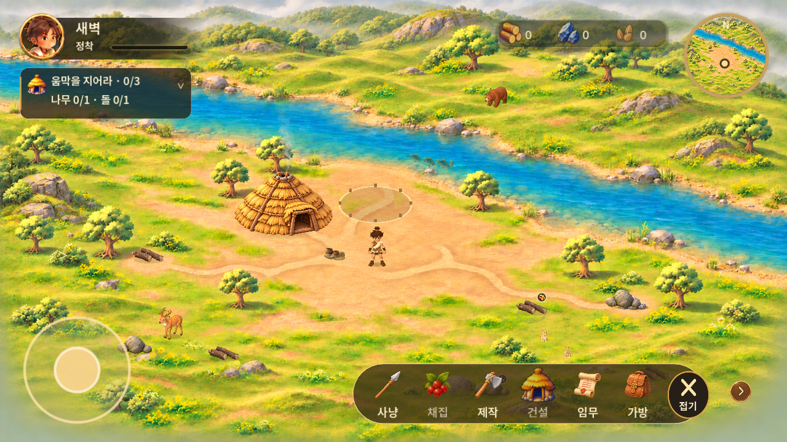
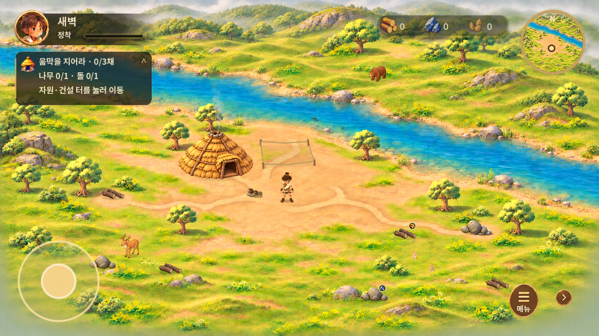
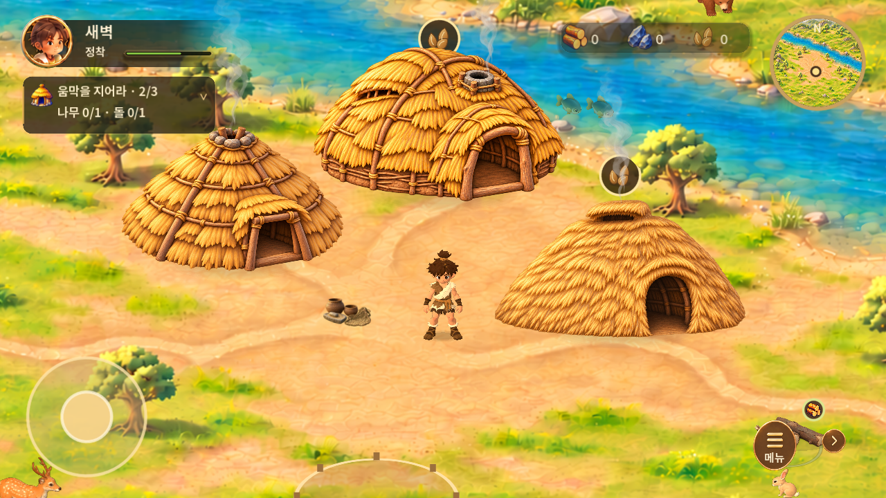
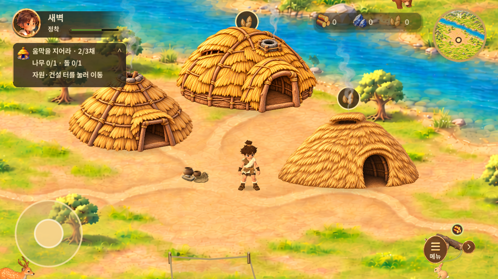

# 이동·채집 상태와 화면 조작 보완 — v0.1.25

2026-11-03 KST · versionCode 26. 기준 main `b71d5c1fc3a3f51fbc0f1a85ab328c2deb8fd0b8`, 작업 브랜치 `feat/play-interaction-polish`.

시각 기준은 [승인 원화 S40000](https://www.figma.com/design/zkbflw9fCdAlWbphhw5pSS?node-id=457-8)이며 최근 6단계 설명 화면을 디자인 기준으로 사용하지 않았다. 기존 배경·컨트롤 아이콘·3D 모델과 이전 공간감 보완을 보존했다. 최종 원화 재현도와 보행 자연스러움은 사용자 검토 대상이다.

## 전후 화면

| v0.1.24 | v0.1.25 |
| --- | --- |
|  |  |
|  |  |

동일한 네이티브 1280×720, 새 게임 위치와 최소 배율 캡처 절차를 사용했다. 확대 비교는 동일하게 2채를 추가한 뒤 (1150,690)을 중심으로 2배 확대했다. 동물·물고기·움집 무작위 스타일은 프레임과 실행마다 달라질 수 있다. [원화 비교 자료](../2026-11-03-settlement-depth/evidence/reference.png)는 그대로 보존한다.

## 구현과 설정

- 이동 속도 **110 → 137.5 월드 단위/초(+25%)**. 직접 조작과 자동 경로 이동에 같은 값을 적용한다. 실제 이동 거리로 보행 주기를 계산하는 기존 방식을 유지하고, 걷기 골반 낮춤 0.12→0.07, 몸통 비틀림 0.055→0.025, 좌우 기울기 0.012→0.006으로 줄였다. 기존 회전 보간·발 지지 IK를 재사용한다.
- 확대 상태(배율>1.01)에서 빈 월드를 **12 UI 단위 이상** 드래그하면 카메라를 이동한다. UI 및 자원·건축 터에서 시작한 드래그는 카메라 이동으로 전환하지 않는다. 핀치 종료 후 남은 손가락도 모두 뗄 때까지 행동을 차단한다. 경계 밖을 보이지 않게 제한하며 드래그 후 자동으로 주인공에게 튀지 않는다. **미니맵 탭, 직접 이동 또는 자동 이동 시작**으로 주인공 추적에 복귀한다. PC에서는 빈 곳 왼쪽 드래그, 기존 Ctrl+휠 확대를 함께 지원한다.
- 기존 코드는 소진 자원을 반투명하게 유지했다. 이제 완전 소진 시 자원 루트와 하위 수량/행동 표시를 숨기고 충돌을 끄며 선택을 해제한다. 탭·가까운 대상 검색·목표 안내에서 제외한다. 노드를 메모리에서 삭제하지는 않지만 화면/물리/상호작용에는 남지 않는다.
- 기존 재생성 규칙이 없어 **완전 소진 30초 후** 같은 ID/종류를 다른 위치로 옮겨 재생성한다. 기존 나무 4곳×각5회, 돌 3곳×각4회를 유지하며 새 자원을 추가 누적하지 않는다. 이전 위치와 180 이상, 다른 활성 자원과 150 이상, 현재/예정 건축 위치와 240 이상 떨어지도록 검사한다. 강변 거리·물리 충돌·플레이어로부터 접근 가능한 경로를 확인하고 후보가 없으면 1초 뒤 재시도한다. 재생성 시 보상을 지급하지 않는다.
- 소진 수량·재생성 예정 시각·새 위치를 기존 원자적 저장에 포함한다. 과거 저장의 선택 필드는 없어도 유효하며, 예전 소진 자원은 첫 실행에서 30초 타이머를 시작한다. 앱을 꺼 둔 시간도 포함하지만 일시 중단 중에는 월드 변경을 실행하지 않는다. 휴대폰 시계 변경 대응을 포함한 서버 시간 동기화 시스템은 없다.
- 아무 행동도 없는 **2.5초 뒤** 고개와 상체로 주변을 둘러보는 3.6초 동작을 적용한다. 14초 간격으로 방향을 바꾸며 이동·자동 경로·채집·건설·일시 중단 시 종료한다. 스트레칭/낮잠은 적절한 전용 모션이 없어 추가하지 않았다.
- 경로 점선은 크림색 중심 2.2px와 어두운 외곽 4px로 조정하고 줌에 맞춰 선 두께를 보정한다. 기존 지나간 경로 0.5초 소멸과 도착/취소 정리를 유지한다.
- 퀘스트 제목은 **‘움막을 지어라 · 0/3채’**처럼 단위를 명시한다. 접으면 제목·진행도만, 펼치면 나무/돌과 자동 이동 안내를 표시한다. 화살표와 패널 높이가 함께 바뀌며 UI 입력 소유권을 유지한다.
- 건축 터는 흰 타원/네모 대신 낮은 농도의 지면·4개 말뚝·처진 밧줄로 표시한다. 물고기는 기존 승인 에셋을 유지하며 너비 28~42, 서로 다른 위상·간격·방향, 녹청색 52% 농도로 수중 느낌을 보완했다. 기존 물 영역 제한과 이동/꼬리 동작은 유지한다.

채집 1.2초, 건설 2초, 나무1+돌1 비용, 씨앗10, 기존 움집1+추가3채는 변경하지 않았다. 건설시간을 레벨별로 확장하는 후속 구조도 유지한다.

## 검증

| 종류 | 결과 |
| --- | --- |
| 새 조작·소진·재생성·대기·퀘스트 검사 | 30 통과 |
| 상태·저장 회귀 | 347 통과 |
| 이동·채집·3채 건설·보상 흐름 | 21 통과 |
| 동물·물고기·연기·생명주기 | 39 통과 |
| 기존 핀치/채집 연출 | 45 통과 |
| UI·복수 비율 | 105 통과 |
| 물리 이동·가림 | 13 통과 |
| 기존 자산·음원 무결성 | 127개·15개 통과 |
| Android 빌드·기존 서명 업데이트 설치 | 통과 |

네이티브 관련 검사 **600개**가 통과했다. [신규 검사](evidence/interaction-polish-tests.json)는 실제 저장 트랜잭션과 합성 입력을 사용하며 재생성 시각을 검사 안에서만 앞당긴다. Android에서는 예정 시각을 변경하지 않고 **실제 30초를 기다렸다**.

Android 15/API35 x86_64 에뮬레이터에서 기존 v0.1.24 테스트 저장을 그대로 불러와 나무를 3회 더 채집해 완전히 소진했다. 나무 수량은 1→4, 소진 상태는 2→5, 재생성 후 소진0과 다른 위치를 확인했고 보상은 추가되지 않았다. [실제 저장 결과](evidence/android-regrowth.json), [소진 화면](evidence/android-depleted.png), [재생성 화면](evidence/android-respawn.png).

- [채집·실제 재생성·퀘스트 접기·핀치·한 손 드래그 영상(55초)](evidence/android-regrowth.mp4)
- [자동 이동·채집·건설·보상·대기·직접 이동·화면 비율 영상(45초)](evidence/android-flow.mp4)
- [남은 경로](evidence/android-route.png), [접힌 퀘스트](evidence/android-quest-folded.png), [드래그한 화면](evidence/android-pan.png)
- [커버 비율 896×370](evidence/android-cover.png), [펼침 비율 816×616](evidence/android-unfolded.png)
- [건설·보상·강제 종료 후 저장 재진입 결과](evidence/android-flow.json)

영상은 원속도이며 파일 크기를 위해 재인코딩만 했다. 에뮬레이터 screenrecord 영상에는 음성이 없다. 기존 실제 진행 저장 파일의 해시가 변하지 않았음을 별도로 확인했다. 실물 폴드가 아닌 해상도 변경이며 실물 터치 감각·안전영역·발열·배터리·장시간 성능·직접 청취는 미검증이다. 빌드 통과를 보행 품질이나 원화 동일성 통과로 간주하지 않는다.

## 남은 품질 차이

- 기존 3D 리그와 절차적 보행을 보완한 것이므로 전문 제작 걷기/정지/회전/대기 클립 수준의 자연스러움은 추가 검토가 필요하다. 스트레칭·졸기 전용 클립이 필요하다.
- 배경과 자원·움집의 세부 묘사 밀도 차이, 배경 나무의 잎 끝 정밀 가림은 이전 보고서의 한계가 남는다. 이번에 임의 대체 에셋을 만들지 않았다.
- 작은 커버 비율에서는 텍스트와 메뉴가 상대적으로 작다. 잘림·겹침은 캡처와 자동 검사에서 확인했지만 실제 폴드 조작 편의는 아직 판단하지 않았다.
- 재생성 안전 위치 탐색은 최대60개 후보를 검사하며, 막힌 맵에서는 재생성이 늦어질 수 있다. 장시간 반복 재생성 및 저사양 기기 탐색 순간 성능은 추가 검증 대상이다.

원본 자산은 `design/assets/s40000/`, `design/assets/world-objects/`, `game/assets/animals/`, `game/assets/environment/`에 유지했다. 이번 수정은 기존 자산을 사용하는 코드 조정이다. [최종 APK 릴리스](https://github.com/byungho-cho/roxhistory/releases/tag/v0.1.25)에는 병합 main의 정확한 소스 커밋과 APK SHA-256, 단일 APK를 제공한다.
