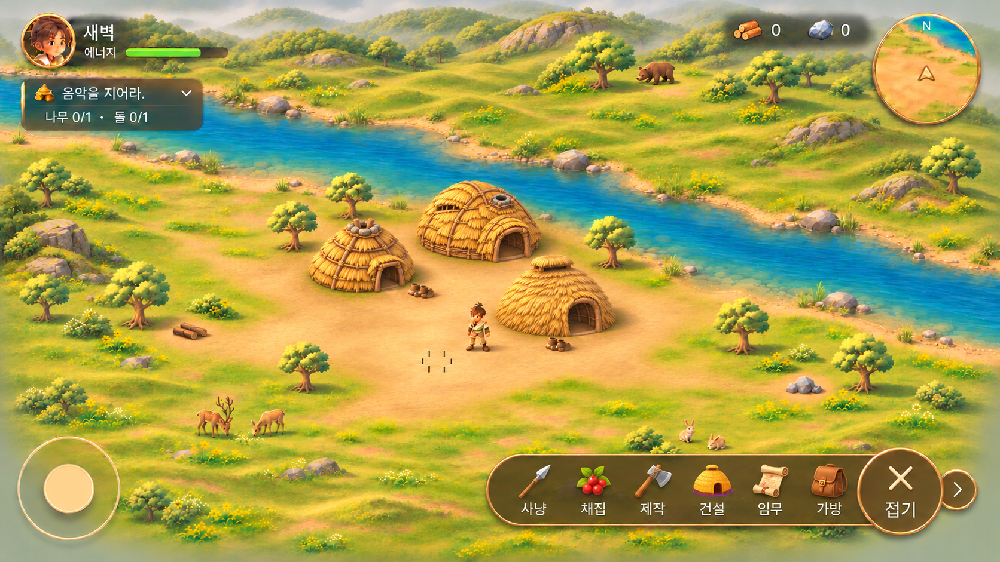
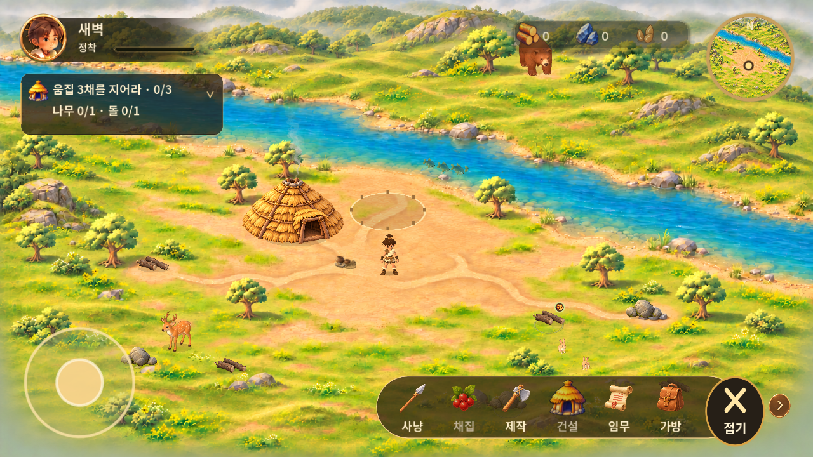
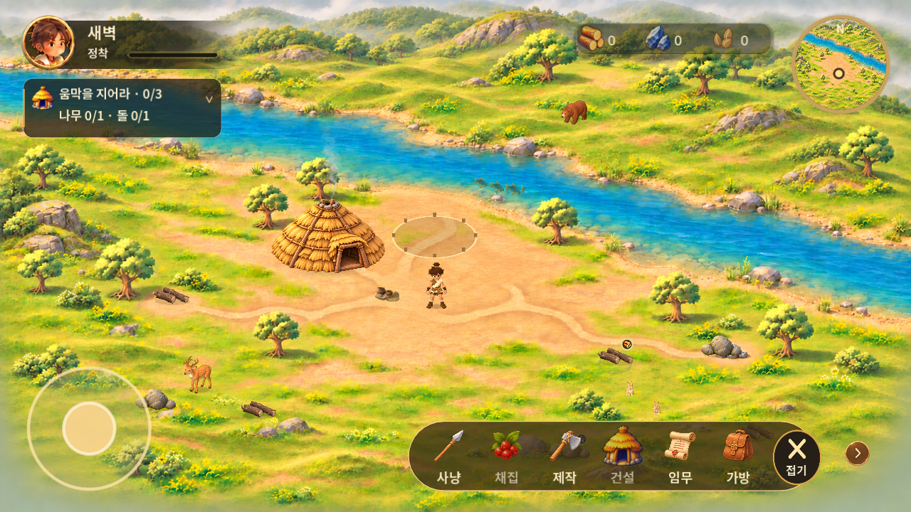

# 대표 정착지 공간감·UI 검토 — v0.1.24

기준 main: `56b2d86449aa508390a04767de9b876d4b55e594`. 날짜: 2026-11-03. 원화: [S40000](https://www.figma.com/design/zkbflw9fCdAlWbphhw5pSS?node-id=457-8), 펼침 원화 `565:82`를 직접 확인했다. 별도 브랜치 `fix/settlement-depth`에서 수정했다.

## 같은 구역 비교

| 승인 원화 | 변경 전 0.1.23 | 변경 후 0.1.24 |
| --- | --- | --- |
|  |  |  |

전후는 동일한 1280×720, 새 게임 위치, 최소 배율, 동일 캡처 절차다. 원화는 3개 움집의 디자인 예시이고 실제 새 게임은 기존 지시대로 1개에서 시작한다. [확대 전](evidence/before-maximum.png) / [확대 후](evidence/after-maximum.png). 원화 파일은 비교 전용이며 게임 코드에 통째로 넣지 않았다.

## 변경

- 2400×1350 월드와 최소 1 / 최대 2 카메라 배율, 이동·핀치·Ctrl+휠을 유지했다. 배경을 새로 만들지 않았다.
- 카메라는 직교 방식이다. 북쪽 배경의 원근 표현과 맞추기 위해 북쪽 y=200~650에서 동물 크기를 0.62~1로 완만하게 보정한다. 정착지의 기준 크기는 유지한다. 원근 카메라로 바꿨다는 뜻은 아니다.
- 동물 기준 높이: 사슴 112→92, 토끼 40/38→34/32, 곰 95→70 월드 단위. 곰은 추가로 북쪽 깊이 보정을 받는다. 종별 크기를 구분하며 일괄 축소하지 않았다.
- 곰 중심을 (1580,200)에서 (1510,320)으로 옮기고, (1390,265)~(1630,385)의 강 건너 풀밭으로 배회를 제한했다. 최소 배율에서 자원바와의 겹침을 피한다. 사용자가 카메라를 확대·이동하면 월드가 고정 UI 뒤로 지나가는 일반적인 겹침은 가능하다.
- 동물의 조명 방향·환경광을 주인공과 통일했다. 원본 Meshy 모델과 재질은 유지했다. 이동 속도와 보폭 계산에 표시 크기를 반영하고, 기존 관절 보행·고개 숙이기를 재사용한다.
- 동물의 렌더 발 원점, 그림자, 충돌체는 같은 부모 좌표를 사용한다. 발 y 기준 정렬을 유지하고 이동 후보가 고정 오브젝트 충돌체에 들어가지 않게 검사한다.
- 움집·소품 그림자를 딱딱한 타원에서 겹친 낮은 농도의 접지 그림자로 바꿨다. 확정 에셋 교체는 없다.
- 퀘스트 240×74→210×64, 상황/접기 버튼 88×88→64×64. 조이스틱과 미니맵은 유지한다. 넓은 커버 비율에서는 행동 버튼 폭을 64로 확보한다. 작은 펼침 그림은 유지하면서 터치 영역은 64×64로 분리한다. 인접 터치 영역이 겹치지 않게 배치했다.
- 에너지는 아직 실제 게임 데이터가 없어 기존 정착 진행 표시를 유지했다. 씨앗·자원 수량은 저장 데이터와 연결된다.

## 검증 구분

| 검증 | 결과 |
| --- | --- |
| Godot import / Android build | 성공 |
| UI synthetic touch·다중 비율 | 101 통과 |
| 실제 이동·자동 채집·3채 건설·중복 보상·저장·복귀 | 21 통과 |
| 물리 이동·앞뒤 가림 관련 기존 검사 | 13 통과 |
| 동물 보행·생명주기·물고기·연기·발 원점·곰 범위 | 39 통과 |
| 실물 폴드 기기 | 미검증 |
| 최종 원화 재현 만족도 | 사용자 검토 대기 |

가림 검사는 물리 이동 검사와 별개로 지정된 발 위치의 확대 캡처도 확인했다. 나무 뒤에서는 수관이 캐릭터를 가리고 앞에서는 캐릭터가 먼저 그려진다. 배경에 합쳐진 나무의 가림은 기존 수관 다각형을 사용하므로 잎 끝의 정밀 알파 가림에는 한계가 있다. 캡처만으로 보행·터치 사용성을 통과 처리하지 않았다.

Android 15 / API35 x86_64 에뮬레이터, RTX5060 OpenGL translator. 실제 폴드가 아니라 해상도 변경으로 1280×720, 커버 비율 896×370, 펼침 비율 816×616을 확인한다. [기본](evidence/android-1280x720.png), [커버](evidence/android-cover-896x370.png), [펼침](evidence/android-unfolded-816x616.png), [짧은 실행 영상](evidence/android-motion.mp4).

동일 에뮬레이터·동일 저장·기본 배율의 짧은 120프레임 측정: 0.1.23 평균 16.663ms / p95 18.660ms, 수정본 평균 16.658ms / p95 18.422ms. 통계적으로 성능이 개선됐다는 증거는 아니며, 이 표본에서 큰 저하가 관찰되지 않았다는 의미다. GPU·발열·배터리·장시간 성능은 미검증이다.

## 남은 차이·추가 에셋 필요

Android 실제 입력으로 채집 버튼을 누르고 나무 0→1 증가를 확인했다. [채집 결과](evidence/android-gather.png), [상호작용 영상](evidence/android-interaction.mp4). 이동 영상은 원속도 화면 녹화이며 화면 비율 전환도 포함한다.

- 주인공과 동물의 전문 제작 보행 클립, 발 고정 IK의 추가 개선 여지가 있다. 이번에 새 모션을 제작했다고 보고하지 않는다.
- 배경 나무의 정밀 가림을 위해서는 원화와 같은 투명 수관/줄기 분리 에셋이 필요하다. 임의의 다른 나무로 교체하지 않았다.
- 원화보다 지붕·자원 윤곽이 선명하고 배경 풀의 묘사 밀도가 높다. 확정 원본을 유지했으며 색감 최종 승인은 남아 있다.
- 기존 물·식생·물고기·굴뚝 효과를 유지하고 동작 검사를 수행했다. 물고기 군집과 보행의 최종 자연스러움은 영상과 APK로 검토한다.
- 전체 맵, 에너지 시스템, 신규 건물·동물 종류는 추가하지 않았다.

원본/편집 소스: `design/assets/world-objects/`, `design/assets/s40000/`, `game/assets/animals/`, `game/assets/environment/`, 기존 동물 리깅 편집 원본. 이번 변경은 코드 조정이며 원본 이미지·모델은 보존한다.
