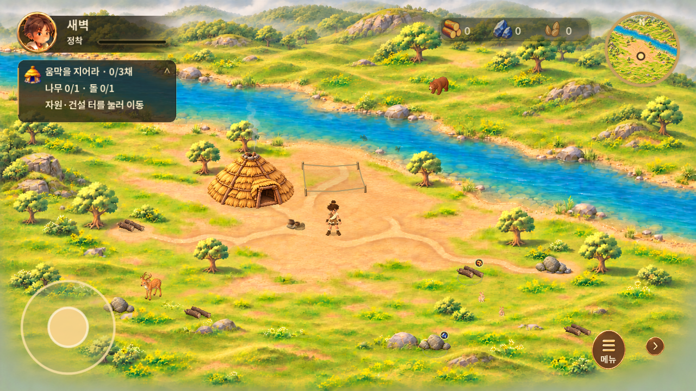
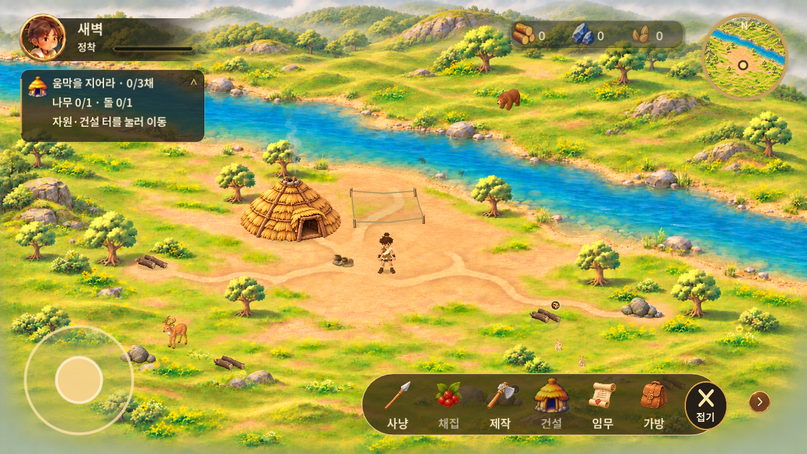
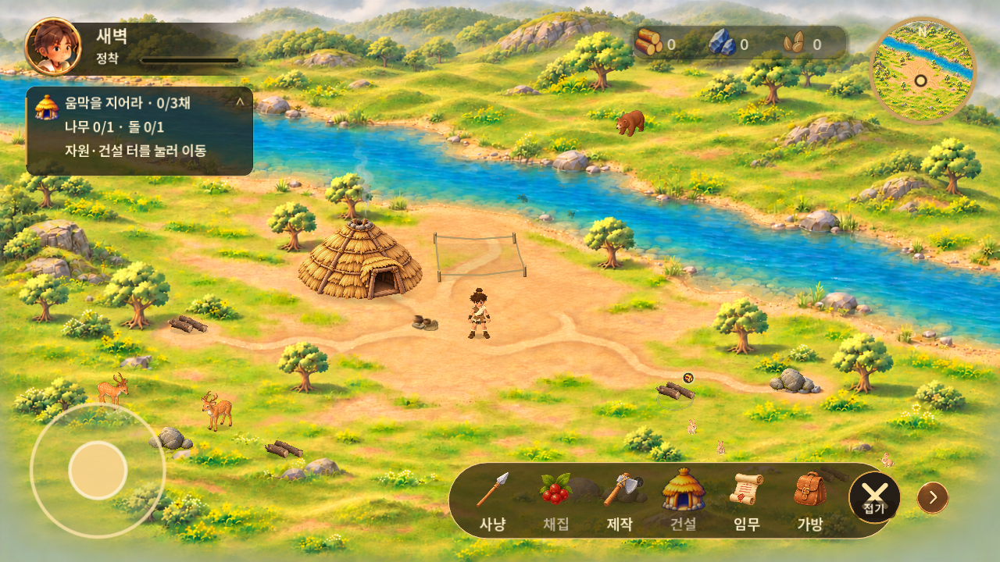
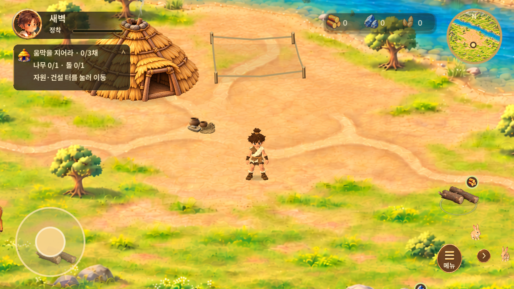
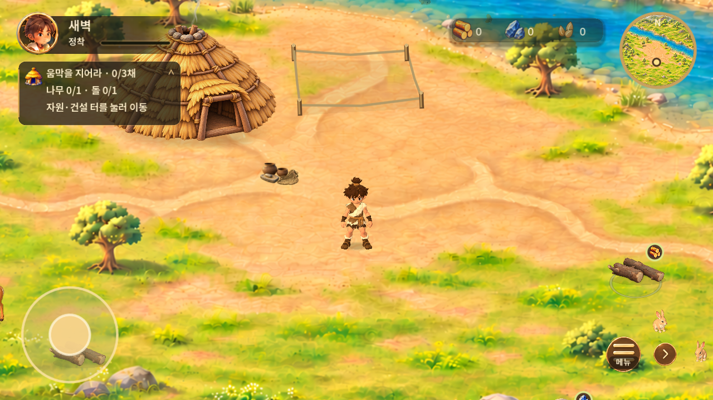

# 조작·보행·하단 메뉴·마을 표현 — v0.1.26

2026-11-03 KST · versionCode27. 기준 main `511b286c7049fadc0551efc53b2d5b90a351ef07`. 별도 브랜치 `feat/village-controls-polish`에서 작업했다. [승인 원화](https://www.figma.com/design/zkbflw9fCdAlWbphhw5pSS?node-id=457-8)의 펼침 원본 `565:82`를 다시 확인했다. 6단계 기획 화면은 디자인 기준으로 사용하지 않았다.

## 같은 구도의 전후

| v0.1.25 | v0.1.26 |
| --- | --- |
|  |  |
|  |  |
|  |  |

[보행 변경 전](evidence/walk-before.mp4) / [보행 변경 후](evidence/walk-after.mp4): 동일 1280×720, 동일 출발점·2배 카메라, 오른쪽2초→아래1초→왼쪽2초→정지3초. 실제 Godot 렌더를 고정 60fps 게임 시간으로 기록한 약9.6초 영상이다. 재생 속도를 변경하지 않았다. 변경 전은 기준 커밋의 코드를 사용했고 변경 후는 새 구현을 사용했다. 물고기·동물의 동작 시점은 조금 다를 수 있다.

## 적용 내용

### 보행

- 속도 **137.5→151.25 월드 단위/초, 추가10%**. 최초110 대비 누적37.5%다. 직접/자동 이동은 같은 값을 사용한다.
- 발 앞뒤 범위 ±0.43→±0.47, 한 주기 이동거리84→92, 발 들어올림 최대0.09→0.17로 함께 조정했다. 발을 바닥에 둔 구간은 선형으로 뒤로 보내고 복귀 구간에만 발을 든다. 팔 스윙0.30→0.34, 기존 방향 회전 보간·출발/정지 블렌딩과 낮은 몸통 흔들림을 유지한다.
- 기존 보행 검사의 예전 발 높이 상한0.12는 새 요구에 맞춰0.18로 갱신했다. 단순히 검사를 완화한 것이 아니라 실제 리그 발 위치를 추가 검사해 좌우 발이 번갈아0.12 이상 올라가고 지지 발 높이가 일치함을 확인했다. 전문 제작 모션 클립을 새로 제작한 것은 아니다.

### 메뉴와 입력

- 메뉴/접기 버튼은 **64×64 터치 영역 유지**. 기존 Git 에셋의 기호 부분을 AtlasTexture로 재사용해 중앙에 크게 배치하고, ‘메뉴/접기’는 필요한 글자 부분만 어둡게 받쳐 아이콘 위에 겹쳤다. 다른 이미지로 교체하지 않았다. 오른쪽 화살표는40→48 크기로, 터치 칸 안에서 왼쪽으로12 이동했다. 인접 버튼의 터치 영역은 겹치지 않는다.
- 빈 땅을 짧게 탭하면 기존 물리 기반 A* 경로로 이동한다. 누를 때가 아니라 손을 뗄 때 실행한다. 자원·보상 건물·건축 터·UI를 먼저 처리하고, 보상이 없는 건물 이미지 탭도 빈 땅 명령으로 전달하지 않는다.
- 강·장애물·맵 바깥의 목적지는 **‘이곳으로 이동할 수 없어요’**로 거절한다. 이동 중 막히면 막힌 경유점을 제외해 최대2회 재탐색하며, 계속 막히면 기존 안내로 종료한다. 가까운 임의 위치로 강제 순간 이동시키지 않는다. 새 목적지는 이전 경로를 지우고, 조이스틱은 자동 이동을 취소한다. 빈 땅 도착 시 채집/건설은 실행하지 않는다.
- 드래그 여부는 배율 대신 **실제 보이는 월드 범위가2400×1350보다 작은지**로 결정한다. 따라서 세로1배에서도 좌우로 살펴볼 수 있다. 기존12 UI 단위 탭/드래그 임계값, UI 시작 소유권, 핀치 후 모든 손가락 해제 대기를 유지한다. 미니맵 탭/직접 또는 자동 이동으로 주인공 중심에 복귀한다.
- Android 가로 고정을 해제하고 센서 회전을 허용했다. 세로 논리 화면은540×960 기준으로 조정해 컨트롤이 과도하게 작아지는 것을 줄였다. 세로 자원바를 상태 아래, 퀘스트를 그 아래에 배치하고 펼친 메뉴는 조이스틱 위에 둔다. 가로·커버·펼침은 기존 배치를 유지한다.

### 마을·경로

- 움집 원본의 알파·세부 무늬를 유지하며 채도90%, 대비96%로 살짝 정돈했다. 흐림 필터는 사용하지 않았다. 기존 별도 그림자를 새 접지 그림자로 교체했으며, 그림자를 추가로 중복 누적하지 않는다. 낮은 농도의 흙 흔적을 출입구 앞에 넣었다. 건물 위치·크기·충돌체·출입 경로는 그대로다.
- 경로를 각진 짧은 선에서 **둥근 점**으로 바꿨다. 화면 기준 바깥 반경2.5/안쪽1.65, 간격12, 어두운 외곽36%·크림색 중심76%. 실제 경로 선분 위에서만 점을 배치하므로 곡선 보간으로 장애물을 가로지르지 않는다. 통과 구간은0.5초에 사라지고, 도착·취소·재지정·수동 전환 때 이전 흔적을 지운다.
- 기존 실제3D 모델로 **사슴1+토끼1, 총2마리**를 추가했다. 총6마리이며 신규 위치는(270,980),(2130,1120), 기준 높이85/32다. 각 위치 기반 위상·휴식·목적지를 사용한다. 건축 예정지190, 살아 있는 자원85, 다른 동물55 이내를 피하도록 이동 검사를 보완했다. 기존 물 영역·집·물리 장애물 검사와 화면 밖 렌더 중단을 유지한다.

## 검증

네이티브 Godot4.5.1/Windows/RTX5060: 신규 조작37, 기존 조작·재생성30, 전체 플레이 흐름21, 동물·환경49, 핀치·채집45, UI105, 보행/작업53, 가림13, 상태·저장347 = **700개 통과**. 기존 에셋127개·음원15개 무결성 통과. 새 보행 검사의 초기 실패는 예전 발 높이 상한 때문이었으며 새 높이와 리그 접지 검사를 반영해 재검증했다. [신규 입력 검사](evidence/village-controls-tests.json), [보행 검사](evidence/hero-tests.json).

Android15/API35 x86_64 에뮬레이터에서 기존 저장을 보존한 업데이트 설치를 확인했다. 빈 땅 탭→목적지 변경→조이스틱 전환, 세로1배 드래그, 핀치 후 의도하지 않은 이동 없음, 메뉴 조작, 기존 자원 자동 채집을 실제 Android 입력으로 확인했다. [입력 영상](evidence/android-input.mp4), [저장 위치 비교](evidence/android-input.json).

- [세로 기본370×896](evidence/portrait-initial.png), [세로1배 드래그](evidence/portrait-pan.png), [세로 펼친 메뉴](evidence/portrait-menu.png)
- [커버896×370 메뉴](evidence/android-cover-menu.png), [펼침816×616 메뉴](evidence/android-unfolded-menu.png)
- [자동 채집 경로](evidence/android-resource-route.png)
- [3채 건설·보상 영상](evidence/android-build-regression.mp4), [실제30초 재생성 영상](evidence/android-regression.mp4), [완료·저장 재진입 결과](evidence/android-regression.json)

Android 영상은 원속도 screenrecord를 용량만 줄여 인코딩했으며 음성은 없다. 실제 진행 저장은 별도로 보존하고 임시 테스트 저장만 사용했다. 실물 폴드/휴대폰·센서 회전 감각·노치 안전영역·직접 청취는 **미검증**이다. 화면 캡처만으로 모든 터치 사용성을 통과 처리하지 않았다.

같은 에뮬레이터·저장·1280×720·기본배율, 준비60프레임 뒤120프레임 표본: 평균 **16.692→16.955ms**, p95 **18.557→20.633ms**, draw calls **156→203**, primitives **131,334→166,006**. [전](evidence/perf-before.txt) / [후](evidence/perf-after.txt). 동물 추가 비용이 있으며 성능 무저하를 주장하지 않는다. 짧은 표본에서 평균은 약1.6% 증가했다. 저사양·장시간·발열/배터리는 미검증이다.

첫 Android 회귀에서 자동 이동 중 정지한 사례가 있었다. 다시 탭하면 채집되는 것을 확인했고, 동적 장애물 또는 경유점 접촉으로 경로가 무효화될 때 최대2회 재탐색하도록 보완했다. 출발 후 새 장애물을 놓는 실제 물리 검사에서 우회·도착을 검증했다. 최초 영상의 중간 정지는 이 보완 전 기록이다. 추가 회귀에서 비대화형 채집 안내가 자원을 가리면 다음 탭을 차단하는 원인도 확인해 안내의 터치 차단을 제거했다. 실제 버튼·퀘스트 영역은 계속 입력을 소유한다.

## 남은 사항·전달

- 보행은 기존 리그의 절차적 모션 조정이다. 발 교대/접지는 검사했지만 관절 변형과 자연스러움의 최종 판단은 비교 영상과 APK로 확인해야 한다. 전문 제작 걷기·정지·급회전·대기 클립이 후속 개선에 필요하다.
- 움집의 세부 묘사 밀도와 배경 나무의 정밀 가림 한계는 남는다. 원화와 픽셀 단위 동일성을 완료했다고 판단하지 않는다.
- 세로 화면의 다른 시작/지역 선택 화면은 기존 디자인을 사용하며 이번 작업의 시각 재설계 범위가 아니다. 세로 펼친 메뉴의 실제 손가락 사용감도 실물 확인이 필요하다.
- 채집1.2초·건설2초·나무1+돌1·씨앗10·기존움집1+추가3채,30초 재생성·대기·퀘스트·저장 흐름을 보존했다.
- 원본/편집 자산은 기존 `design/assets/s40000/`, `game/assets/ui/s40000/`, `game/assets/environment/`, `game/assets/animals/`를 그대로 사용했다. 새 이미지나 모델을 임의 제작하지 않았다.

[v0.1.26 단일 APK 릴리스](https://github.com/byungho-cho/roxhistory/releases/tag/v0.1.26)에 병합 main의 소스 커밋·파일 SHA-256·직접 다운로드를 기록한다. 기존 서명을 유지하며 원격 CI 결과는 PR 실행 결과를 따르고 위 로컬 검사와 구분한다.
