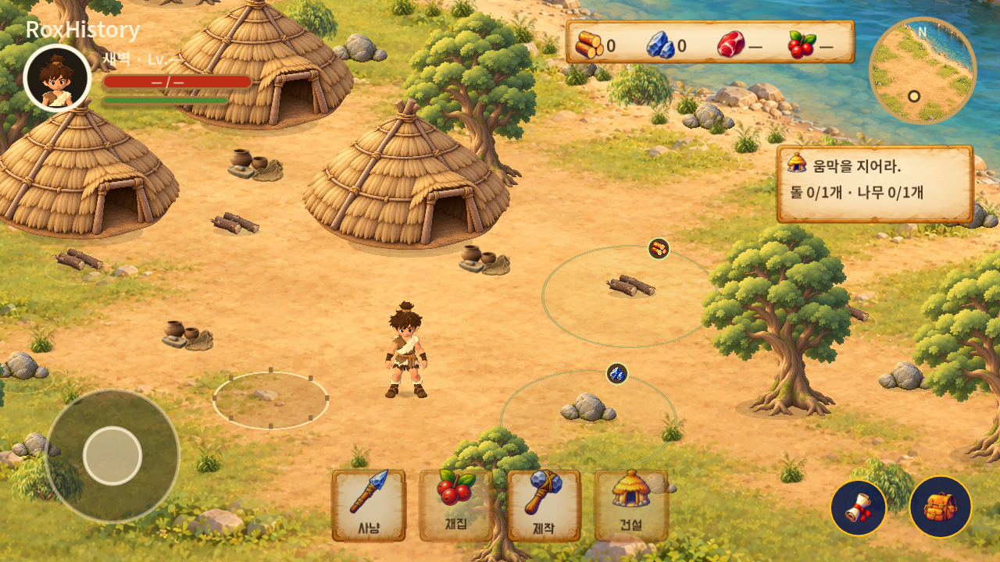
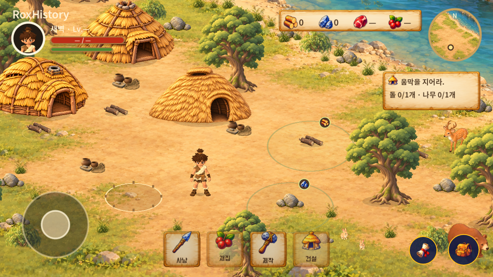

# S40000 동물과 건설 연출 통합

2026-11-03 KST, 앱 0.1.19 / versionCode 20. 기준 main cb84814, 승인 디자인 자산 424b2cb에서 작업 브랜치 feat/s40000-world-life-20261103을 분리했다.

## 적용 내용

- 사용자 Meshy 사슴·토끼·곰 3종을 실제 3D로 통합했다. 사슴 1·토끼 2·곰 1을 마을 밖에 배치했다. 게임 모델 합계 2,323,028 bytes, 각 16,000 삼각형, 최대 1024 텍스처. 원본과 Fluffy Bear V2는 보존한다.
- 주인공 보폭 64→80 월드 단위, 발 들기 0.095→0.065, 몸통/머리 좌우 흔들림 축소. 이동 거리로 위상을 계산하는 기존 방식을 유지했다.
- 확정 움집 3종을 하나씩 배치하고, 신규 건설은 1/3 확률로 선택한 스타일을 저장한다. 이전 저장에는 기본 1안을 적용한다. 투명 여백을 제외한 바닥 기준으로 접지를 맞췄다.
- 공통 원형 건설 발판, 먼지·금빛 입자, 완료 링을 연결했다. 녹색 진행바·남은 시간·배경 없는 큰 망치 애니메이션을 Figma 582:83 기준으로 적용했다. 현재 2초이며 전체 시간 변경에 대응한다.
- 완성 움집에 위상이 다른 연기, 강 안에 느리게 이동하는 물고기 떼를 추가했다. 일시중단과 효과 설정을 따른다.
- 패키지와 서명, 나무 1+돌 1·각 1회 지급·채집 1.2초·건설 2초를 유지했다.

## 실행 증거와 검증

### 동일 구도 비교

변경 전 `cb848142`와 변경 후 `4fe66ec2`를 Windows Godot 4.5.1/RTX5060, 1280×720, 새 게임의 같은 시작 위치·기본 배율, 30프레임 대기 조건으로 캡처했다. 비교용 실행은 테스트 저장을 사용했다.

| 변경 전 main | 변경 후 |
| --- | --- |
|  |  |

움집은 동일한 세 곳에서 서로 다른 승인 스타일로 바뀌었고, 마을 밖에 동물이 추가됐다. 시작 구도에서는 우측 하단 곰/토끼 일부가 기존 HUD와 겹친다. 동물 배치는 월드 위치에 고정되어 카메라 이동에 따라 드러나며, 전체 HUD 정리는 별도 후속 범위다.

Windows Godot 4.5.1, RTX5060 실제 렌더링. 자동 검사와 시각 품질 승인은 구분한다. [기본 화면](evidence/worldlife-settlement.png), [건설 중](evidence/worldlife-construction.png), [완료](evidence/worldlife-completed.png), [동물](evidence/worldlife-wildlife.png), [원속도 30fps 영상](evidence/native-worldlife.mp4). 네이티브 영상은 재현 가능한 테스트 위치 전환을 포함하며 손으로 처음부터 플레이한 기록은 아니다. 아래 관련 로컬 검사는 총 757개 통과했다.

| 검사 | 통과 |
| --- | ---: |
| 저장·보상 | 345 |
| 주인공·접촉 동작 | 51 |
| 환경·충돌·이동 경로 | 17 |
| 핀치·입력·자원 획득 | 45 |
| 음향 수명·UI·카메라 | 56 |
| 채집·건설 흐름 | 27 |
| 3D 전환·이동 | 30 |
| 26방향 채집 접근 | 160 |
| 동물·중단·건설 스타일 저장 | 26 |

사슴 충돌체가 wood_4의 우측 접근을 막던 문제를 발견해 배치를 수정했고, 접촉 검사 160개를 다시 통과했다. 원본 뼈대/동작 유무는 Blender에서 확인했다.

최종 코드의 [GitHub Actions #51](https://github.com/byungho-cho/roxhistory/actions/runs/41524086376)은 Ubuntu 24.04/Godot 4.5.1/llvmpipe·Xvfb에서 21개 검사 묶음 **1,449개 통과, 실패 0**이며 APK 내보내기와 산출물 업로드도 통과했다. [작업 결과](evidence/ci-checks.json), [검사 요약](evidence/ci-test-summary.json). 기존 A303 지역·선택음·오로라·팝업 회귀 검사도 포함한다. CI 출력 중 일부 테스트의 runtime 문구는 기존 정적 문자열이므로 실제 실행 환경은 이 단락을 따른다.

### Android 에뮬레이터

Android 15/API 35 x86_64, RoxHistory35 읽기 전용 세션, host RTX5060 GPU, 1280×720 및 1280×960에서 확인했다. 초기 SwiftShader 환경은 기존 Canvas 셰이더의 uniform 한도를 초과했으므로 host GPU로 변경했다. 원본 AVD는 보존했다.

- 조이스틱 이동, 채집 취소 시 무지급, 반복 탭에도 나무/돌 각 1회 지급, 건설 자원 차감, 보상 반복 탭에도 10개만 지급: 통과.
- Android 두 손가락 확대/축소, Home 중단/복귀, 강제 종료 후 이어하기, 4:3 화면 배치: 통과.
- 저장된 움집 스타일 1, 나무/돌 0, 보상 10개가 재진입 뒤 유지됐다. 테스트 저장 경로는 `files/tests/session/save.json`이다. 별도 생산용 `files/save.json`은 빈 파일이었으며 전후 SHA-256이 동일했다. 실제 사용자의 유효한 진행 저장을 이번 세션에서 검증했다고 해석하지 않는다.
- 스크립트/런타임 오류 없음. [1차 결과](evidence/android-part1.json), [복귀·저장 결과](evidence/android-part2.json), [실제 터치 입력 실행 영상](evidence/android-worldlife.mp4), [4:3 화면](evidence/android-4x3.png). Android 영상은 음성 없는 100초 기록이다. 해당 영상은 마지막 건설 UI 중복 제거 직전 빌드이며 최종 빌드 설치 결과는 아래 배포 기록에서 구분한다.

### 성능 기록

변경 전 main과 변경 후 소스를 동일한 플레이어 위치 (1750,1140), 확대 1.7, 1280×720으로 별도 실행했다. 각각 120프레임 준비 후 2,000프레임 측정: 이전 평균 1.370ms/p95 4.173ms, 변경 후 평균 1.500ms/p95 2.421ms. 평균은 약 0.13ms 증가했으나 단일 실행의 편차와 호스트 환경이 포함되어 있다. [전후 측정값](evidence/baseline-performance.json), [공통 측정 코드](evidence/comparison_benchmark.gd).

Windows 동일 구도 1280×720, 제한 없는 렌더링으로 동물 OFF/ON을 번갈아 1,000프레임씩 두 차례 측정했다. 평균 프레임 시간 OFF 1.290/1.369ms, ON 1.334/1.420ms. p95 OFF 3.874/3.325ms, ON 3.637/4.522ms로 실행 편차가 있으므로 확정적인 성능 개선 수치로 해석하지 않는다. [측정값](evidence/worldlife-performance.json), [재현 스크립트](evidence/worldlife-benchmark.gd).

Android 에뮬레이터는 600프레임 평균 27.58ms, p95 38.11ms, draw calls 231, primitives 134,469였다. 논리 렌더 뷰포트 960×540이며 실물 기기의 성능을 보장하는 결과가 아니다.

## 남은 품질 범위

- 동물은 실제 3D 모델이지만 리깅이 없어 제자리 호흡만 한다. 걷기·달리기·먹이 찾기는 미구현이다.
- 물고기는 승인된 떼 이미지 전체가 움직이는 1차 구현이다. 개별 꼬리 관절/분산 이동은 후속이다.
- 원화 전체와 현재 HUD·지도 공간 배치가 동일한 상태는 아니다. 이번 변경은 동물, 승인 움집/환경/건설 연출, 주인공 보행 조정이다. 접힘/펼침 HUD 전체 재구성과 구름 경계 확대 등은 별도 잔여 작업이다.
- 실물 폴드/Android 기기, 출력 장치를 통한 직접 청취, 사용자 최종 외형 승인은 미검증이다. 음원 자체는 이번에 변경하지 않았다.

## 병합과 최종 APK

- 구현 PR: [#36](https://github.com/byungho-cho/roxhistory/pull/36).
- 구현 커밋: `8114361377abc1ed074496dcaf11c678d6e035f8`, `4fe66ec2826a5a1b83f9b85ed3b78284db084814`.
- main 병합·최종 APK 소스: `aad00f9affde32ac66e3b192ad58d2ef044de4c2`. 이후 보고서만 추가하는 커밋은 APK 코드 변경이 아니다.
- 버전 `0.1.19`, versionCode `20`, 패키지 `com.roxhistory.demo`.
- 파일 `RoxHistory-0.1.19-20261103-062455.apk`.
- SHA-256: `76d0d452ba4312fcb81ed7781740ed2f9565648492d23a7e506c778493bf7272`.
- 기존 서명 인증서 SHA-256: `cf65aeecb4e399ba9e2e6b9fa947f34f8c31bd75c8e3b686ad29d8431bb1695f`, v2/v3 검증 통과. [서명](evidence/signature.txt), [패키지](evidence/package.txt).
- 병합 main에서 재빌드 후 읽기 전용 Android 세션에 업데이트 설치·이어하기를 확인했다. 저장 스타일/자원/보상 유지, 생산용 파일 해시 유지, 실행 오류 0. [최종 설치 결과](evidence/android-final-main.json), [설치 후 화면](evidence/android-final-main.png).

## 원본과 편집 위치

- 동물 원본: design/assets/animals-3d/reference-v001, 게임용: game/assets/animals, 변환: tools/prepare_animals.py.
- 움집 원본/경량본: design/assets/huts/v001, 게임 사본: game/assets/environment/hut-*.png.
- 효과 원본: design/assets/effects/FX-001~003, 게임 사본: game/assets/effects.
- 구현 책임: WorldAnimal(3D 표시), WorldAmbient(환경 효과), ConstructionProgress(진행 UI), WorldFeedback(작업 연출), GameState/SaveStore(지급·스타일 저장), HeroMotion/HybridCharacter(주인공 동작).
- Figma 승인 예시: https://www.figma.com/design/zkbflw9fCdAlWbphhw5pSS?node-id=579-83. 오늘 Figma 원화를 변경하지 않았다.

## 다운로드

[APK 한 파일 직접 다운로드](https://github.com/byungho-cho/roxhistory/releases/download/v0.1.19/RoxHistory-0.1.19-20261103-062455.apk). 공개 URL에서 재다운로드하여 위 SHA-256과 일치를 확인했다. [배포 메타데이터](evidence/release.json).

요청에 따라 새 파일 검증 후 과거 릴리스 APK 18개를 삭제했다. 소스 태그·원화·원본 모델·보고서는 보존했다. 과거 보고서의 APK 링크는 더 이상 유효하지 않을 수 있다. [삭제한 APK 목록](evidence/old-apk-cleanup.json).
