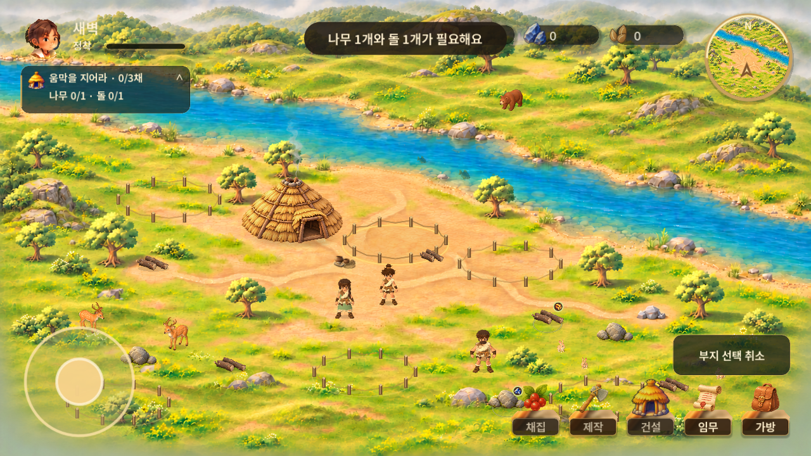
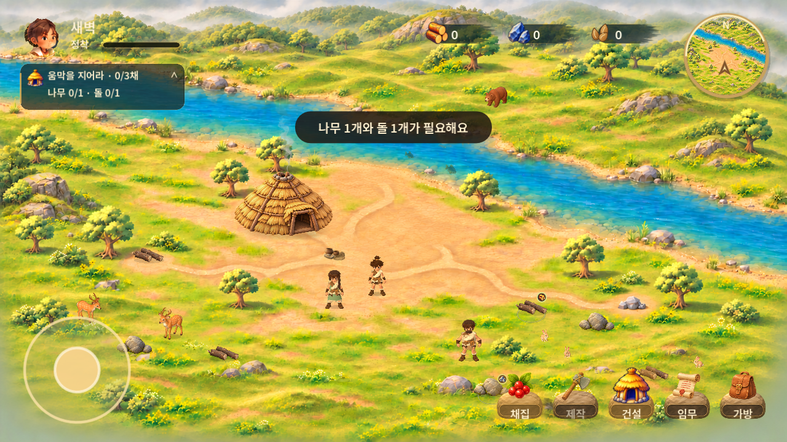

# v0.1.32 · 건설·채집 예약 및 붓터치 HUD

2026-11-04 · 기준 main `661f18c8ee7b1defdbe732a36339213a764fc495` · versionCode 33.
공개 배포 완료: [APK 직접 다운로드](https://github.com/byungho-cho/roxhistory/releases/download/v0.1.32/RoxHistory-0.1.32-20261104-170605.apk) · [PR #58](https://github.com/byungho-cho/roxhistory/pull/58).
빌드 소스 main: be561e84d6ad16aa8c44caed6f9bad15a6fbb41a.
APK SHA256: b0048f00445ac87b0b40e58aaf672fc87beb904829f83e8263767ab2de304a26 · 189297451 bytes.
공개 다운로드 해시 일치 확인 후 이전 공개 APK 1개만 삭제했습니다. 태그·소스·보고서·원본은 보존했습니다.
최종 main APK의 Android 업데이트·실행 및 일반/임시 저장 해시 보존을 확인했습니다.
[업데이트 검증](evidence/android-final-update.json) · [시작 화면](evidence/android-final-title.png) · [플레이 화면](evidence/android-final-play.png) · [배포 정보](evidence/release.json).
로컬 전체 34개 검사 묶음 통과. [원격 CI](https://github.com/byungho-cho/roxhistory/actions/runs/41796712040)는 배포 시 실행 중으로 통과로 기록하지 않습니다. 실기기·직접 청취는 미검증입니다.

## 기준과 변경

- [확정 원화 689:330](https://www.figma.com/design/zkbflw9fCdAlWbphhw5pSS?node-id=689-330), [건설 예시 579:85](https://www.figma.com/design/zkbflw9fCdAlWbphhw5pSS?node-id=579-85)를 직접 확인했습니다. 645:167은 흐름 참고이며 가족 합류는 구현하지 않았습니다. Figma 파일은 수정하지 않았습니다.
- 건설 → 움집 선택 → 후보지 선택 → 즉시 건설. 촌장이 이동하거나 망치를 휘두를 필요가 없습니다. 후보지는 선택 중에만 보이며 기존 6개 위치와 최대 3채를 유지합니다. 비용 나무 1 + 돌 1, 시간 2초. 비용은 성공 시 한 번만 저장합니다.
- 기존 원형 말뚝·밧줄, 비계 PNG, 녹색 진행바·망치, 먼지·금빛 효과를 재사용합니다. 건설 타격 효과가 촌장의 도구 위치로 잘못 연결되던 코드를 끊고 부지에 고정했습니다.
- 채집 버튼: 월드 좌표 **650** 이내의 자원을 거리순으로 검사하고 실제 경로가 있는 가장 가까운 자원으로 이동합니다. 전체 월드는 2400×1350, 접촉 거리와 채집 1.2초는 기존값입니다. 없으면 안내합니다.
- 작업 중 요청은 **한 개**만 예약하며 마지막 유효 요청으로 교체합니다. 빈 땅/자원 탭의 예정 경로를 표시하고 작업 완료 후 경로를 재검사합니다. 사라진 자원·막힌 부지는 안내 후 예약을 비웁니다. 잘못 누른 물속 등 거부된 요청은 이미 유효한 예약을 지우지 않습니다.
- 사용자 확정: 조이스틱 직접 이동은 현재 작업·예약·경로를 모두 취소하고 즉시 이동합니다. WASD/화살표도 같은 수동 우선 규칙입니다. 취소한 작업은 지급/차감하지 않습니다. 중단·재진입 시 일시적인 작업·예약은 취소되며 완료된 결과만 저장됩니다.
- 철거: 650ms 길게 누르기 → 실제 환급량 확인 → 제거/먼지. 자원별 비용 10 이하 전액, 10 초과 `floor(비용×0.9)`. 11→9, 15→13, 20→18. 기존 건물은 역사적 비용 1+1 적용. 주민 유지. 미수령 씨앗은 먼저 수령하도록 기존 보호를 유지합니다.
- 붓터치 자원바는 지정 PNG를 수평 3-slice로 표시합니다. 파일 자체의 약 75% 알파에 다시 75%를 곱하지 않으며 아이콘/숫자는 불투명하게 읽힙니다. 실제 수량·획득 비행·짧은 강조는 유지합니다.
- 하단 5개 상시 메뉴를 유지하고 제공된 돌 받침 PNG를 사용했습니다. 새 접기/펼치기나 사냥 기능은 추가하지 않았습니다. 원화의 6개 중 사냥은 기존 미구현 기능이므로 노출하지 않습니다.
- 상단 안내를 자원바 아래의 안전한 위치로 이동했습니다. 하단 수동 안내와 첫 보금자리 팝업은 계속 숨깁니다.
- 시작 화면 소리 아이콘 **그림의 가로/세로를 이전 대비 2배**로 하고 터치 사각형은 주변 시작 버튼과 겹치지 않게 별도로 배치했습니다.
- 기존 나무 가림/접지/보행을 유지하고 실제 나무 앞뒤에서 확인했습니다. 배경에 그려진 큰 바위 5곳에는 별도 충돌 영역을 추가해 경로 계산에도 반영합니다.

## 에셋 출처

[UI 사용 안내](https://github.com/byungho-cho/roxhistory/blob/b1433687df091e1355d5abb17c0fc55a73ceea11/design/reference-images/2026-11-04-ui-assets-brush/README.md).

| 파일 | 실제 사용 | 비고 |
|---|---|---|
| `game/assets/ui/brush/resource-slot-brush@2x.png` | 세 자원칸 공통 배경 | 선택된 원본 바이트 보존. 2x 좌64/우176 수평 슬라이스 |
| `game/assets/ui/brush/action-stone-base@2x.png` | 하단 메뉴 받침 | 제공된 생성 검토용 에셋. 원화에서 픽셀 동일 추출한 그림이라고 주장하지 않음 |
| 기존 `assets/ui/s40000` 아이콘/초상 | 그대로 재사용 | 얼굴/보행/모델 재제작 없음 |
| 기존 `assets/effects/construction-scaffold.png` | 건설 비계 | 기존 재사용, 원화 전체를 게임 배경으로 대체하지 않음 |

다른 제공 패널·링·진행바는 검토용이며 현재 동작/원화와의 차이가 있어 무조건 교체하지 않았습니다. 사용한 신규 PNG는 manifest SHA-256에 등록했습니다. 총140개 에셋 검사 통과.

## 비교와 실행 증거

같은 Windows/NVIDIA RTX5060, Godot4.5.1, 1280×720, 주인공 (1150,900), 기본 줌, 같은 새 게임/안내에서 캡처했습니다. 원화와 실행은 서로 다른 카메라 구성으로 픽셀 동일하다고 주장하지 않습니다.

| 이전 v31 | 변경 v32 |
|---|---|
|  |  |

[확정 원화](evidence/approved-art.png) · [접힘 폴드 비율](evidence/cover-layout.png) · [펼침 비율](evidence/unfolded-layout.png)

- [13초 원속도 네이티브 실행](evidence/native-actions-13s.mp4): 움집 선택/부지/건설 → 예약 채집 → 목적지 교체/이동 → 씨앗 수령 → 철거. 60Hz 엔진/30fps 저장, 무음 캡처.
- [12초 Android 실제 입력 녹화](evidence/android-actions-12s.mp4): 원격 건설, 후속 이동/채집. 자동 입력이며 실물 기기가 아닙니다.
- [Android 건설 선택](evidence/android-build-choice.png), [원격 건설](evidence/android-remote-build.png), [환급 확인](evidence/android-demolition.png).
- [나무 뒤](evidence/tree-behind.png), [나무 앞](evidence/tree-front.png): 실제 SettlementTree (1780,850) 주변. 이전 보고서의 자원 주변 대체 캡처와 구분합니다.

## 검증

- 최종 런타임 기준 **34개 네이티브 검사 묶음 모두 통과**, 339.13초. [전체 결과](evidence/native-full-suite.json).
- [행동 예약31항목](evidence/action-queue-tests.json): 원격 건설/연속 부지 예약/한 칸 교체/완료 후 실행/잘못된 목적지/사라진 대상/조이스틱 취소/수량/저장/바위 충돌/알림-자원바 분리.
- [철거48항목](evidence/demolition-tests.json): 취소/긴 터치/중복/저장 재실행/주민 유지/경계 환급값/아이콘 화면 범위.
- 과거 검사가 요구하던 ‘작업 중 클릭 무시/취소’, ‘부지로 이동 후 건설’, ‘건설 중 촌장 모션’, ‘10초과 소수 환급 거부’는 최신 지시에 맞춰 수정했으며 기존 저장/보상 검사는 유지했습니다.
- Android15/API35 x86_64 `RoxHistory35` 에뮬레이터, 1280×720 가로. v31→v32 설치 성공. 원본 `files/save.json` 해시 설치 전후 및 모든 테스트 후 동일: `34b742d376d281c93a7309368b0757be973efe9e9b6112a226a78d8151148d4a`.
- 조작 전에 원본을 `files/tests/session`으로 복사하고 `--test-ui`만 실행했습니다. 기존2채/씨앗20 → 한 채 철거(1+1 반환) → 후보지3 건설 → 채집까지 확인. [임시 저장 결과](evidence/android-test-save.json).

## 남은 차이 / 미검증

- 원화의 퀘스트 뼈 장식과 완전히 같은 패널, 미니맵 질감은 아직 차이가 있습니다. 새 생성 그림으로 임의 대체하지 않았습니다.
- 낮은 수풀은 배경에 합쳐져 있습니다. 모든 풀잎별 가림은 구현하지 않았고 큰 나무의 기존 가림을 검토했습니다. 바위 충돌은 별도 추가했지만 모든 바위에 독립 전면 가림 레이어를 새로 만들지는 않았습니다.
- 하단 상시표시/접기 정책은 현재5개 유지. 변경 결정 전 임의 전환하지 않습니다.
- 실물 폴드 커버/펼침 터치, 직접 청취, 장시간 발열/성능은 미검증입니다. 비율별 네이티브 캡처와 자동 검사 통과를 실기기 검증으로 간주하지 않습니다.
- 최종 그림체·시각 품질 승인은 사용자의 APK 확인 대상입니다.
