# v0.1.28 PC 확인본 — HUD·보행·가림·주민·최대 축소

2026-11-04 KST. 기준 main `cbe6ccdc2457a6e013ff68133cae21589b92b850`, 브랜치 `feat/approved-hud-resident-polish`. **PC 검토 대기**이며 main 병합·Android 최종 검증·APK 배포를 하지 않았습니다. 이 보고서의 PC 확인은 Windows 네이티브 실행이며 Android 실기기 검증이 아닙니다.

## 적용 내용

1. 확정 [Figma 645:152](https://www.figma.com/design/zkbflw9fCdAlWbphhw5pSS?node-id=645-152)의 접힘/펼침을 기준으로 하단 반투명 메뉴, 아이콘 간격, 접기 원형 및 인접 화살표를 정리했습니다. 메뉴의 햄버거/X 이중 렌더를 제거했습니다. 원본 아이콘을 재사용하고 기존 SVG 접기 테두리만 보완했습니다. 터치 영역은 메뉴82×82, 화살표44×44이며 서로 겹치지 않습니다.
2. 퀘스트를 두 줄·202×58로 줄이고 접힘에는 `0/3채`처럼 의미를 유지합니다. 이름과 상태를 조밀하게 배치하고 미니맵에 방향 표시와 얇은 테두리를 적용했습니다. 주인공 초상화는 동일한 원본입니다. 실제 에너지 시스템이 없으므로 상태는 **정착 진행도**이며 가짜 체력을 추가하지 않았습니다.
3. 보행 v002: 팔과 같은 쪽 다리가 함께 움직이던 위상을 반대로 고쳤습니다. 발의 지지 구간과 들리는 구간을 분리하고 골반 높이를 보정하며 몸통 흔들림을 줄였습니다. 이동속도181.5, 보폭104는 v27과 같습니다. 주인공 원본 모델·재질·초상화는 그대로입니다.
4. 움집의 시각적 정렬 기준만 바닥 중앙 쪽으로 조정했습니다. 물리 원점과 8점 충돌체, 저장 배치, 연기 소켓은 그대로입니다. 세 양식 모두 양옆 물리 진입 차단과 정렬 기준을 따로 검사합니다.
5. 나무 가림 마스크에서 넓은 땅/물 영역을 제외하고 잎·줄기 형태로 좁혔습니다. 초기 돌 `stone_2`는 배경에 그려진 바위와 겹치지 않도록 `(1900,940)→(1820,1010)`으로 옮겼습니다. 재생성은 배경 바위110 이내도 피합니다. 기존 저장의 자원 재생성 좌표와 지급 수량은 보존합니다.
6. 주민은 기존 주인공 리그·원본에서 여성의 땋은 머리/녹색 긴 가죽옷, 남성의 넓은 몸통/앞치마/수염으로 구분했습니다. 유료 생성·외부 모델 교체 없음. 얼굴·신발 일부가 주인공과 비슷하고 머리·수염은 단순한 시제품 형태이므로 최종 원화 일치 완료로 보지 않습니다.
7. 추가 승인된 최대 축소: 최소 배율 `1→1/1.2(약0.8333)`, 최대2 및 초기1 유지. **보이는 월드의 가로·세로 길이가 각각20% 증가**합니다(면적44% 증가). 기존16:9 화면은 이미2400×1350 배경 전체를 표시했으므로 2880×1620 보기에 필요한 외곽은 옅은 안개로 덮었습니다. 플레이 영역·지형 충돌·저장 좌표는 확장하지 않았습니다. 인물/건물은 화면상 약16.7% 작아지고 UI 크기는 유지됩니다. 16:9에서 새 지형이 드러나는 것은 아니며, 마을을 작게 내려다보는 구도입니다. 이 외곽 여백 표현은 PC 시각 검토 대상으로 남깁니다.

## 같은 조건 비교

1280×720, 동일 월드 위치·카메라 조건. 주민·동물은 비교 캡처에서 정지시켰습니다. 아래 움집·주민 비교는 동일한 캡처 스크립트를 기준 main 및 최종 코드에 각각 실행했습니다. 캡처에서 위치를 배치한 것은 경로 통과 검증을 대신하지 않습니다.

| 항목 | v27 | v28 PC 확인본 |
|---|---|---|
| 접힘 | 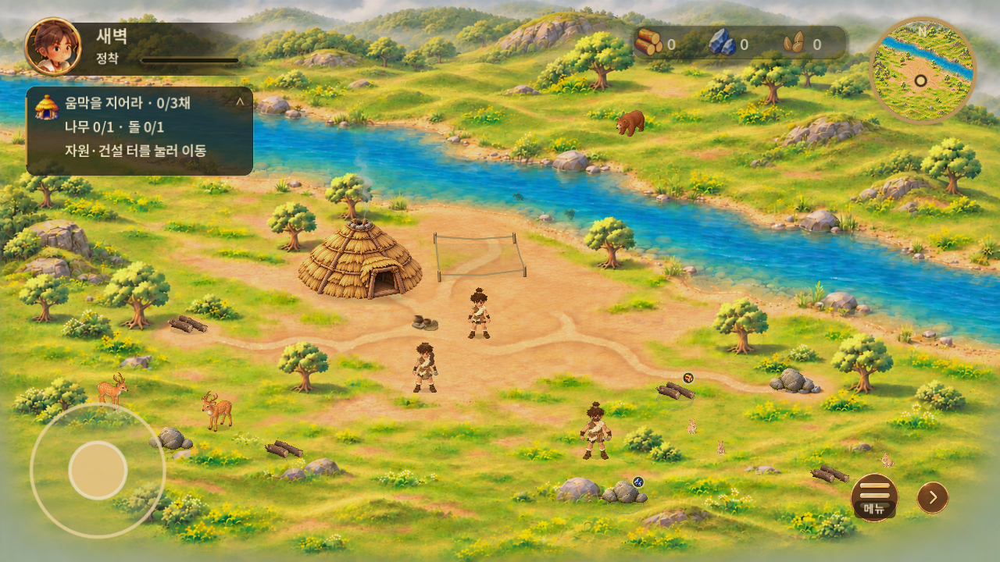 | 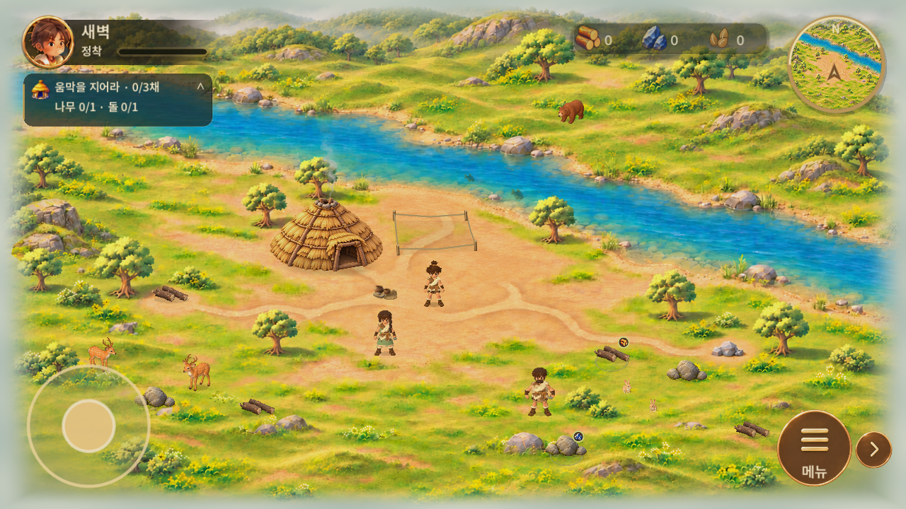 |
| 펼침 | 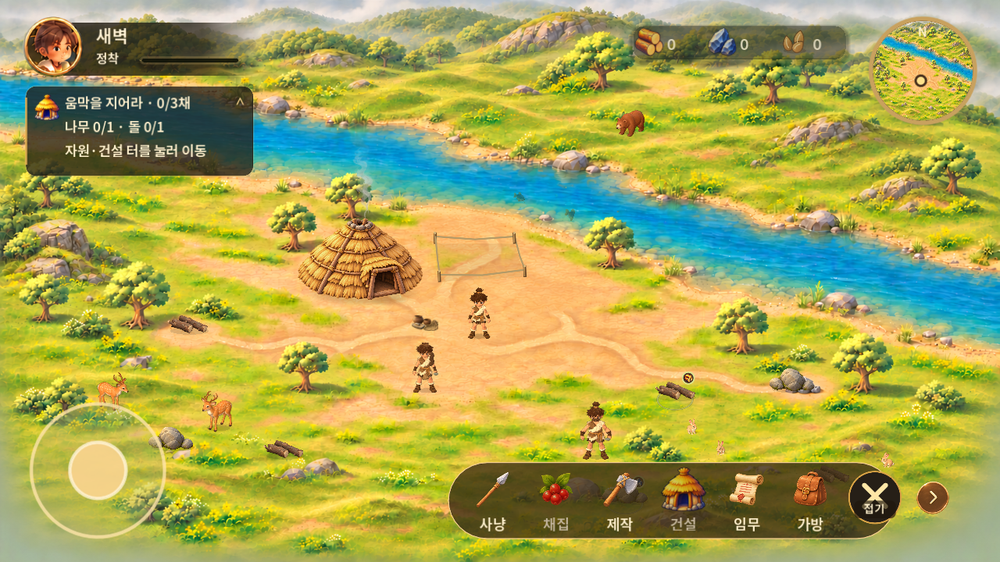 |  |
| 확대 | 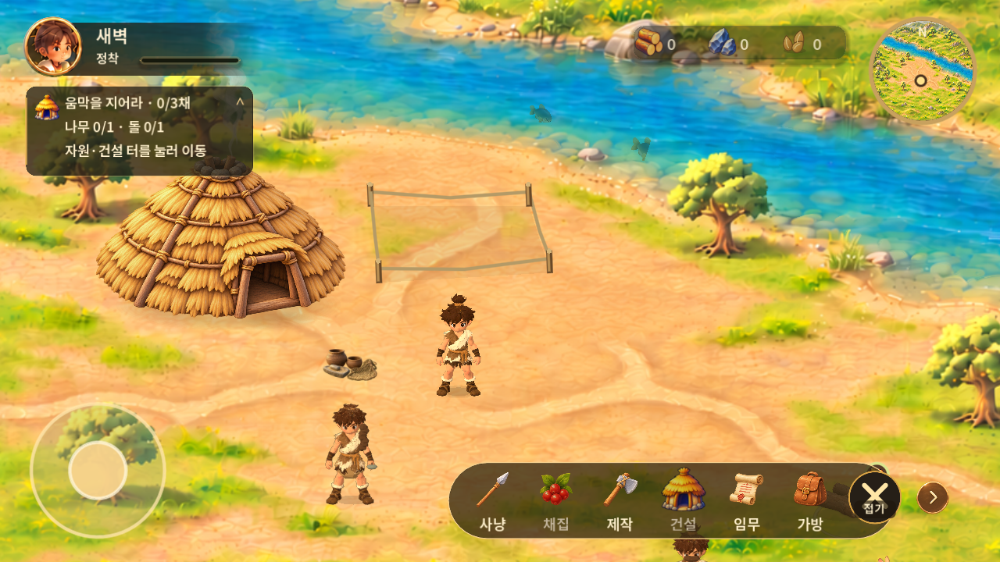 | 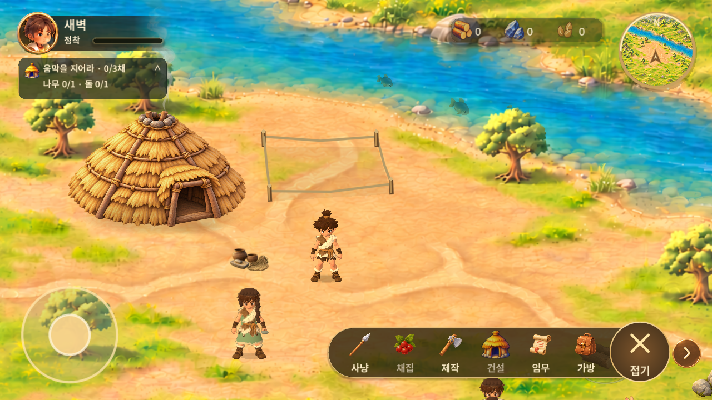 |
| 움집 뒤 | 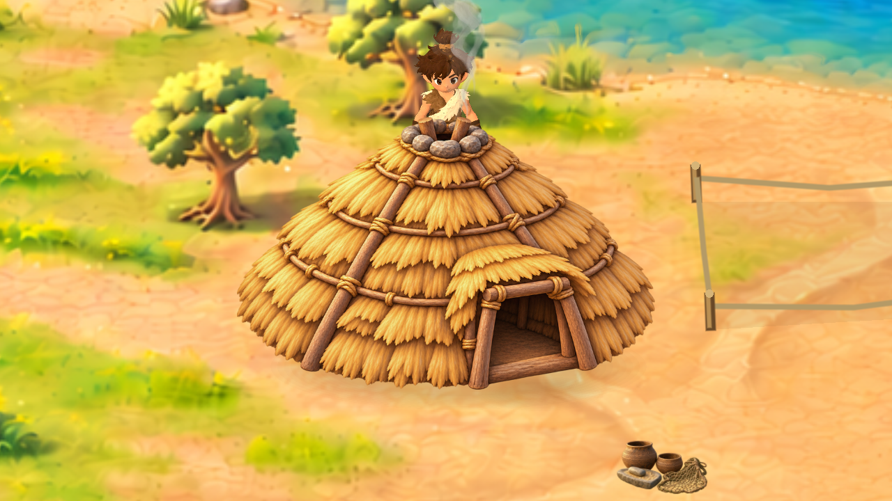 | 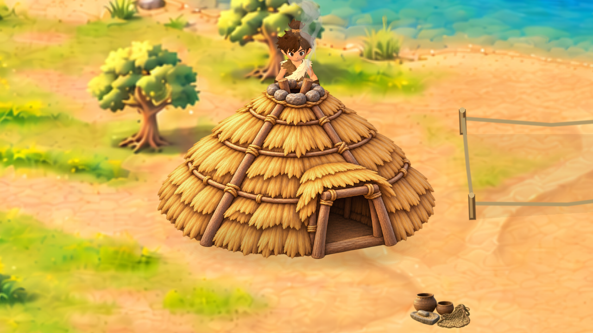 |
| 움집 앞 | 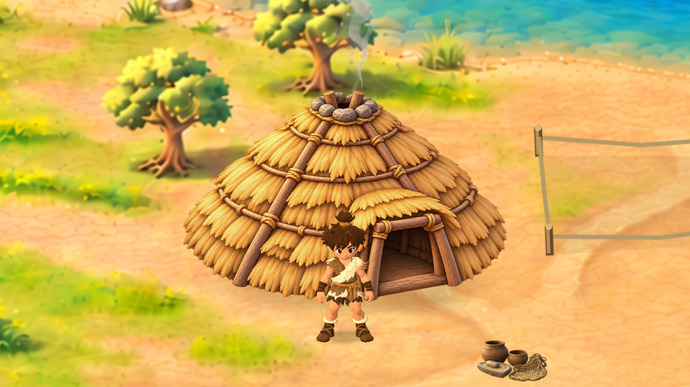 | 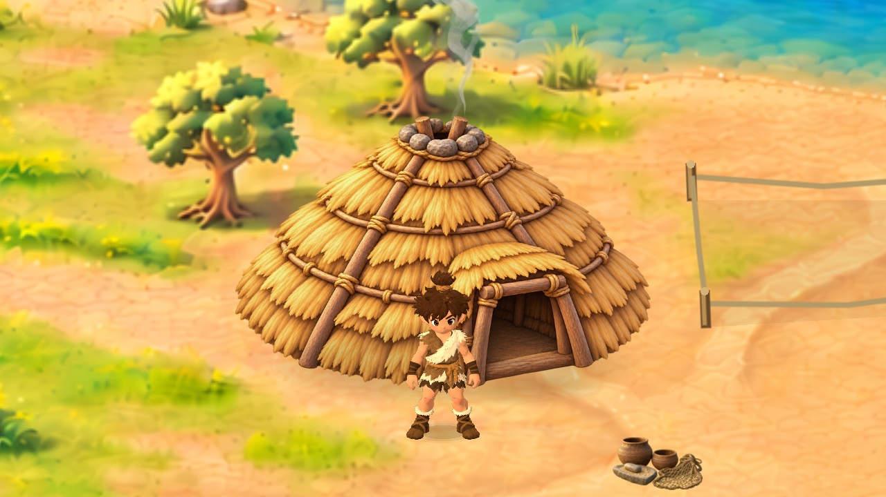 |
| 움집 옆 |  | 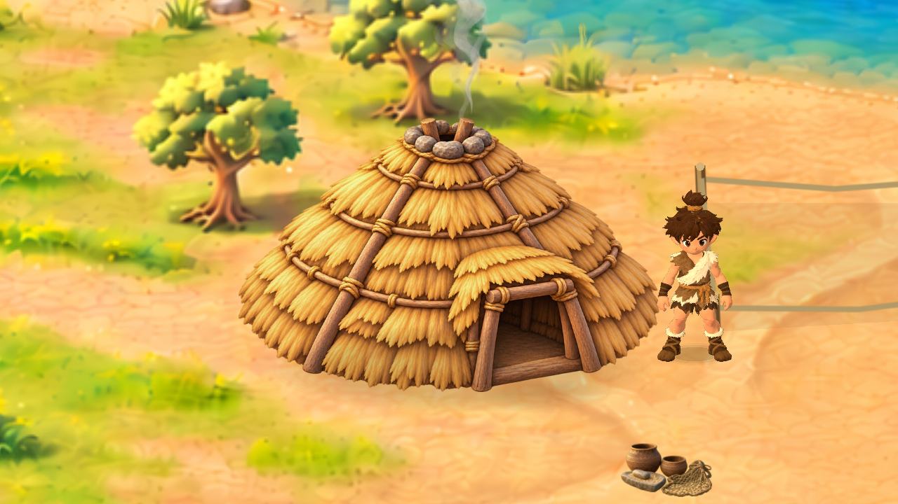 |
| 나무·돌 | 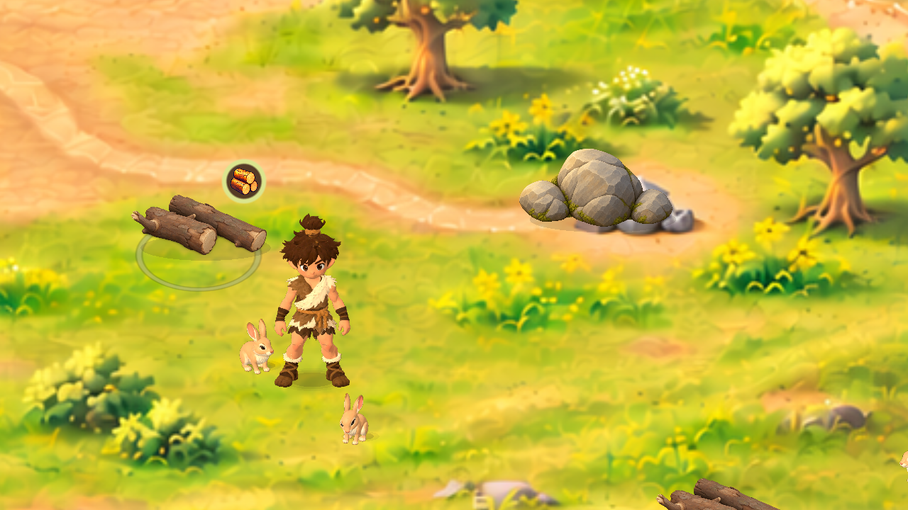 | 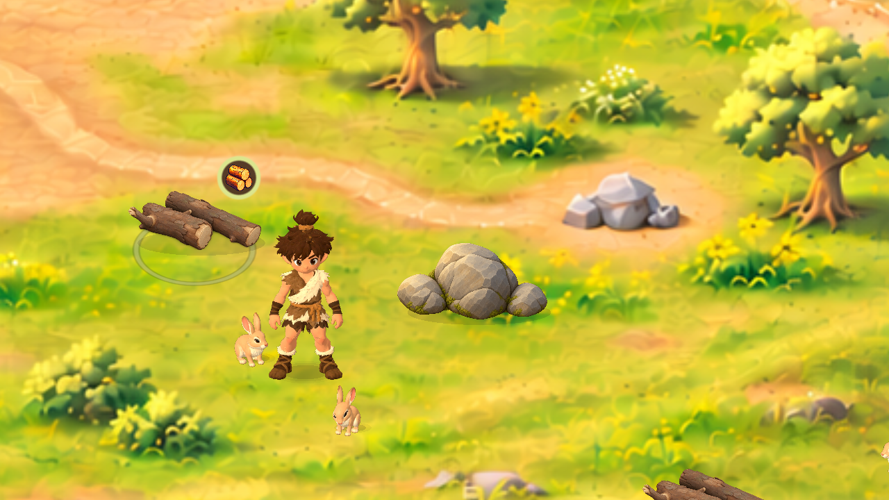 |
| 주민 정면 | 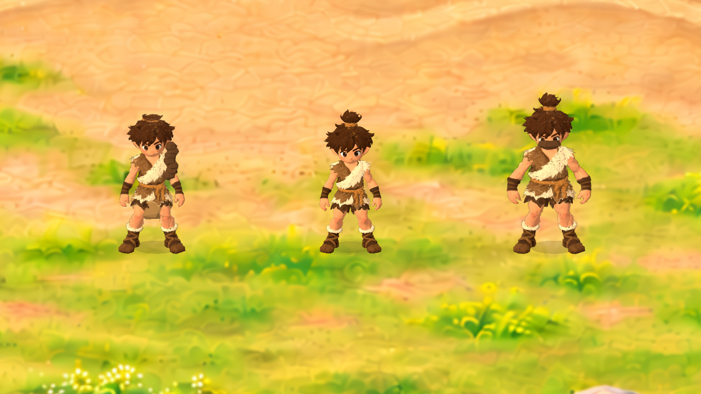 | 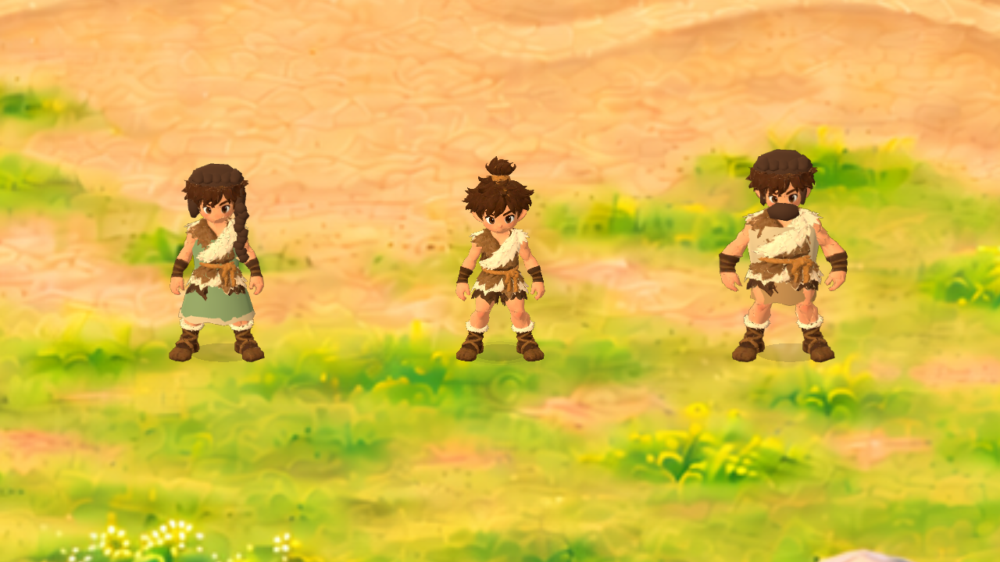 |
| 주민 후면 |  | 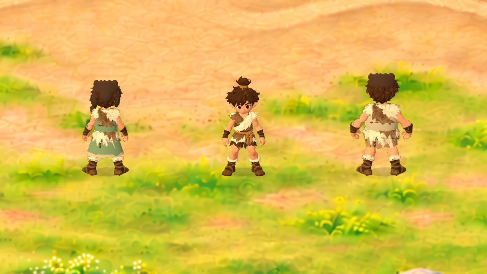 |

[보행 전](evidence/before-walk.mp4) · [보행 후](evidence/after-walk.mp4). 각7.03초·60fps·1배속, 같은 위치/입력/카메라1.4·속도181.5. 고정 게임 시계로 녹화해 영상 재생 속도는1배이며 실제 성능 측정 영상은 아닙니다. 최종 모델·보행 클립을 사용했습니다.

### 추가 최대 축소

| 기존 최소 | 새 최소 |
|---|---|
| 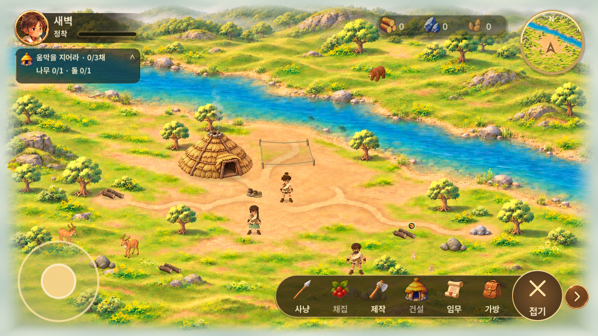 | 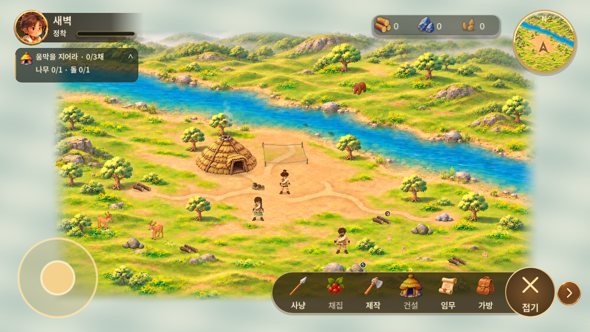 |

네 비율의 실제 가시 범위 측정 및 카메라 가장자리 검사 결과는 [수치](evidence/approved-polish-tests.json)에 있습니다. [커버](evidence/overview-after-896x370.png) · [펼침](evidence/overview-after-816x616.png) · [세로](evidence/overview-after-370x896.png)는 PC 창 크기 모사이며 실물 폴드 캡처가 아닙니다. 새 축소에서 자원 탭 좌표, 경로 취소, 조이스틱 크기 유지도 검사합니다.

## 검증과 실패 원인

- 최초 `interaction_tests`, `presentation_tests`, `play_experience_tests`는 옮기기 전 돌의 고정 좌표를 사용해 실패했습니다. 실제 자원 위치와 채집 접근점을 사용하도록 수정했습니다. 보상·저장·취소 기대값을 유지했고, 채집 시작 후 핀치 취소인지 확인하는 조건을 추가했습니다.
- 전체 실행에서 `play_flow_tests`의 돌 탭 좌표와 `village_controls_tests`의64px 고정 크기도 발견했습니다. 실제 돌을 탭해 경로가 시작되는지, 메뉴의 최소 터치 크기·확정 이미지·중복 아이콘 부재를 검사하도록 바꿨습니다. 검사 생략 없음.
- 한 재실행은 사용자가 확인하는 창과 자동 검사 창의 외부 입력이 섞일 수 있어 결과를 채택하지 않았습니다. 자동 검사 창을 화면 밖/포커스 비활성으로 분리한 뒤 전체를 다시 실행했습니다. 합성 터치·키 입력과 실제 물리/렌더 검사는 그대로 유지합니다.
- 최종 전체 결과: **28묶음 통과 / 0실패 / 로컬 목록 중 미실행0**, 추가 UI·가림·축소73개 포함.  [검사 목록](evidence/full-suite.json). 개별 원문 검사 보고서도 evidence에 포함합니다. 자동 검사 통과는 주관적 보행·아트 품질 승인이 아닙니다.
- PC 실행파일에서 버전0.1.28·생성일자 표시, 기존 저장 이어하기와 실제 플레이 화면을 관찰했습니다. 이후 사용자 입력과 이동 중 경로/안내 변화도 관찰됐지만 직접 조작 검사를 완료한 것으로 계산하지 않습니다.
- **Escape로 컴퓨터 제어가 중단되어 최종 실행파일의 메뉴 클릭·이동·Ctrl+휠 직접 입력 검증은 미완료**입니다. 특히 추가 최대 축소 변경 이후의 최종 EXE는 자동 엔진 검사/빌드와 직접 입력 검증을 구분합니다. 이전 프로세스 조회만으로 앱이 종료됐다고 보고했던 판단은 잘못됐으며 실제 Windows 창 목록과 화면에서 실행을 확인했습니다.
- 이번 버전의 Android/에뮬레이터 최종 검사·APK는 수행하지 않았습니다. 실기기·장시간 성능·직접 청취는 미검증입니다. 사용자 PC 전체 확인 후 진행합니다.

## PC 재실행

전달된 `RoxHistory-0.1.28-YYYYMMDD-HHMMSS.exe` 한 파일을 더블클릭합니다. Godot 설치나 소스 폴더가 필요 없는 PCK 내장 Windows x86_64 실행본입니다. 시작 화면에서0.1.28 및2026.11.04를 확인하고 **이어 하기**로 기존 저장을 사용합니다. 새로 시작/완전 초기화는 검증 때문에 누르지 않습니다.

마우스로 빈 땅/자원 탭, 하단 메뉴, 퀘스트 접기, `Ctrl+휠` 확대·축소, 조이스틱, 미니맵 복귀를 확인할 수 있습니다. 최종 실행 파일명·SHA256은 [PC 전달 정보](evidence/pc-build.json)에 기록합니다. 기존 검토 파일은 사용자 확인 전까지 보존합니다.

## 자산과 남은 차이

- 확정 UI: `game/assets/ui/s40000/`, Figma645:157(접힘),645:158(펼침). [참고 접힘](evidence/reference-folded.png) / [펼침 원본](evidence/reference-expanded.png). 임시 다운로드 URL을 실행 코드에 넣지 않았습니다.
- 주인공: `game/assets/characters/meshy01/hero.glb`, `portrait.png` 원본 변경 없음.
- 주민 편집 원본: `art-source/resident-prototypes/*.blend`, 생성 절차 `tools/prepare_resident_prototypes.py`; 게임 GLB 각16,000삼각형/1024텍스처. [출처·제약](../../../art-source/resident-prototypes/README.md).
- 모션: `game/assets/characters/motion/brisk_walk_v002.tres`; v001 보존, `game/tests/bake_walk_clip.gd`로 재생성.
- 확정 움집PNG·배경 원화 유지. 신규 축소 여백은 기존 배경과 어울리는 옅은 안개 셰이더 처리이며 새 플레이 맵이 아닙니다. 가장자리 픽셀 늘리기는 줄무늬가 보여 폐기했고, 바깥을 부드러운 안개로 덮도록 수정했습니다.
- 주민의 성인 얼굴/맨발/헤어 디테일, 전문 리깅 수준 보행, 원화와의 최종 체감 차이는 검토가 남아 있습니다. 에너지 표시 대신 실제 정착 진행도 사용. 외곽 안개 여백은 대표님 PC 화면에서 최종 확인해야 합니다.
