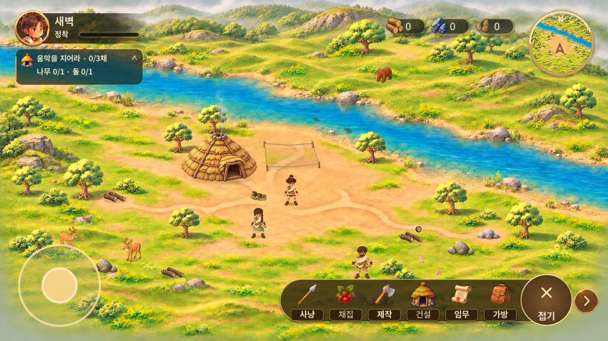
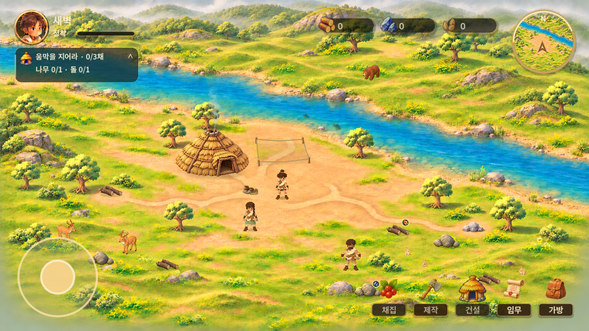

# 확정 3안 HUD — 1단계 구현

2026-11-04 · 기준 main `b12c2113ce703ff93246d708393ddbb5dd735363` · 작업 브랜치 `feat/selected-hud-build-sites-20261104`.

## 적용 범위

[Figma 01 확정 3안](https://www.figma.com/design/zkbflw9fCdAlWbphhw5pSS?node-id=689-330)의 실제 픽셀을 확인하고 반영했다. 초기 다운로드의 DNS 오류 이후 공식 Figma 응답 경로로 이미지 다운로드와 열람에 성공했다. 자료 접근 차단 상태가 아니다. 90 보관안은 사용하지 않았다.

- 상단 나무·돌·씨앗을 각각 반투명 검정 슬롯으로 표시. 예시 숫자와 기능 없는 + 대신 실제 보유 수량을 유지한다. 획득 애니메이션·5초 강조·평시 불투명도 75%는 기존 동작을 유지한다.
- 프로필 뒤 그라데이션 배경을 제거. 기존 초상화 PNG와 원형 프레임은 보존한다.
- 하단 채집·제작·건설·임무·가방 5개 메뉴를 항상 표시한다. 접기/펼치기·화살표·공통 캡슐 배경과 미구현 사냥 버튼은 제거했다.
- 채집·건설 가능 시 금빛 이름판/은은한 광택, 진행 중에는 진행 문구와 별도 색, 불가능할 때는 낮은 강조와 이유 안내를 사용한다.
- 제작은 기존에 실제 기능이 없으므로 비활성 상태로 유지하고 터치 시 준비 중임을 안내한다. 새 제작 시스템을 추가하지 않았다.
- 기존 Git의 `game/assets/ui/s40000/` 아이콘과 기존 I10000 건설 아이콘을 재사용한다. 새 이미지 생성이나 Figma 수정은 없다.

## 변경 코드

- `game/scripts/main.gd`: 상시 메뉴 배치와 상태 표현, 폐기된 토글 제거.
- `game/scripts/play_chrome.gd`: 검정 독립 슬롯, 프로필 배경 제거, 다섯 자리 이상 수량을 위한 슬롯 폭 확보.
- `game/scripts/touch_button.gd`: 새 메뉴의 진행 상태가 기존 큰 버튼 스타일로 덮이지 않도록 분리.
- `game/tests/selected_hud_tests.gd`: 실제 버튼 터치 경로, 상태별 캡처, 4개 화면 비율, 조이스틱/메뉴/자원 슬롯 분리 검사.
- 기존 접기 버튼을 전제로 한 검사·캡처만 최신 상시 메뉴 계약으로 갱신. 이동·가림·보상·음향 검사 내용은 유지.

## 검증과 시각 차이

Windows Godot 4.5.1의 별도 테스트 저장소와 화면 밖 렌더링을 사용한다. Windows 컴퓨터 제어를 재개하지 않았다. 화면 크기는 1280×720, 896×370, 816×616, 370×896이다. 폴드 크기 시뮬레이션이며 물리 기기 검증이 아니다.

이번 단계는 HUD만 수정했다. 주인공/보행/저장/보상/BGM 구현은 변경하지 않았다. 원화의 둥근 돌 받침 질감은 별도 승인된 원본이 없어 새로 그리지 않았으며, 기존 아이콘과 간결한 이름판을 사용했다. 기존 원형 초상화는 보존 지시에 따라 유지하여 원화의 프레임 없는 얼굴과 차이가 있다. 화면 전체의 지형·캐릭터 위치까지 일치시킨 결과는 아니다.

새 부지 선택·건설 연출·철거 미리보기·일반 클릭 작업 유지 등은 후속 승인 범위로 남아 있다. 철거 정책과 새 공개 배포는 답변 전 임의 확정하지 않는다. 이 문서는 전체 새 라운드 완료 보고나 APK 배포 보고가 아니다.

## 이번 단계 검증 결과

- 기존 회귀 30/30 통과: 상태/저장, UI 터치, 이동/자동 경로, 채집/재생성, 건설/보상, 가림, 기존 보행, 지역 선택, 음향 재생 상태 포함. [전체 결과](evidence/full-suite.json)
- 새 HUD 145개 항목 통과: 4개 화면 비율, 상시 메뉴, 터치 영역 분리, 실제 터치로 채집·건설·임무·가방 연결, 비활성 안내, 중단 시 재료 보존. [결과](evidence/selected-hud-tests.json)
- 기존 에셋 137개 크기·SHA-256 검증 통과. 코드 공백 오류 검사 통과.
- Android 신규 APK/실기기 검증, 원격 CI, 직접 청취는 이번 HUD 단계에서 수행하지 않음. 공개 배포 없음. 버전은 아직 기존 v0.1.30 메타데이터이며 이 변경이 기존 배포본에 포함되었다는 의미가 아님.

## 실행 캡처

동일 1280×720, 플레이어 위치 (1150,810), 기본 카메라의 전후 비교. 배경 주민/동물의 움직임은 정지했지만 난수 배치는 다를 수 있다.

| 변경 전 | 변경 후 |
|---|---|
|  |  |

- [채집 가능](evidence/selected-hud-gather-ready.png) · [채집 진행](evidence/selected-hud-gather-working.png)
- [건설 가능](evidence/selected-hud-build-ready.png) · [건설 진행](evidence/selected-hud-build-working.png) · [행동 불가](evidence/selected-hud-unavailable.png)
- [커버 비율](evidence/selected-hud-layout-896x370.png) · [펼침 비율](evidence/selected-hud-layout-816x616.png) · [세로](evidence/selected-hud-layout-370x896.png)

빌드/자동검사 통과와 원화에 대한 최종 시각 승인은 별개다. 위 잔여 차이를 포함해 사용자 시각 검토는 아직 완료되지 않았다.
