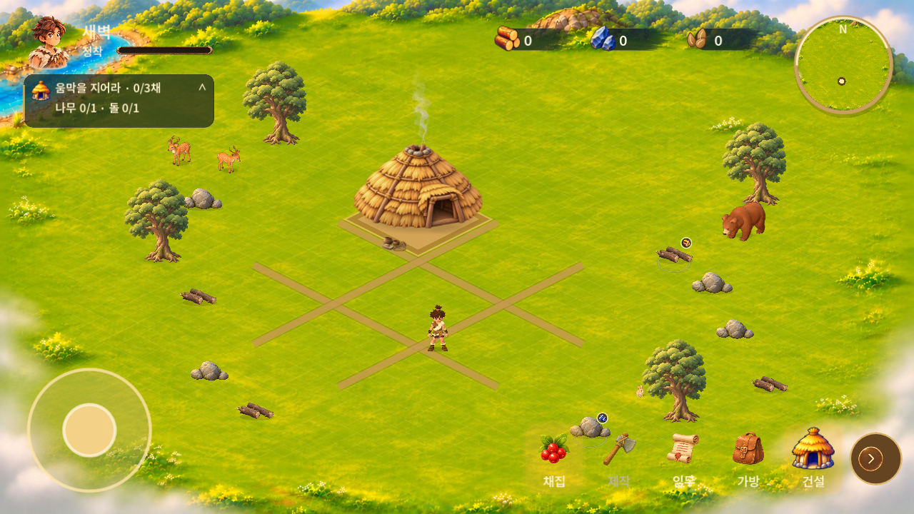

# 사선 마을 v0.1.34 · 2026-11-05

기준 main: 819f3fce0fa3738d31a5bdb11b9c712c0fe9737d. 작업: feat/isometric-village-20261105.
[Figma 새 기획](https://www.figma.com/design/zkbflw9fCdAlWbphhw5pSS?node-id=771-403), 세부 확인: 780:118, 773:13, 772:577.

## 적용
- 촌장 1채 + 주민 5채 = 총 6채를 임시 기준으로 적용했습니다. 포함 여부 질문은 아직 답변 전이며 MAX_RESIDENT_HOMES로 분리했습니다. 주민 3채 건설 퀘스트와 총 용량은 별개입니다.
- 촌장 6×6, 주민 4×4 사선 격자. 한 칸 투영축 (32,16)/(-32,16), 월드 2400×1350. 6개 후보 중 최대 5곳에 주민 집을 지을 수 있습니다. 건설은 원격 2초, 나무1+돌1을 유지합니다.
- 새 배경의 좌상단 하천에 맞춰 이동 경계·충돌·채집·동물 위치 재배치. 동물/충돌체가 부지를 점유하면 건설 불가. 기존 승인 3D 동물 재사용, 물고기 제거.
- 주민 3채 → 기존 3D 성인 2명이 방문 → 말풍선 터치 → 촌장 접근 → 1.5초 대화 진행 → 합류. 중간 취소 시 재시도, 저장된 합류는 한 번만 처리됩니다. 별도 신규 가족 모델/인구 시스템은 추가하지 않았습니다.
- 기존 저장의 건물 ID·스타일·비용·보상·자원·소진 수량 유지. 좌표와 부지는 새 지형으로 한 번 이전합니다. 원본 백업 흐름 유지.
- 최소 줌 0.8333→0.6410: 보이는 선형 범위 약30% 증가. 최대2.0→1.5. 초기1.0. 최외곽은 이동 불가 안개 영역입니다.
- 원형 메뉴, 제공 초상화·에너지 프레임·건설 확인/취소 PNG, 미니맵 점 적용. 상태 막대는 기존 정착 진행도이며 가짜 에너지 수치를 넣지 않았습니다.

## 최소 검증
- Windows Godot4.5.1/NVIDIA RTX5060, 1280×720, 격리 저장: 새 마을 48개, 상태/저장 349개 통과. 실제 엔진에서 3채 건설→접근/대화/합류→추가 건설→저장 로드, 구버전 이전, 채집·철거·중복 보상/환급 방지 확인.
- 지정 자산148개 크기·SHA256 확인.
- Android15 x86_64 읽기 전용 AVD: 기존0.1.4 설치 위 업데이트 성공, 타이틀 실행 확인. 기존 배포 서명 SHA256 cf65aeecb4e399ba9e2e6b9fa947f34f8c31bd75c8e3b686ad29d8431bb1695f 유지. 구버전 테스트 저장 이전/재실행 통과: 자원7/8/10, 건물 built-8과 보상 상태 보존, site5→0 한 번 이전. 재실행 파일 해시 동일. [검증 기록](android-verification.json) · [Android 시작 화면](android-start.png).
- 요청에 따라 반복 회귀를 줄였습니다. 기존 지형 고정 좌표 검사들은 삭제하지 않고 workflow_dispatch의 legacy_scene_checks로 남겼습니다. 기본 CI는 자산/음향 출처/상태349/새마을48으로 구성합니다. 과거 전체 검사 통과로 보고하지 않습니다.
- 실물 Android·폴드 터치, Android 내 전체 플레이, 직접 청취, 장시간 성능 및 최종 원화 일치도는 미검증입니다. 시각 승인은 사용자 검토 사항입니다.

## 비교 및 남은 차이

[최대 확대](zoom.png) · [건설 미리보기](preview.png) · [가족 방문](family.png) · [6채](complete.png)

원화와 같은 개별 모델/UI를 재사용했지만 길/부지 가장자리의 흙 질감, 메뉴 크기/간격, 가족 표현은 원화와 차이가 남습니다. 길은 격자 방향의 반투명 지면 선이며 새 흙 텍스처를 임의 제작하지 않았습니다. Android 시작 시 캐시 셰이더 재컴파일 경고가 있었고 시작은 정상입니다.

## 자산 출처·편집 원본
- 공유 브랜치 bdd61b09374487961b3eeef5d419baa29ee7e01e의 design/reference-images/2026-11-05-isometric-village-terrain/terrain-s40000-isometric-clean-edited-v003.png → game/assets/environment/terrain-isometric-v034.png. SHA256 504f52757a228434ae1141750d50640d328d6e1d350d498952991cacd81fa208. 사용자 승인 편집본이며 원본 레이어 파일은 아닙니다.
- 같은 공유 브랜치 design/reference-images/2026-11-04-hud-action-assets/{chief-portrait,energy-bar-frame,build-confirm,build-cancel}.png → game/assets/ui/v034/. 원본 해상도/알파 유지, 코드에서 표시 영역만 자릅니다.
- 기존 움집·동물·메뉴 아이콘 재사용. 움집 축소 선명도는 mipmap 생성으로 조정. 기존 출처/이용 조건 그대로 적용하며 신규 외부 구매·다운로드 모델 없음.
- APK만 GitHub 배포, Windows 실행 파일은 이후 로컬 저장 원칙 유지.

