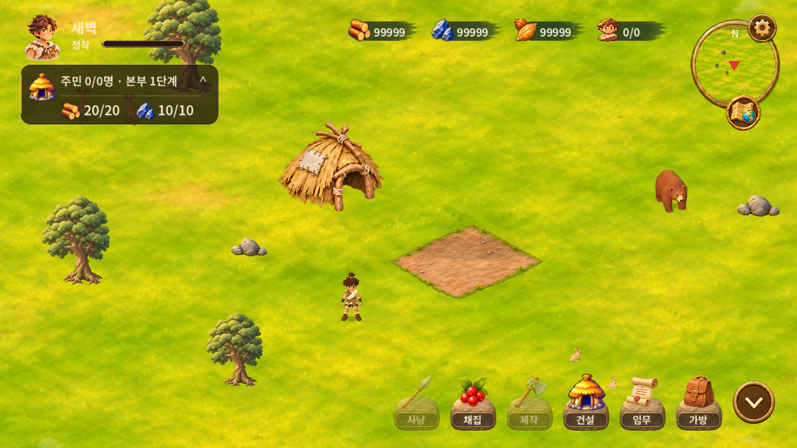
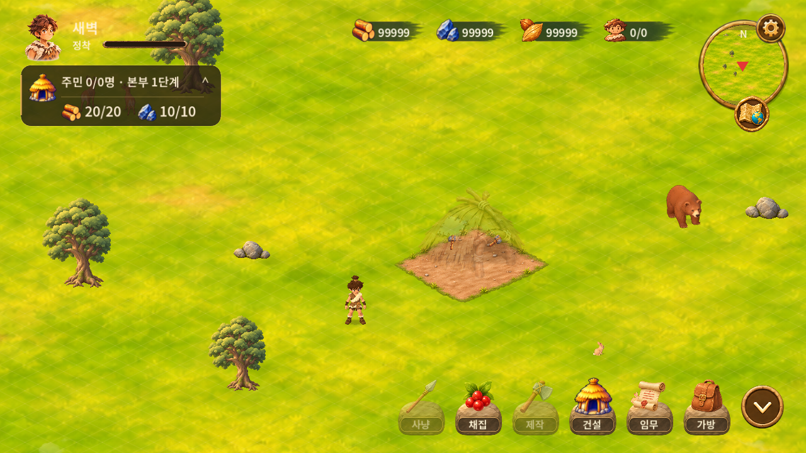
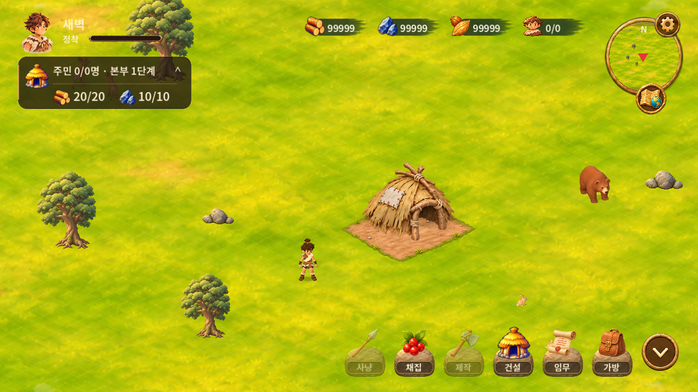

# v0.1.57 이동·건물 이동 연출·5초 공사

- 기준 커밋: 430faa852662a1db4143321eef889882b3c498ed
- 작업 브랜치: feat/movement-v057-20261107
- 버전: 0.1.57 / Android versionCode 58
- 기존 저장을 유지하며 초기화하지 않았습니다.

## 변경
- 이동 중 목적지 변경: 실제 도착점과 직선 이동 가능 여부를 먼저 검사하고, 격자 경로는 주변 후보 중 실제 도달 가능한 경로를 탐색합니다. 도달 불가능한 탭은 기존 이동을 취소하지 않습니다.
- 핀치·카메라 드래그·휠 확대 중에도 자동 이동과 목적지를 유지합니다. 핀치 해제 입력이 새 이동 명령으로 전달되지 않는지 검사했습니다.
- 건물 이동 원본은 불투명도 85%와 어두운 색조, 작은 이동 표식으로 표시합니다. 취소 시 복원합니다.
- 이동 확정 시 원래 자리에서 먼지·망치로 1.5초 사라지고, 새 자리에서 1.5초 나타납니다. 진행바는 없으며 비용·환급 없이 위치만 한 번 저장합니다. 앱이 중단돼도 저장된 최종 위치로 복구됩니다.
- 개발 설정을 ‘건설·업그레이드 5초 완료’로 변경했습니다. 켜면 모든 종류·단계 공사가 5초입니다. 진행 중 켜면 남은 시간을 최대 5초로 제한하고, 끄면 현재 진행 비율을 유지하며 정상 시간으로 돌아갑니다. 기존 10배속 ON 저장도 새 방식으로 이관합니다.

## 검증
Windows Godot 4.5.1 실행 및 자동 검사 총 308개 통과:
- 상태·저장·건설 검사 192개
- Windows UI 회귀 검사 46개
- 공사 취소·단계별 효과 검사 24개
- 목적지 변경·합성 터치 핀치·이동 연출·5초 설정 검사 46개

실제 Windows 렌더 화면과 원속도 이동 연출을 확인했습니다. Android APK 빌드, 패키지 및 서명 검증은 통과했습니다. Android 설치·업데이트·실기기 멀티터치 및 직접 청취는 미검증입니다. 자동 검사는 최종 시각 품질 승인과 구분합니다.

## 비교 자료

[실제 실행 영상](evidence/relocation.mp4)

기존 건물 에셋을 재사용했습니다. 먼지·망치와 이동 표시만 코드 효과로 추가했습니다. 전체 디자인 및 구름 리터치는 이번 범위에 포함하지 않았습니다.

## APK
[단일 APK 다운로드](https://github.com/byungho-cho/roxhistory/releases/download/v0.1.57/RoxHistory-0.1.57-20261107-192756.apk)

SHA-256: 8aae145652fa252dac15f4f162a0642de3b9c77cd1eb54d5c34fe5a9d66a26ec

기존 로컬 배포판 및 v0.1.56과 동일한 서명을 유지했습니다. 다른 서명으로 만든 v0.1.50·v0.1.51 Cloud TEST에는 덮어쓰기할 수 없습니다. 앱 삭제나 저장 초기화는 수행하지 않았습니다.
