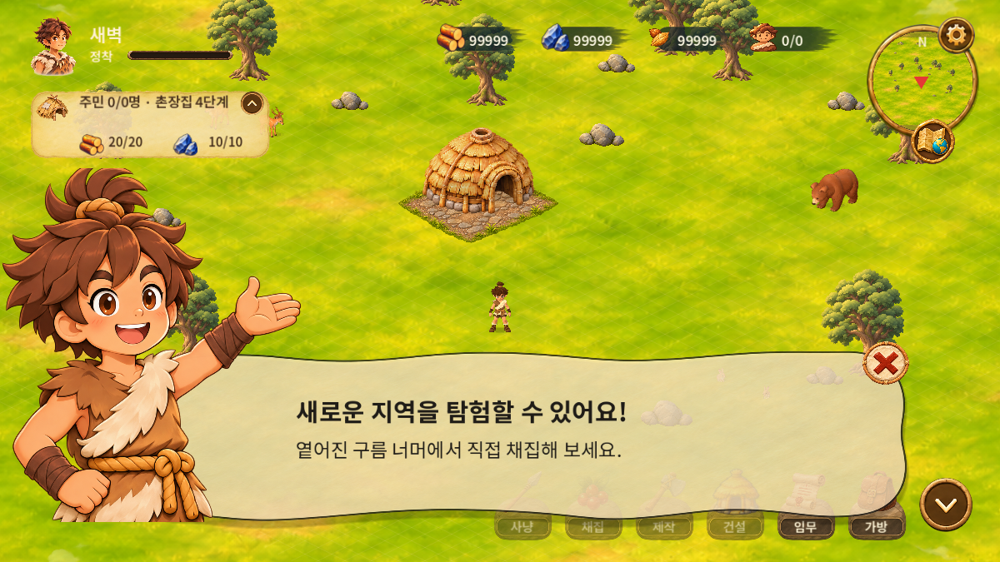
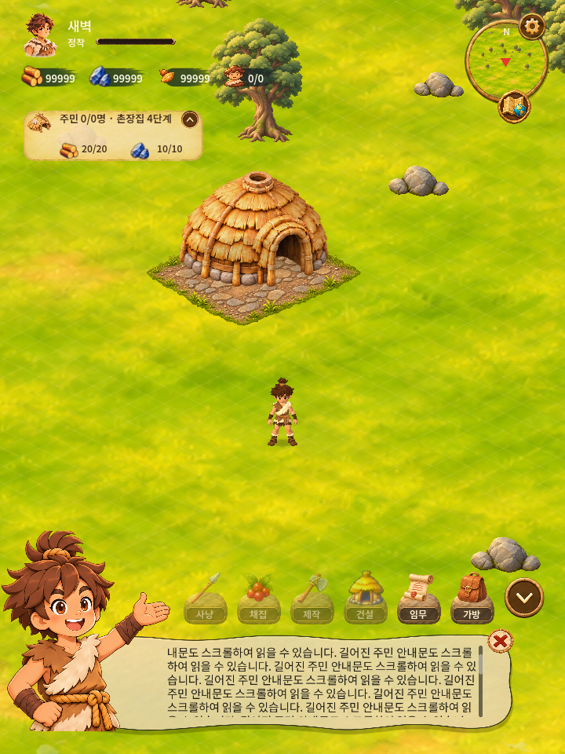

# U10400 캐릭터 안내 메시지 리팩터링

2026-11-08. 작업 브랜치 feat/world-polish-await-farm-20261108. 이전91928c6의 농장 제외 수정은 보존했다. **농장 에셋 적용 후 빌드한다는 지시를 유지하며 APK/EXE 빌드·배포·버전 변경·main 병합은 하지 않았다.**

## 디자인 대조

Figma 파일 zkbflw9fCdAlWbphhw5pSS를 읽기만 했다.
- 안내 프레임1627:83: 기준1200×675, 패널(149,415,949,212), 캐릭터(-67,202,468,425).
- 문구1627:86: 시작(355,475), 제목30px/행36px, 본문23px/행28px, 간격14px. 실제 제목/본문은 호출자 문구를 유지한다.
- 닫기1636:7295는 프레임 내부가 아닌 섹션1627:80의 형제 레이어다. 섹션 위치(1074,518)에서 프레임 위치(40,110)를 빼서 안내 프레임 기준(1034,408,58,54)에 배치했다.
- 패널의 설명 이름에는 알파90% 문구가 있으나 실제 Figma 렌더 노드 opacity는80%다. 실제 렌더 기준80%를 유지했다.

## 에셋

아래 세 원본이 모두 Git 추적 파일이며 Figma 현재 원본과 SHA256이 일치함을 확인했다. 새 에셋 요청/대체 제작은 필요 없었다. 이미지 파일은 수정하지 않았다.

| 용도 | 기존 Git 파일 | Figma 분리 원본 |
| --- | --- | --- |
| 캐릭터 | game/assets/ui/v0159/guide-character.png | 3719a.png |
| 크림 패널 | game/assets/ui/v0159/guide-panel.png | 1b868.png |
| 원형 빨간 X | game/assets/ui/v034/build-cancel.png | f2ca1.png |

기존 guide-close.png의 검정 X는 사용하지 않는다. 예시의 잔디 배경은 실제 게임 월드로 유지하며 Figma 화면 캡처를 게임 에셋으로 사용하지 않았다. 런타임 원격 URL 없음.

## 수정

- 전체 안내 프레임에 들어가던 추가 여백을 제거하고 폭 기준으로 기획 구도를 적용했다. 넓은 화면에서는 비어 있는 프레임 상단을 활용하고, 극단적으로 넓은 화면은 캐릭터 머리가 안전 영역 밖으로 나가지 않도록 제한한다.
- 캐릭터는 원본 object-cover 비율과 왼쪽 전경 겹침을 유지한다. 패널→캐릭터 등장, 약한 좌우 움직임은 유지하고 기획에 없는 회전은 제거했다.
- 같은 글자 크기에서도 Godot의 Noto 행 높이가44/34px라 본문이 아래로 밀리던 차이를36/28px로 보정했다. 기본 문구의 전체 높이78px와 기획 Y475 위치를 맞췄다. 긴 문구는 패널 안에서 확장·스크롤하며 세로 화면 글자 최소 크기도 확보한다.
- X 이미지는 정확한58×54 슬롯에 두고 화면이 작아질 때 보이지 않는 터치 영역만 최소44px로 넓힌다. 이미지가 커지거나 위치가 밀리지 않는다.
- X/배경 터치 닫기, 패널 내부 터치 유지, 입력의 월드 전달 방지와 안내 중 중단·복귀 시 기존 작업 유지 동작을 보존했다.

## 검사

- 신규 기획 배치·에셋·글꼴/줄 높이·가로/와이드/세로·긴 문구 터치 스크롤·터치 X:19개 통과.
- 기존 HUD/안내/다음 작업 예약·중단/복귀·닫기·화면 크기 변경 회귀:45개 통과.
- 합계64개. Windows Godot 개발 실행 및 합성 터치 검사다. Android 실기기나 새 실행 파일 검증은 하지 않았다. 기존 전체 legacy 검사 통과를 뜻하지 않는다.
- 로그: D:\devtools\roxhistory-checks\guide-refactor-*.log.

