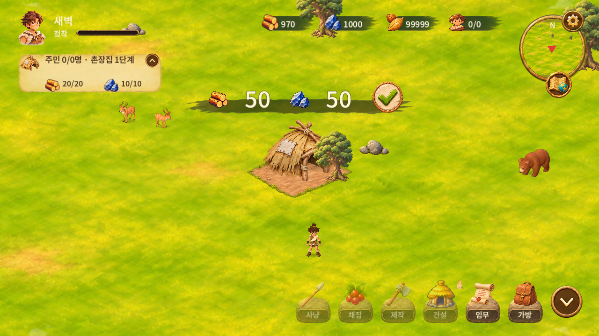
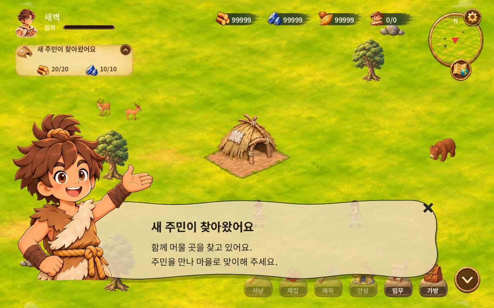
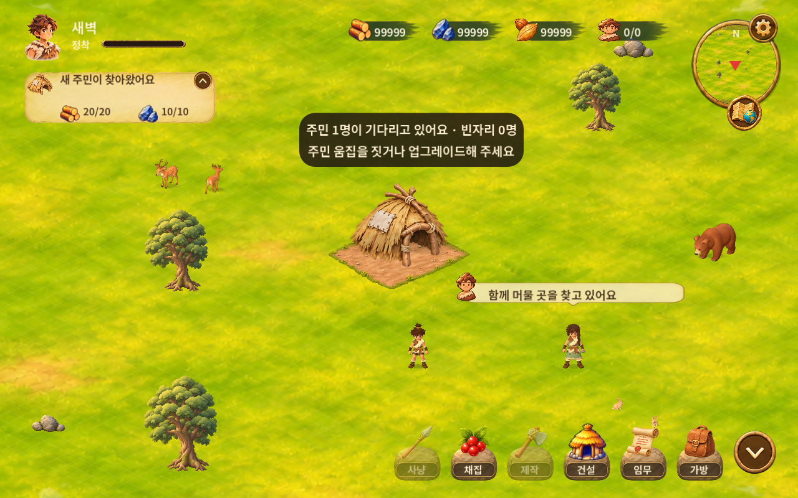
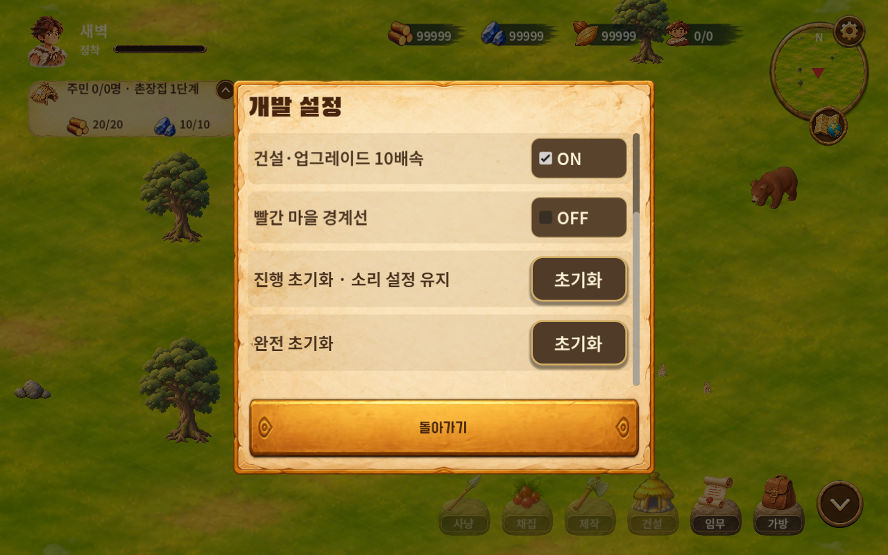
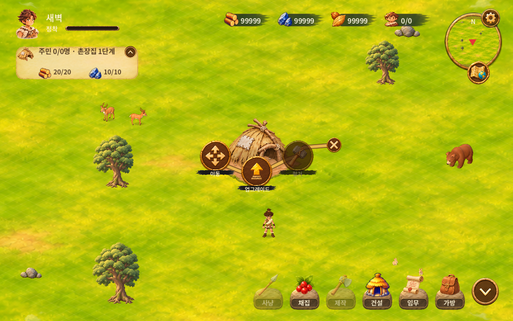
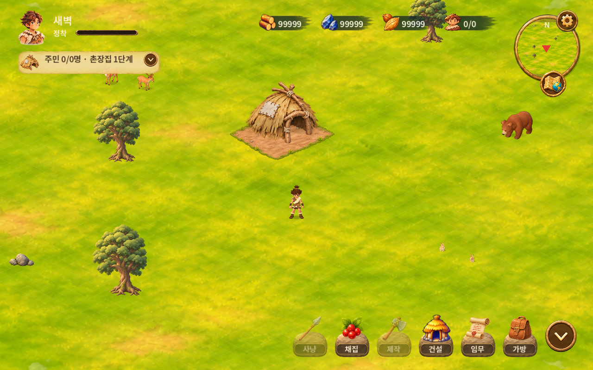

# 0.1.59 후속 구현·검증 · 2026-11-08

`91b6172` 인수인계에서 이어서 비용 HUD·캐릭터 안내와 이 채팅의 UI 수정 메모를 반영했습니다. 아래 기존 WIP 기록은 당시 이력으로 보존합니다.

## 반영 내용
- 공통 비용 HUD: 실제 건물·단계 비용, 분리된 붓터치/아이콘/숫자/확인 버튼 유지. 긴 숫자는 측정한 글자 폭에 맞춰 축소하며 자재 부족·확인 중복·취소/전액 환급 검증.
- 공통 캐릭터 안내: Figma U10400(1627:83)의 실제 opacity80%, 패널/캐릭터 순차 등장·좌우 움직임 유지. 모바일 작은 X도 전용 터치 버튼으로 닫힘. 안내 중 앱 중단·복귀 시 진행 작업과 이동 경로를 보존하고 안내 종료 후 재개.
- 주민 말풍선: 한 줄만 표시, 클릭/접근/짧은 대화와 수용 조건 설명 제거, 포커스 테두리 제거. 수용 불가 조건은 클릭 시 토스트로 표시.
- 주민 첫 등장: 공통 전체 화면 캐릭터 안내로 표시. 표시 이력은 저장해 같은 캠페인에서 반복하지 않음.
- 신규 게임: 개발 설정의 토글4개 모두 ON. 기존 저장의 사용자가 선택한 OFF는 유지.
- 개발 설정: 행·토글에서 시작하는 모바일 터치 스크롤 처리. 마지막 초기화 항목까지 표시하고 하단 돌아가기 버튼과 분리. 스크롤이 토글/초기화를 실행하지 않도록 처리.
- 퀘스트 HUD: 약8 논리 UI px 내부 여백. 접힌 상태에서 회전된 화살표도 배경 안에 유지. 촌장집 조사 오타 수정.
- 건물 메뉴: 주 버튼과 닫기 이미지20% 축소. 철거와 닫기 사이8px 간격. 닫기의 실제 터치 영역은44px 이상 유지.
- 버전0.1.59 / Android versionCode60. 동일 소스의 APK·EXE 한 쌍, `build/Roxhistory_0.1.59.apk`, `build/Roxhistory_0.1.59.exe` 사용.
- Figma는 읽기만 했고 사용자 디자인을 수정하지 않았습니다. 기존 MY-NUROX 디버그 키를 재사용하며 키 생성/교체는 하지 않습니다.

## 검사 결과
| 검사 | 결과 |
| --- | --- |
| HUD·캐릭터 안내 | 44개 통과 |
| 주민 말풍선·개발 설정·메뉴·퀘스트 | 22개 통과 |
| Windows v052 회귀 | 48개 통과 |
| 건물 모델 | 192개 통과 |
| 주민 채집·귀환 시나리오 | 24개 통과 |
| 건물 UI polish | 오류 배열 없음 |
| Godot 가져오기 | 성공 |

기존 Windows 실패 원인은 성장 안내가 열린 상태에서 검사가 곧바로 업그레이드 모달을 요청한 것이었습니다. 실제 안내 닫기 입력과 대기 중인 안내를 처리한 다음 업그레이드/취소/환급을 검사하도록 수정했습니다. 필수 노드 누락 시 검사 프로세스가 무한 대기하지 않고 실패 종료하도록 보완했습니다. 기본 ON 변경으로 정상 속도·건물 상한을 검사하는 기존 모델/Windows fixture는 명시적으로 해당 스위치를 OFF로 설정합니다.

Windows OpenGL 렌더링, 합성 마우스·터치, 가로1280×800/세로720×900 및 앱 중단·복귀를 확인했습니다. Android 실물 기기의 터치·청취·장시간 성능은 이번 자동 검사에 포함하지 않았습니다. 이전에 보고된 다른 레거시 검사 전체가 통과했다는 뜻은 아닙니다.

건물 이동 효과음은 이번 HUD/UI 범위와 분리된 후속 항목으로 남깁니다. 기존 게임 진행 저장을 초기화하지 않았고 테스트는 개별 `user://` 경로를 사용했습니다.

## 실행 증거

정확한 배포 소스와 파일 해시는 `build/release-manifest.json`과 [0.1.59 릴리스](https://github.com/byungho-cho/roxhistory/releases/tag/v0.1.59)에서 확인합니다. 배포 파일은 Git에 커밋하지 않고 Releases 첨부로 관리합니다.

---

## 이전 WIP 인수인계 기록

# 개발 인수인계 · 비용 HUD / 캐릭터 안내 · 2026-11-08

## 상태와 이어받는 방법
사용자 요청으로 작업을 임시 중지했습니다. 완성·배포본이 아닌 WIP입니다.
- 저장소: https://github.com/byungho-cho/roxhistory
- 브랜치: feat/hud-guide-20261108
- 기준 main: df1cb74 (이전 로컬 f22032c의 변경을 포함한 main으로 fast-forward 후 작업)
- 다른 PC에서는 해당 브랜치를 fetch/checkout하여 이어서 작업합니다. main에는 아직 병합하지 않았습니다.
- 프로젝트: game/project.godot, Godot 4.5.1
- 앱 버전은 main의 0.1.58 그대로이며 새 빌드·배포·버전 증가는 하지 않았습니다.
- 실제 사용자 저장을 초기화하거나 삭제하지 않았습니다. 테스트는 별도 user:// 경로를 사용했습니다.
- Figma는 읽기만 했으며 사용자 수정본을 변경하지 않았습니다.

## 확정 요구사항
1. S40100 02-2 사용자 수정본 1427:6916 / I10000 MAT-007 1426:318:
   금색 패널과 X 제거, 붓터치 380×39 / 알파60%, 자원 아이콘32px, 확인 터치 영역60px.
   표시 수량은 실제 건물·단계 비용. 20/10 고정값 금지.
   X 제거 후 새 취소 방식은 미정. 기존 취소 경로 및 진행 중 취소·전액 환급 유지.
2. U10400 1627:80 / 에셋 1626:340:
   크림 패널 알파80%, 검정 테두리·글자·작은 X, 은은한 그림자.
   캐릭터가 패널 왼쪽 전경을 가림. 패널 먼저, 캐릭터 다음 등장 및 약한 좌우 흔들림.
   X 또는 안내 바깥 터치로 닫고 월드 입력으로 전달하지 않음. 호출자가 전달한 문구를 표시.
3. 앞서 메모한 건물 이동 애니메이션의 기존 건설 효과음 연결은 아직 미반영. 이번 HUD 작업과 별도 후속 항목.

## 반영된 코드
- game/scripts/build_cost_display.gd: MAT-007 공통 분리 HUD. 붓터치·기존 목재/돌·실제 숫자·확인 버튼.
- game/scripts/upgrade_confirmation.gd: 위 공통 HUD를 건물 상단에 배치. X와 금색 패널 제거.
- game/scripts/build_preview.gd: 신규 건설에도 같은 HUD 연결. 기존 부지 선택 취소 경로 유지. 건물 이동 자체의 O/X는 유지.
  위치 선택 후 이전 위치 선택 토스트를 정리하여 비용과 겹치지 않도록 수정.
- game/scripts/character_guide.gd: 공통 안내 화면. 동적 제목/본문, 긴 본문 스크롤, 순차 등장, 캐릭터 흔들림, 닫기.
- game/scripts/main.gd: show_character_guide(title, body) 추가, 화면 비율 변경 시 열린 안내 내용 보존.
- game/scripts/building_workflow.gd: 촌장집 단계 상승 안내를 새 공통 안내로 연결. 다른 모달/배치 중에는 대기.
- game/tests/hud_guide_v0159_tests.gd: 확인·실제 비용·환급·닫기·입력 전달 방지·화면 비율·저장 재진입 검사.
- game/tests/v0158/building_polish_test.gd: 이전 금색 HUD 기대값을 이번 확정안으로 변경.

## 에셋과 출처
game/assets/ui/v0159/에 Figma에서 내려받은 PNG 원본 보존:
- guide-character.png: 1627:85 / 1625:340
- guide-panel.png: 1627:84 / 1625:341
- cost-brush.png: 1641:7286 / 1636:7303
- guide-close.png: 1626:347의 기존 검정 X 원본
기존 res://assets/figma-latest/b7632.png의 목재·돌 크롭과 res://assets/ui/v034/build-confirm.png 재사용.
런타임 임시 URL 없음. crop은 AtlasTexture로 비파괴 적용, 원본 PNG 유지.
패널·문구·캐릭터·버튼 분리. 실제 화면 크기는 기존 Godot 960×540 논리 UI 스케일을 따릅니다.

## 수행한 검사 / 실제 결과
- 신규 HUD·안내 실행 검사: 26개 통과 (Windows OpenGL, 1280×720 / 세로 전환, 합성 터치).
- building_model_v0151_tests.gd: 192개 통과.
- v0158/building_polish_test.gd: 오류 배열 없음.
- windows_v052_tests.gd: **실패 / 미완료**.
  73행 “Compact approved upgrade panel” 실패 후 77행 ConfirmUpgrade null 접근.
  전체 통과로 보고하지 마세요. 새 촌장집 성장 안내가 기존 회귀 흐름의 업그레이드 요청을 막았는지,
  기존 테스트 상태·타이밍 및 최신 HUD 탐색 경로를 확인해야 합니다. 원인 확정 전입니다.
- Godot import/스크립트 로딩 성공.
- 이번 변경의 APK/EXE export, Android 설치, 실제 모바일 터치·청취: 미수행.
- 자동 검사는 사용자 최종 시각 승인과 다릅니다.

## 이어서 할 일
1. 실패한 Windows 기존 회귀를 재현하고 원인을 확인. 안내/업그레이드 모달 간 충돌인지 검사하고 필요한 수정만 적용.
2. 비용 HUD와 guide의 크기·간격을 Figma와 최종 대조. 4자리 이상 비용은 27px로 축소하므로 필요한 비용 범위에서 겹침 검사.
3. 건설 자재 부족, 확인 연타, 배치 취소, 업그레이드 배경 닫기, 진행 중 X·환급 회귀를 마무리.
4. 캐릭터 안내를 띄운 상태에서 앱 중단·복귀, 기존 자동 이동/작업 복귀 확인.
5. 필요 시 건물 이동 출발·도착 효과음(기존 build cue, 음소거·중복 방지)을 후속 반영.
6. 사용자 요청에 맞춰 버전 확정 후 빌드. 최신 AGENTS.md 및 scripts/build-release.ps1 확인.
   현재 배포 규칙: 같은 소스/버전 APK·EXE 쌍, build/ 폴더, Roxhistory_<version> 이름.
   이번 턴은 임시 저장만 요청받았으므로 릴리스 게시/기존 파일 정리 하지 않음.
7. 서명 주의: 과거 로컬 서명과 별도 Cloud TEST 서명이 달랐음. 배포 대상의 기존 키 확인 필수.
   키 생성/교체 또는 사용자 앱 삭제로 우회하지 말 것.

## 실행 자료

검사 로그도 evidence/에 포함했습니다. 이번 자료는 임시 구현의 실제 PC 실행 캡처이며 최종 승인본이 아닙니다.
